# AI

속성: AI


<details>
<summary><strong>이게 최근에 내가 가장 많이 쓰는 프롬프트 중 하나가 됐어:</strong></summary>

이게 최근에 내가 가장 많이 쓰는 프롬프트 중 하나가 됐어:

> 내 목표가 뭐라고 생각하는지, 그리고 내가 해결하려는 문제가 뭔지, 네 말로 다시 설명해 봐  
> 

AI한테 다운로드 폴더 정리 맡기기 전에

아직 옮기지 말고 현재 경로와 이동할 경로를 표로 보여주고, 이름이 겹치는 파일은 따로 표시한 뒤 내 확인을 기다려줘

파일 접근 가능한 AI에 이 문장 붙이면 됨  
일단 분류표부터  
엉뚱한 폴더로 보내려는 파일을 실행 전에 골라낼 수 있음

---


</details>

---


<details>
<summary><strong>학습 곡선별 AI 도구 순위</strong></summary>


🟢 ChatGPT — 매우 쉬움  
🟢 Gemini — 매우 쉬움  
🟢 Claude — 쉬움  
🟢 Perplexity — 쉬움  
🟢 GitHub Copilot — 쉬움

🔵 Cursor — 보통  
🔵 Lovable — 보통  
🔵 Replit — 보통  
🔵 v0 — 보통  
🔵 Bolt — 보통

🟠 LangChain — 어려움  
🟠 LlamaIndex — 어려움  
🟠 CrewAI — 어려움  
🟠 AutoGen — 어려움  
🟠 RAG Systems — 어려움

🔴 AI Agents — 매우 어려움  
🔴 Model Fine Tuning — 매우 어려움  
🔴 LLM Training — 매우 어려움  
🔴 Inference Optimization — 매우 어려움  
🔴 Building Foundation Models — 매우 어려움

---


</details>

---


<details>
<summary><strong>요즘 개발자들 사이에서 이런 이야기를 자주 듣는다.</strong></summary>


"AI를 쓰면 생산성은 올라가는 것 같은데, 내가 점점 멍청해지는 것 같다."

문서를 먼저 열어보기보다 AI에게 먼저 묻고,  
에러를 직접 읽기보다 로그 전체를 그대로 붙여넣는다.  
어느 순간부터 헤매는 시간이 사라진다.

근데 원래 공부는 그 헤매는 시간 안에서 많이 남는다.

이와 관련해서 우아한테크코스에서 코치 활동을 하고 계신 동준님과 이야기를 나누었다.

동준님은 AI를 학습에 어떻게 반영할지 계속 실험하고 계셨다.

처음부터 AI에게 전부 맡기는 방식은 아니었다.

먼저 사람이 생각하고,  
그 다음 AI로 정리하거나,  
모르는 것을 찾아가며,  
점진적으로 학습에 AI를 반영하는 방식이었다.

AI를 쓰지 말자는 것도 아니고,  
AI에게 다 맡기자는 것도 아니었다.

핵심은 AI와 함께 배우되,  
내가 직접 생각하고 판단하는 시간을 어떻게 남길 것인가였다.

동준님이 특히 중요하게 본 것은 "좋은 원천 소스를 다시 보게 만드는 구조" 였다.

요즘은 유튜브, 쓰레드, 블로그, 요약 콘텐츠가 너무 많다.

"AI로 딸깍하면 된다"는 이야기도 많고,  
새로운 도구 소개도 매일 나온다.

근데 결국 오래 남는 학습은  
좋은 공식 문서와 원천 소스를 스스로 읽고,  
내 상황에 맞게 해석하고,  
직접 적용해보는 과정에서 생긴다.

그래서 동준님이 잡은 방향이 흥미로웠다.

"AI Agent를 배우기 위해  
나의 AI 학습 Agent를 직접 만든다."

예전에 TDD를 배울 때  
TDD로 xUnit 같은 테스트 프레임워크를 직접 만들어보는 예제가 있었다.

테스트를 배우려고 테스트 도구를 만들고,  
그 도구로 다시 테스트를 더 깊이 이해하는 방식이다.

동준님의 접근도 비슷하다.

AI Agent를 배우려고 나의 AI 학습 Agent를 만들고,  
그 Agent로 다시 Anthropic 공식 문서와 커리큘럼을 학습한다.

내가 만든 학습 Agent는  
공식 문서를 읽고,  
어려운 개념을 다시 설명하게 만들고,  
내가 놓친 부분을 퀴즈로 확인하게 만들고,  
AI가 왜 그렇게 판단했는지 다시 설명하게 만든다.

단순히 "쉽게 설명해주는 챗봇"이 아니다.

내가 더 깊이 생각하게 만들고,  
좋은 원천 소스를 다시 보게 만들고,  
다음 학습으로 이어지게 만드는 도구다.

이렇게 하면 Claude Code 사용법 자체를 외우는 것보다 더 중요한 것을 다루게 된다.

"AI가 준 답을 어떻게 판단할 것인가?"  
"좋은 원천 소스를 어떻게 계속 학습할 것인가?"  
"내가 이해하지 못한 내용을 어떻게 다시 추론하게 만들 것인가?"  
"내 학습 방식에 맞는 도구를 어떻게 직접 만들 것인가?"

이 질문에 계속 답하는 과정이 필요하다.

특히 취준생이나 주니어 개발자라면 더 그렇다.

AI가 아무리 코드를 잘 짜줘도,  
면접에서는 여전히 깊이 있는 이해를 본다.

"왜 그렇게 구현했는지"  
"다른 방식과 무엇이 다른지"  
"어떤 트레이드오프가 있는지'  
"AI가 만든 코드가 맞는지 틀린지"  
설명할 수 있어야 한다.

AI도 잘 써야 하지만,  
그 과정에서 내 실력도 남아야 한다.

---


</details>

---


<details>
<summary><strong>소프트웨어 엔지니어링은 변화하고 있다. 천천히가 아니다. 구조적으로.</strong></summary>


```
구식 엔지니어
│
├── 코드를 수동으로 작성
├── 고립된 문제 해결
├── 구현에 집중
└── AI를 도우미로 사용

↓

신식 엔지니어
│
├── 올바른 문제 정의
├── 맥락 + 제약 조건 제공
├── 아키텍처 & 트레이드오프 검토
├── AI 에이전트 조율
└── 코드뿐 아니라 시스템 구축
```

변화의 흐름:

```
자동완성 → 어시스턴트 → 맥락 인식 도구 → 에이전트 워크플로
```

AI는 단순히 코딩을 돕는 게 아니다.  
생각하고, 결정하고, 실행하는 데 돕는다.

🔥 이제 정말 중요한 것:

- 시스템 사고
- 아키텍처 판단
- 코드 리뷰 기술
- 복잡한 흐름 디버깅
- 보안 & 신뢰성
- 작업 분해

🚀 다음으로 배울 것:

- 리포지토리 인식 프롬프팅
- AI 생성 코드 검토
- 평가 + 테스트 우선 워크플로
- 에이전트 워크플로 설계
- 가드레일 + 안전한 자동화

미래의 엔지니어는 단순히 코드를 작성하지 않을 것이다.

그들은 대규모 시스템을 조율할 것이다.

여전히 코딩만 하고 있다면 이미 뒤처진 것이다.

---


</details>

---


<details>
<summary><strong>AI 결과가 10배 달라지는 핵심 용어 3가지</strong></summary>


1. 재발방지
2. 추정하지말고 실측로그로 판단
3. e2e 테스트


---


</details>

---


<details>
<summary><strong>티빙 해킹 건</strong></summary>


AWS 키가 하드코딩 돼있었다고 하는데  
나 예전에 다녔던 회사 중에도 키 하드코딩 돼있던 회사가 있었음  
그래서 물어봤음  
"최소한 환경변수같은 걸로 빼는 게 낫지 않아요?"  
"어차피 코드가 해킹당할 수준이면 환경변수도 해킹할텐데 관리만 번거롭지 않나?"

---


</details>

---


<details>
<summary><strong>ChatGPT, Claude, Gemini 에서 사용할 수 있는 한마디 &quot;신&quot; 프롬프트 등급 매기기</strong></summary>


Tier D（아쉬운 결과가 되기 쉽다）  
・요약해줘（너무 막연하다）  
・가르쳐줘（주제가 불명확）  
・좋은 느낌으로 해줘（당황스럽다）  
・전부 읽어줘（부담이 크다）  
・뭐 좀 있어?（넘어 던짐）

Tier C (합격점 아슬아슬)  
・최소한으로 요약해  
・3행으로 요약해(정보 부족)  
・중요한 부분만 추출해(선이 모호함)  
・더 자세히 알려줘(지적이 얕음)  
・간단히 설명해(해상도가 들쭉날쭉)  
・표로 만들어(열이 정해지지 않음)  
・비교해(비교 기준 없음)  
・장점을 알려줘(단점이 빠짐)

Tier B（실용 수준）  
・주장・근거・결론으로 나누어（논점이 정돈됨）  
・초보자도 알 수 있도록（독자가 명확함）  
・TODO, 담당, 기한으로 정리해서（태스크를 추출 가능）  
・장점과 단점 모두（비교가 정확함）  
・5개 포인트로 좁혀서（개수가 정해짐）  
・이 자료의 모순을 찾아서（교정이 효과적）

Tier A(엄청나게 뛰어남)  
・결정 사항과 TODO를 리스트화해서(회의록이 신 수준)  
・병목 현상을 특정해서(과제가 두드러짐)  
・신입도 이해할 수 있는 자료로 만들어서(교육 효율화)  
・이 자료의 누락을 지적해서(리뷰가 순환됨)  
・반론이 나올 만한 점 3가지를 열거해서(미리 대비 가능)  
・제안서의 뼈대를 만들어서(구성이 자동으로 짜짐)  
・경쟁자와의 차이를 표로 해서(비교가 한눈에 명확)

Tier S(진짜 최강)

・문제→원인→해결책으로 구조화해서 (구조가 정해짐)

・60점입니다. 100점으로 만들어 (정확도가 차원이 달라짐)

・상사가 승인할 형태로 정리해서 (한 방에 통과됨)

・숨겨진 리스크 3개를 들어 (리스크가 떠오름)

・반대 의견을 상정해서 깔끔히 처리 (미리 대비 가능)

・완전히 다른 산업의 관점에서 생각 (타 산업 시각이 들어감)

・간과한 전제 조건은 없는지 (전제가 의심 가능)

・이 정보가 거짓이라면 뭐가 수상한지 (검증 스위치가 켜짐)

・〇〇의 프롬프트를 만들어 (자동 생성 가능)

・근거를 전부 제시해서 (근거가 완비됨)

---


</details>

---


<details>
<summary><strong>AI로 코딩할 때 리얼 꿀팁!</strong></summary>


바이브 코딩할 때  
Claude Code나 Codex를  
오래 돌릴 일이 있으면  
tmux를 쓰면 좋음.

쉽게 말하면 이거임.

내 노트북에서 직접 돌리면  
노트북을 닫는 순간 작업도 멈출 수 있음.

tmux 사용하면 계속 돌릴 수 있음.  
그냥 3시간 동안 돌리고  
놀고 오면 됨.

처음 시작할 때:  
tmux new -s vibe

그 안에서 Claude Code나 Codex 실행.

중간에 노트북을 닫아도 괜찮음.  
서버 쪽 작업은 계속 살아있음.

다시 확인하고 싶을 때:  
tmux attach -t vibe

그러면 아까 작업하던 화면으로 다시 들어감.

로그도 남아있고,  
돌리던 작업도 그대로임.


---


</details>

---


<details>
<summary><strong>vscode 확장 프로그램_ continue.</strong></summary>


continue 라는 확장프로그램을 사용중입니다.  
보통 vscode를 사용하면 깃허브 코파일럿 같은것을 사용하는데요.  
코드자동완성이나 코드추천기능이 좋아서 사용하지만  
무료로 제공되는것이 한계가 있어서 금방 한도가 차버립니다.

로컬LLM을 사용하면 ollama를 연동하여 continue에서 로컬llm이 코드자동완성과 추천기능을 제공합니다.  
물론 채팅창을 띄우고 작성한 코드에대해 설명을 듣거나 검사받고 고쳐주기도 합니다.

그래서 저는  
코드자동완성과 추천은 qwen2.5-coder:7b  
코드 관련 채팅은 qwen3.6:35b-a3b  
이렇게 쓰고 있는데, 느리거나 밀리는것없이 아주 자연스럽습니다.

---


</details>

---


<details>
<summary><strong>AI로 혼자 앱을 만들며 어디서 막히고 어떻게 고쳤는지 남긴 기록을 무료로 열어뒀습니다.</strong></summary>


프롬프트가 안 먹힐 때 실패 지점 보는 용도입니다.

[https://wikidocs.net/book/20452](https://wikidocs.net/book/20452)

---


</details>

---


<details>
<summary><strong>AI 시대, 대규모 차세대 SI는 어떻게 바뀔 것인가</strong></summary>


지금의 현실부터 냉정하게 짚어야 한다.   
300~500명이 투입되는 금융권·공공의 대규모 차세대 프로젝트에서는 클로드 코드나 코덱스 같은 유능한 외부 LLM을 사실상 쓰지 못한다.   
폐쇄망과 보안 규제, 개인신용정보 보호, 감사 추적성 요구가 겹겹이 얽혀 있어서, 소스코드 한 줄도 외부로 나갈 수 없는 환경이기 때문이다. 실제로 프런티어급 모델의 성능을 눈앞에 두고도, 현장은 여전히 사람 손으로 코드를 짜고 사람 눈으로 리뷰하는 노동집약 방식에 머물러 있다.

그러나 이 제약은 본질적으로 '규제와 인프라의 문제'이지 '기술의 문제'가 아니다.   
금융분야 망분리 개선 로드맵이 이미 발표됐고, 규제 샌드박스를 통해 생성형 AI 활용이 한 걸음씩 허용되고 있다. 격리된 온프레미스 sLLM의 성능도 빠르게 올라오고 있다.   
즉 지금의 벽은 시간이 해결해 줄 성질의 것이다. 

제약이 풀린다고 가정하고 미래를 상상하면, 대규모 차세대 SI의 모습은 다음과 같이 바뀔 것이다.

①개발표준·보안규정·레거시 소스·산출물을 구조화한 온톨로지 지식 파운데이션, 

②분석·설계 → 코딩 → 테스트·품질검증으로 이어지는 전문 에이전트 체계, 

③사전 정의된 기준으로 생성하고 검증하는 스펙 주도 개발(Spec-Driven Development), 

④COBOL을 Java로 분 단위에 바꾸는 레거시 모더나이제이션, 그리고 이 모두를 온프레미스 구축형으로 규제 산업에 이식하는 브라운필드 AI 전략으로 이뤄져 있다. 

이 골격을 미래로 연장하면 SI는 다섯 가지 축에서 근본적으로 달라질 것이다.

첫째, SI의 본질이 인력집약에서 지식집약으로 바뀐다. 

지금까지 차세대의 경쟁력은 "얼마나 많은 검증된 인력을 투입하느냐"였다. 앞으로는 프로젝트의 자산이 사람의 머릿수가 아니라 지식 파운데이션의 품질로 옮겨간다.   
고객사의 도메인·표준·레거시를 얼마나 정교하게 온톨로지화했는지가 곧 생산성과 품질의 상한을 결정한다. 이 자산은 프로젝트가 끝나도 사라지지 않고 운영(SM) 단계와 다음 과제로 재사용되며 복리로 증식한다.   
SI가 '일회성 구축'에서 '누적되는 지식 플랫폼의 운영'으로 성격 자체를 바꾸는 것이다.

둘째, 프로젝트의 첫 공정이 '분석·설계'가 아니라 'as-is 온톨로지화'가 된다. 

차세대의 진짜 난제는 신규 개발이 아니라 아무도 전체를 알지 못하는 as-is 레거시를 파악하는 일이다.   
착수 시점에 레거시 소스·DB·연계·실행 로그를 지식 파운데이션에 태우는 것이 1번 공정이 되고, 분석·설계 에이전트가 그 위에서 영향도와 업무 구조를 복원한다.   
그 결과 차세대 최대의 리스크였던 '이행 범위 산정 오류'가 초반에 상당 부분 흡수된다. 수 주씩 걸리던 레거시 분석·전환이 분 단위로 줄면서, 모더나이제이션은 별도 상품이 아니라 차세대의 기본 엔진이 된다.

셋째, 인간의 일이 '만드는 것'에서 '스펙을 쓰고 게이트를 지키는 것'으로 이동한다. 

스펙 주도 개발이 중심이 되면, 품질과 책임의 무게중심이 상류(스펙 정의)와 하류(검증·승인)로 뚜렷이 갈린다. 코드를 타이핑하던 중간층은 얇아지고, 대신 세 종류의 새로운 역할이 부상한다. 

요구·규정·아키텍처를 기계가 실행할 수 있는 스펙으로 번역하는 스펙 작성자, 지식 파운데이션을 큐레이션하고 검증하는 온톨로지·지식 엔지니어, 그리고 에이전트의 산출물을 감사·규제 관점에서 책임지고 통과시키는 품질 게이트키퍼다. 

인력 구조는 대량 코더가 가운데를 채우던 피라미드에서, 고급 인력이 허리를 이루는 다이아몬드형으로 재편된다. 개발자 단가를 낮추는 방향이 아니라, AI를 잘 다루는 더 높은 단가의 엔지니어·PL이 투입되는 방향이다.

넷째, 과금과 계약 모델이 맨먼스(M/M)에서 벗어난다. 

산출물의 대부분을 에이전트가 만든다면 "몇 명이 몇 개월"이라는 견적은 근거를 잃는다. 대신 스펙의 규모와 복잡도에 연동한 과금, 성과 기반 과금, 지식 파운데이션과 에이전트 파이프라인에 대한 플랫폼 구독형으로 이동한다. 

표준화된 쉬운 일은 범용 AI에 잠식되지만, 규제·레거시·연계가 얽힌 고난도 차세대는 오히려 브라운필드 방식의 해자가 깊어진다. 

SI 업체의 수익원이 '저난도 대량 물량'에서 '고난도 지식·플랫폼'으로 옮겨가는 것이다.

다섯째, 운영(SM)에 에이전트가 상주한다. 

구축이 끝나면 지식 파운데이션과 에이전트가 그대로 운영 환경에 남아 장애 원인 분석, 패치, 회귀 테스트를 상시 수행한다. 구축과 운영의 경계가 흐려지고, '차세대 오픈=종료'가 아니라 '지식 파운데이션이 계속 진화하는 상태'가 정상값이 된다.

물론 이 그림이 하루아침에 오지는 않는다.   
진짜 병목은 기술이 아니라 감사 추적성과 책임 소재다. 폐쇄망 온프레미스라 모델은 프런티어급이 아닌 격리된 sLLM이어서 성능에 상한이 있고, 에이전트가 만든 코드의 회귀 버그나 환각이 규제 감사에서 방어되려면 "왜 그렇게 판단했는지"에 대한 재현 가능한 로그와 인간 승인 이력이 반드시 남아야 한다.

 지식 파운데이션의 초기 구축 비용도 만만치 않아, 고객사의 거버넌스와 데이터 접근 승인 속도가 실제 도입 시점을 좌우한다. 그래서 확산은 3단계를 밟을 것이다. 

1단계는 리스크가 낮고 효과가 즉각적인 분석·이해와 레거시 파악 보조, 

2단계는 인간 검증을 전제로 한 코드 생성과 전환, 

3단계에 이르러서야 연계·이행까지 에이전트가 오케스트레이션하는 반 자율 SI다. 그중에서도 대고객 개인정보가 얽힌 영역은 망분리 규제 때문에 가장 늦게 열릴 것이다.

결국 미래의 대규모 차세대 SI는 "사람이 코드를 짜서 시스템을 만드는 일"에서 "사람이 지식과 스펙을 관리하고, 에이전트 군단이 그 위에서 시스템을 생성하고 검증하는 일"로 바뀐다.

경쟁력의 원천은 인력의 규모가 아니라 지식 파운데이션의 깊이로 이동한다. 지금 우리를 막고 있는 폐쇄망과 보안의 벽은 분명 실재하지만, 그것은 넘지 못할 벽이 아니라 시간이 낮춰 줄 문턱이다. 

그 문턱이 낮아지는 순간을 대비해 지금부터 레거시를 지식으로 구조화하고, 사람을 코더가 아닌 스펙·검증의 전문가로 준비시키는 조직이 다음 판을 가져갈 것이다.

---


</details>

---


<details>
<summary><strong>아이에게 AI를 제대로 가르쳐주고 싶다면, 이 무료 사이트부터 보여주세요</strong></summary>


[http://prompts.chat/kids](https://t.co/apMEu8SjNo)는 8~14세 어린이를 위한 프롬프트 학습 코스임.

어려운 용어도 없고,  
복잡한 프롬프트 템플릿도 없음.

로봇 `Promi`와 함께 스토리와 미니게임을 진행하면서  
AI에게 어떻게 질문하고, 원하는 답을 얻는지 자연스럽게 배움.

완전 무료, 오픈소스, 게임형 학습 방식.  
언어를 한국어로 바꿀 수도 있음.

AI 시대에서 가장 먼저 필요한 건  
AI와 제대로 대화하는 법일지도.

[https://prompts.chat/kids](https://t.co/sfP91rw7EZ)

---


</details>

---


<details>
<summary><strong>생성형 ai에게 지능이란 뭐게?</strong></summary>


1. 팩트를 사용자에게 제시하는 능력
2. 사용자가 속을 정도로 그럴 듯한 답변을  
제시하는 상상력과 추론 능력

둘중 뭐게?  
정답은 바로 2번.

생성형 ai는 이름 그대로 상상력과 추론능력을 바탕으로 결과물을 생성하는 능력을 가진 ai임 그래서 결과물의 팩트판단은 인간의 영역인거래

생성형 ai의 본질은 끊임없이 상상하고 추론하고 공감하는 거지 팩트와는 무관하대

**AI는 비어있는걸 채우는거에 능력이 있음  
이걸 어떻게 잘 채우게 제어하는게 관건**

---


</details>

---


<details>
<summary><strong>AI를 한 번도 안 써본 사람도 곧 AI를 쓰게 될지도 모르겠습니다.</strong></summary>


정부가 추진하는 ‘모두의 AI’가  
연내 베타를 거쳐 12월 정식 출시를 목표로 하고 있습니다.

국민 누구나 무료로 사용할 수 있는  
국산 범용 AI 서비스입니다.

처음에는 챗봇 형태로 시작하고,

내년부터는  
자산관리, 학습 코칭, 노후 설계처럼  
생활을 돕는 AI 에이전트까지 확대할 계획이라고 합니다.  
이미 한국은 생성형 AI 이용률 증가 속도가  
세계에서 가장 빠른 시장 중 하나입니다.

이제 관심은 AI를 누가 만들었는지보다,  
수천만 명이 사용할 서비스를 누가 운영하게 될까요? 투자 관점으로 접근해도 흥미롭습니다.


---


</details>

---


<details>
<summary><strong>카파시 형님이 말한 진짜 LLM 활용법인데 이거 진짜 공감됨다</strong></summary>


LLM한테 일을 잘 시키려면  
프롬프트를 잘 작성하는 것도 중요하지만

가끔은 그냥 음성 켜고  
10분 동안 머릿속에 있는 걸 막 떠드는 게  
훨씬 잘 먹힐 때가 있슴다

정리 안 된 생각  
중간에 바뀌는 목표  
애매한 감정  
이상한 예시  
다 같이 던져도 됨다

오히려 LLM은 그런 긴 횡설수설을 받아서  
“아 이 사람이 진짜 원하는 건 이거구나”  
하고 꽤 잘 재구성해줌다

저도 요즘 느끼는 게  
AI를 잘 쓰는 사람은

자기 머릿속 맥락을  
AI한테 많이 주입시키는 사람에 가까운 것 같슴다

생각이 정리돼야 AI를 쓰는 게 아니라  
AI랑 떠들다 보면 생각이 정리되는 거쥬

형님들도 막힐 때  
프롬프트 짜려고 너무 힘주지 말고

그냥 음성 켜고  
“지금부터 횡설수설할게”  
하고 5분만 떠들어보십쇼

생각보다 AI가 내 머릿속보다 내 생각을 더 깔끔하게 정리해줌다 ㄷㄷ

LLM과 함께 일할 때 유용하다고 생각하는 한 가지 패턴은 길고 느슨한 수다 세션입니다. 때때로 LLM은 당신이 이루려는 것을 이해하려면 더 많은 비트가 필요하지만, 당신은 그것들을 입력하기 너무 게으릅니다. 이런 경우에 저는 의자에 기대고, /voice로 전환한 뒤 그냥 10분 정도 수다를 떨며, 완전 엉망으로, 뭐든지 가는 풀 스트림 오브 컨셔스니스입니다. 때때로 맨 위에 선언하죠, "음성 인식으로 전환합니다 오타 죄송해요..." 같은 식으로요. 때때로 몇 턴 정도의 작은 인터뷰로 바꾸기도 합니다. 하지만 LLM들이 긴 비논리적인 수다를 재구성하는 데 어딘가 매우 능숙하다는 걸 알게 됐고, 종종 당신의 생각 덩어리에 대한 그들의 에코가 시작했던 것보다 훨씬 더 깔끔하게 나옵니다. 그 결과로 마음의 융합이 개선되고, 그 시점부터 수정할 게 훨씬 줄어듭니다.

---


</details>

---


<details>
<summary><strong>회사 일부터 AX 고민해보고 그걸 토대로 밖에서 사업을 강구하는게 좋은 방향</strong></summary>


코드 몇 줄짜리 터미널에서 실행하는 걸  
에이전트 대신 시키는건 AX라고 하면.... 듣는 사람 속터짐

생각보다 사람들 겁나 헤맴  
에이전트 에이전트 외치지만 그래서 뭐하지? 하는게 대부분임

사람은 시각으로 돌아가는데  
LLM은 글자로 돌아감

자동화가 잘되고 있는 분야들을 보면

1. 자료가 많고
2. 텍스트로 변환해도 데이터를 잃지 않는 분야라고 봄

---


</details>

---


<details>
<summary><strong>API와 MCP, 헷갈리시나요?</strong></summary>


정상이에요. 둘 다 “무언가를 연결한다”는 점에서는 비슷하거든요.

API는 Application Programming Interface.  
서비스끼리 기능과 데이터를 주고받는 연결 방식입니다.

MCP는 Model Context Protocol.  
AI가 파일, DB, 외부 도구를 일정한 방식으로 사용할 수 있게 해주는 규칙입니다.

쉽게 말하면,

API = 기능을 제공하는 창구  
MCP = AI가 여러 창구를 이용하게 해주는 공통 규칙

이 정도로 이해하고 있어도 바이브코딩할 때 크게 불편하지 않습니다.

---


</details>

---


<details>
<summary><strong>&quot;AI가 내 일을 대체하면 어쩌지&quot; 불안한 개발자에게 딱 한 편의 글만 권한다면, 오늘은 이 글입니다.</strong></summary>


백엔드에서 AI 풀스택으로 방향을 튼,  
같은 불안을 통과하는 주니어 개발자의 기록입니다.

🔖좋았던 문장들.

1. "마치 어떤 마법이 나올지 모르는 지팡이를 들고, 각자의 주문을 외우며 무언가를 만들어내는 기분이다."
2. "전이었다면 하루 종일 붙잡고 있었을 문제를 인공지능이 몇 분 만에 풀어내는 모습을 볼 때면, 짜릿하면서도 이상하게 허무하다."
3. "가만히 있을 수는 없었다. 세상이 바뀌는 속도는 너무 빨랐고, 나는 그 변화가 지나가길 기다릴 만큼 여유롭지 않았다."
4. "미래를 막연하다고 느끼는 것이 꼭 내가 무능하다는 뜻은 아닐지도 모른다. 시대가 정말로 예측하기 어려워졌다는 말일 수도 있다."
5. "인공지능이 코드를 쓰는 시대에도, 결국 누군가는 문제를 정의해야 한다."

불안이 자연스러운 시대라면, 멈추는 대신 다시 쓰일 자리를 찾아가면 됩니다. 🐾 오늘도 검은 화면 앞에 앉는 우리 개발자들, 화이팅


</details>

---


<details>
<summary><strong>우리 개발자들, 이제 어떻게 해야 해?</strong></summary>


> **인공지능 시대 앞에 선 주니어 개발자의 기록**  
> 

까만 화면 위로 문장이 한 글자씩 떠오른다.

나는 그 앞에 앉아 요구사항을 적었다가 지우기를 반복한다. 원하는 동작을 설명하고, 예외 상황을 덧붙이고, 기존 코드의 맥락을 알려준다. 그러면 에이전트가 코드를 작성한다. 눈으로 결과물을 훑고, 또 다른 에이전트로 검수한 다음, 부족한 부분을 다시 요구사항으로 정리해 요청한다.

이제 이런 방식은 내게 낯선 실험이 아니라 일상이다.

2026년에 소프트웨어 엔지니어로 일한다는 것은 참 이상한 경험이다. 우리는 오랫동안 예측 가능한 세계에서 일한다고 믿어왔다. 코드는 입력에 따라 정해진 결과를 내고, 버그에는 원인이 있으며, 그런 시스템은 논리적으로 설명될 수 있어야 한다고 배웠다.

그런데 지금 우리 손에는 비결정론적인 도구가 쥐어져 있다. 같은 요청에도 매번 조금씩 다른 결과를 내놓는 도구, 정확히 어떤 답을 줄지 알 수 없지만 놀라운 속도로 결과물을 만들어내는 도구. 마치 어떤 마법이 나올지 모르는 지팡이를 들고, 각자의 주문을 외우며 무언가를 만들어내는 기분이다.

우리는 이제 어떻게 해야 할까. AI가 코드를 쓰고, 도구가 판단을 돕고, 어제의 상식이 오늘 흔들리는 시대에 개발자는 어디에 서 있어야 할까. 여전히 우리에게 필요한 자리는 어디일까.

# **흔들린 믿음**

불과 1, 2년 전만 해도 이런 방식으로 일할 줄은 상상하지 못했다. 예전 같았으면 직접 파일을 열고, 코드를 읽고, 한 줄씩 수정했을 것이다. 하지만 지금은 먼저 요구사항을 쓴다. 직접 작성하기보다, 코드가 만들어지도록 지시하고 검토하는 시간이 더 많아졌다.

이제 막 이 업계로 들어오려는 후배들에게 나는 무엇을 조언할 수 있을까. 자료구조와 알고리즘을 공부하라고 말해야 할까. 운영체제와 네트워크, 데이터베이스 같은 컴퓨터 과학의 기본기를 깊게 익히라고 말해야 할까. 물론 이 모두가 여전히 중요하다고 믿고 싶다. 그러나 예전처럼 확신에 차서 말하기는 어려워졌다. “AI를 제대로 쓰려면 개발자도 그만큼의 지식을 갖춰야 한다”는 전제가 우리 사이를 이어줬지만, 시간이 지날수록 그 전제마저 흔들리고 있다.

이제는 한두 줄의 프롬프트만으로도 보안 취약점을 점검하고, 테스트 코드를 만들고, 리팩터링 방향을 제안받을 수 있다. 고급 해커 수준의 지식을 갖추지 않아도 AI의 도움을 받아 코드의 보안을 살필 수 있는 시대가 온 것이다. 물론 그 결과를 이해하고 책임지는 일은 여전히 사람에게 남아 있다. 하지만 적어도 “깊은 지식이 있어야만 AI를 제대로 활용할 수 있다”는 말은 더 이상 절대적인 방어선처럼 느껴지지 않는다.

고용주들의 기대도 달라지고 있다. AI를 통한 생산성 향상은 이미 업계 전반에서 눈에 보이는 성과로 나타났고, 적은 시간에 더 많은 결과물을 요구하는 분위기는 점점 강해지고 있다. 이런 상황에서 “Back to Basic”을 외치며 다시 모든 코드를 한 줄씩 직접 작성하던 시절로 돌아가자 말할 수 있을까. 쉽지 않다. 이미 AI 도구는 우리 일의 방식 안으로 깊숙이 들어와 버렸다.

사람이 짠 코드는 다르다고, 복잡한 맥락을 이해하고 책임질 수 있는 것은 결국 인간 엔지니어뿐이라고 믿고 싶다. AI가 코드를 만들 수는 있어도, 진짜 엔지니어링은 쉽게 대체되지 않을 것이라고도. 그러나 이 믿음도 점점 흔들리고 있다.

돌이켜보면 인간이 작성한 코드가 언제나 훌륭했던 것은 아니었기 때문이다. 모든 개발자가 좋은 코드를 썼던 것도 아니고, 모든 시스템이 아름다운 설계 위에 세워졌던 것도 아니다. “작동하면 건드리지 마라”는 말이 있었고, “레거시에는 이유가 있다”는 말도 있었다. 그 말들 뒤에는 수많은 타협과 임시방편, 그리고 누구도 쉽게 설명하지 못하는 코드들이 숨어 있었다.

그렇다면 사람의 코드와 AI의 코드는 정말 얼마나 다른가. AI가 만든 결과물을 그대로 믿을 수는 없다. 검토도 필요하고, 책임도 결국 사람에게 남는다. 하지만 적어도 “사람이 만들었기 때문에 더 낫다”는 말은 더 이상 충분한 방어선이 되지 않는 듯하다. 인간의 코드도 애초에 불완전했고, AI는 빠르게 그 불완전함의 영역을 침범하고 있다.

# **어떻게든 살아남아야지**

이 격랑의 시대에서, 고작 주니어 엔지니어인 나는 어떤 선택을 해야 했을까.

얼마 전, 나는 이직을 했고, 백엔드 엔지니어에서 인공지능을 다루는 풀스택 엔지니어로 직무를 전환했다.

그것이 정답이었다고 말할 수는 없다. 다만 한 가지는 분명했다. 가만히 있을 수는 없었다. 세상이 바뀌는 속도는 너무 빨랐고, 나는 그 변화가 지나가길 기다릴 만큼 여유롭지 않았다. AI가 개발자의 일을 대체할지도 모른다는 불안, 내가 쌓아온 개발 경험이 어느 순간 낡은 기술이 될지도 모른다는 두려움, 지금 공부하는 것들조차 몇 년 뒤에는 의미를 잃을지도 모른다는 허무함이 계속 나를 흔들었다.

전통적인 웹 서비스 산업의 포지션에 그대로 머물러 있다면, 앞으로의 변화 속에서 오래 살아남기 어렵겠다는 생각이 컸다. 물론 웹 서비스 자체가 사라진다고 본 것은 아니다. 여전히 세상의 많은 문제는 웹의 형태로 사용자에게 전달된다. 사람들은 미래에도 로그인하고, 데이터를 저장하고, 결제하고, 검색하고, 알림을 받을 것이다. 그 모든 흐름에는 앞으로도 여전히 백엔드가 필요할 것이다.

하지만 이 문제들을 푸는 방식은 급격히 달라지고 있다. 예전에는 기능을 정의하고, API를 만들고, 데이터베이스를 설계하고, 서버를 운영하는 능력이 중시되었다. 그러나 이제는 요청을 단순히 처리하는 것을 넘어, 사용자의 의도를 해석하고, 적절한 도구를 호출하고, 여러 시스템을 연결해 결과를 만들어내는 흐름이 점점 중요해지고 있다. 그 변화의 중심에 인공지능이 있다고 느꼈다.

그래서 제대로 공부해야겠다고 생각했다. 단순히 도구를 잘 쓰는 사람이 아니라, 인공지능이 전통적인 서비스와 어떻게 상호작용하는지, 어떤 한계를 가지고 있는지, 어떻게 안전하게 쓰일 수 있는지 이해하는 사람이 되고 싶었다. 그 연장선에서 대학원 지원도 준비하고 있다. 회사에서 마주하는 문제만으로는 부족하다고 느꼈고, 조금 더 깊게 이 분야를 들여다보고 싶었다.

그렇다고 두려움이 사라진 것은 아니었다. 학생 때부터 꿈꿔왔던 백엔드 분야의 스페셜리스트가 되겠다는 목표를 포기하는 것이 맞을까. 다양한 분야를 다루는 제너럴리스트가 되겠다는 새로운 목표는 몇 년 뒤에도 의미가 있을까. 나는 여전히 이런 생각들 앞에서 자주 멈춰 선다.

# **막연한 미래 너머**

학생 시절의 나는 개발자의 미래를 꽤 단순하게 상상했다. 회사에 들어가 좋은 선배에게 배우고, 실력을 쌓고, 언젠가는 능숙한 시니어 개발자가 되는 것. 새로운 기술이 나오더라도 기본기를 잘 다져두면 따라갈 수 있을 것이라고 믿었고, 이 믿음은 오랫동안 나를 지탱해주었다.

하지만 지금은 이 믿음이 조금은 부서졌다.

몇 년 전만 해도 직접 코드를 작성하는 것이 성장의 중요한 증거처럼 느껴졌다. 어려운 버그를 해결하고, 복잡한 로직을 구현하고, 성능을 개선하는 경험이 실력의 기반이라고 생각했다. 그런데 이제 나는 이 일들의 상당 부분을 인공지능과 함께 처리한다. 전이었다면 하루 종일 붙잡고 있었을 문제를 인공지능이 몇 분 만에 풀어내는 모습을 볼 때면, 짜릿하면서도 이상하게 허무하다.

분명 생산성은 높아졌다. 하지만 생산성이 높아진 만큼, 나의 역할에는 더 자주 의문이 든다.

이제 우리는 무엇을 잘해야 할까. 코드를 빠르게 작성하는 능력, 인공지능에게 좋은 지시를 내리는 능력, 서비스 전체를 설계하는 능력이 전부일까. 혹은 도메인을 이해하고, 사용자 문제를 정의하는 능력이 최고일까.

답은, 아마도 전부를 잘해내야 한다는 것이다.

그래서 더 어렵다. 예전에는 공부해야 할 것이 많아도 어느 정도 순서가 있었다. 예컨대 언어를 배운 다음에는 프레임워크를 익히고, 데이터베이스를 공부하고, 배포와 운영을 경험하는 식이었다. 그런데 지금은 모든 것이 순서 없이 쏟아져 들어오는 것 같다. 백엔드도 해야 하고, 클라우드도 알아야 하고, 인공지능도 알아야 하고, 보안도 알아야 하고, 제품 감각도 필요하다고 한다. 여기에 매주 새로운 도구와 프레임워크가 등장한다.

무언가를 놓치고 있다는 생각. 지금 따라가지 않으면 영영 뒤처질 것 같다는 두려움. 이런 생각들은 나를 계속 움직이게 하지만, 동시에 갉아먹기도 한다.

하지만 요즘은 다르게 생각하려 한다. 미래를 막연하다고 느끼는 것이 꼭 내가 무능하다는 뜻은 아닐지도 모른다. 시대가 정말로 예측하기 어려워졌다는 말일 수도 있다. 지금 공부하는 기술이 5년 뒤에도 같은 형태로 남아 있을지는 아무도 모른다. 지금 유망해 보이는 직무가 몇 년 뒤에도 같은 이름으로 존재할지도 확실하지 않다. 그러니 불안한 것은 자연스러운 일일지 모른다.

기술은 계속 바뀐다. 도구도 계속 바뀐다. 어쩌면 지금 우리가 열심히 익히는 많은 것들이 몇 년 뒤에는 다른 이름으로 불릴지도 모른다. 하지만 문제를 정의하고, 맥락을 이해하고, 결과에 책임지려는 태도는 쉽게 사라지지 않을 것이다.

나는 이 믿음만은 아직 놓고 싶지 않다.

# **마치며**

우리는 이제 어떻게 해야 할까?

이 질문에 자신 있게 답할 수 있는 사람은 많지 않을 것이다. 새 시대에 대해 말하는 사람은 많지만, 아직 그 시대를 정확히 살아본 사람은 없다. 모두가 변화의 한복판에 서 있고, 각자의 방식으로 살아내고 있다.

나 역시 그렇다. 백엔드 엔지니어에서 풀스택 엔지니어로 방향을 틀었지만, 이 선택이 완벽한 답이라고 말할 수는 없다. 대학원에 지원하고, 인공지능을 공부하고, 새로운 도구를 익히려 하지만, 이 길이 어디로 이어질지 확신하지 못한다.

그래도 되뇌인다. 변화를 외면하지 말자. 하지만 내가 쌓아온 것을 버리지도 말자. 대신 그것을 새로운 시대와 연결해보자.

백엔드를 해왔으니, 나는 그 경험 위에 인공지능을 얹을 수 있다. 어쩌면 인공지능 시대의 개발자에게 필요한 것은 자기 경험을 잃지 않고, 변화하는 기술과 연결해 다시 쓸 수 있는 능력일지 모른다 믿고 말이다. 인공지능이 코드를 쓰는 시대에도, 결국 누군가는 문제를 정의해야 한다. 누군가는 결과를 책임져야 한다. 누군가는 이용자의 불편함을 발견하고, 기술을 통해 상상을 현실로 만들어내야 한다. 나는 그 자리에 우리가 여전히 필요하다고 믿고 싶다.

지금의 나 역시 할 수 있는 말은 대단치 않지만, 그래도 전하고 싶다.

사라질까 두려워 멈추기보다, 변화하는 세상 속에서 우리가 다시 쓰일 자리를 찾아가자고. 우리 모두 결국에는 그 일을 함께 해낼 것이라고.

---


</details>

---


<details>
<summary><strong>AI 프롬프트 넣을때 왼쪽처럼 명령하면 안되고 오른쪽으로 해야 결과물 잘 나온대</strong></summary>


---


</details>

---


<details>
<summary><strong>AI 출력을 마크다운이 아니라 HTML로 하는 게 더 좋다는 설에 대해,</strong></summary>


처음에는 나도 "아니야, 구조화된 문서라면 별로 다를 거 없을 텐데"라고 생각했지만, 실제로 해보니 확실히 HTML 쪽이 표현력이 높고, 현재 병목 현상 중 하나인 인간의 인지 부하를 줄일 수 있다면 이라는 이유로, 요즘은 설계를 전부 artifact에 UL 시키고 있다.

회사 내부 테크 토크에서 "모두 HTML 출력하고 있고, 개발용 도구도 통합해놨어요"라고 여러 데모를 보여주며 이야기했더니, 바로 "지금까지 Markdown만으로도 충분하다고 생각해서 안 써봤는데..."라는 반응을 받았고, 다음 주 테크 토크에는 "바로 HTML 활용해봤어요!"라는 반응도 받았어요.

회사 내부 SNS에서도 지속적으로 발신하고 있었지만, 실제로 직접 눈으로 보는 것까지는 평가할 수 없구나, 라는 걸 개인적으로 아주 큰 배움으로 삼았어요.

---


</details>

---


<details>
<summary><strong>AI한테 &quot;본론부터 말해&quot;를 스킬로 박아두는 법</strong></summary>


코딩 시킬 때 AI가 정작 답은 저 아래 묻어두고 빙빙 돌 때 있죠  
i-have-adhd 스킬을 깔면 AI가 서론·군더더기 빼고 할 일부터 전달하게 합니다

■ 뭐가 바뀌냐면

- "좋은 질문이에요, 한번 볼게요" 같은 서론 없이 바로 실행할 명령부터
- 여러 단계 작업은 번호로 정리
- 끝맺음은 "다음에 뭐 하면 되는지" 딱 한 줄
- 리스트는 5개까지만, 곁길로 새는 얘기는 차단
- "도움이 되었으면 좋겠어요!" 같은 맺음말도 없음

■ 왜 편하냐면

- 답을 찾으려고 긴 설명을 스크롤할 일이 줄어요
- Claude Code·Codex 등에 명령어 두 줄이면 설치 끝
- 마음에 안 드는 규칙은 포크해서 고쳐 쓰면 돼요
- 무료 오픈소스(MIT)예요

[https://github.com/ayghri/i-have-adhd](https://github.com/ayghri/i-have-adhd)

---


</details>

---


<details>
<summary><strong>파이콘 코리아 2026 “로컬 LLM 으로 AI 에이전트 구현” 자료</strong></summary>


간단하면서도 핵심을 잘 짚어주셔서  
몇 가지 기억에 남는 장표는  
이미지로 붙여 넣었습니다

직접 따라해 보시는 것 추천!

[https://github.com/charsyam/pycon2026-tutorial-ai-agents/blob/main/pycon2026.pdf](https://github.com/charsyam/pycon2026-tutorial-ai-agents/blob/main/pycon2026.pdf)

---


</details>

---


<details>
<summary><strong>AI 시대 테스트를 어떻게 설계해야 하는가?</strong></summary>


- 구현이 아닌 동작을.
- Mock은 시스템 경계에서만.
- 통합 테스트의 검증력을 단위 테스트만큼 중시
- 테스트가 Green이라는 사실만으로 충분하다고 믿지 않음
- AI의 구현과 검증을 분리해 Independent Verification을 둠


[AI 시대 테스트를 어떻게 설계해야 하는가? | Mimul Tech blog](https://www.mimul.com/blog/ai-test-rule/)

---


</details>

---


<details>
<summary><strong>2026년 프로그래밍에서 중요한 5가지:</strong></summary>


① 만드는 제품을 잘 알아야 한다  
② 다른 사람의 코드를 읽고 이해할 줄 알아야 한다  
③ AI의 환각을 감지할 줄 알아야 한다  
④ "이건 병합하지 말아야 해"라고 판단할 기준이 있어야 한다  
⑤ 무엇을 했고 왜 했는지 잘 전달할 줄 알아야 한다

---


</details>

---


<details>
<summary><strong>“AI 안 썼다”는 건 좀 과장 같습니다.</strong></summary>


코드 생성엔 어느 정도 썼고, 다만 통째로 넘긴 뒤 전 줄을 검수하는 구조를 피한 거 아닌가 싶네요. 오히려 AI가 만든 부분은 사람이 적극적으로 리뷰했다는 쪽으로 읽힙니다.

리뷰 방식도 추측해보면, 사람이 한 줄씩 눈으로 훑기보다는 기존 컴파일러의 방대한 테스트 스위트를 그대로 돌려서 원본과 출력이 일치하는지로 걸러냈을 것 같습니다. 즉 “코드를 리뷰”했다기보다 “동작을 대조”하는 쪽에 가깝고, 차이가 나는 지점만 사람이 파고드는 식이었겠죠.

실제로 지금은 테스트 작성이나 이슈 1차 대응에 AI를 적극적으로 쓴다고 본인이 말하기도 했고요. 결국 “AI 거부”가 아니라 “AI를 활용해 검증할 표면적을 줄이는 설계”에 가까운 얘기로 보입니다.

원본 컴파일러 코드를 분석해서 어떻게 리뷰했을지를… 단서들을 정리해서 이 부분을

[https://github.com/leaf-kit/book-verify-ai-code](https://t.co/tUNWhBiB7b)

에서도 한번 다뤄보려고 생각중이에요.

---


</details>

---


<details>
<summary><strong>AI글을 사람 글처럼 만드는 스킬</strong></summary>


[https://github.com/epoko77-ai/im-not-ai](https://github.com/epoko77-ai/im-not-ai)


---


</details>

---


<details>
<summary><strong>AGENTS.md 대 SKILL.md 차이점이 뭐지?</strong></summary>


그들은 서로 다른 문제를 해결합니다...  
저는 최근 우리 프로젝트에서 이것을 실제로 탐구하고 있었는데, 특히 Cursor 내부의 [AGENTS.md](http://agents.md/) 파일에서, 그리고 그곳에서 그 구분이 제게 더 명확해졌습니다...

AGENTS.md → AI에게 프로젝트에서 어떻게 작동할지 알려줍니다  
코딩 규칙, 아키텍처 규칙, 명령어, 제약 조건 등.  
SKILL.md → AI에게 특정 작업/스킬을 수행하는 방법을 알려줍니다  
특정 작업을 위한 재사용 가능한 워크플로우, 지침, 도구, 단계.

이를 다음과 같이 생각해보세요  
AGENTS.md = 여기서 어떻게 행동해야 하는지.  
SKILL.md = 이 특정 작업을 수행하는 방법.

그것들은 대안이 되는 대신 서로를 보완할 수 있습니다.

---


</details>

---


<details>
<summary><strong>IT 엔지니어가 정말로 힘들어지는 건 이제부터야…</strong></summary>


전환기의 지금은 "일이 사라질 거야~~"라고 말하면서도, AI를 제대로 다루면 업무가 쑥쑥 진행되고, 능력도 업그레이드되는 느낌이 들어서 재미있어

AI를 거부하면 그 순간 진짜로 일이 사라지니까, 거부한다는 선택지가 없어

점점 부가가치의 원천이 코딩과 AI 활용 능력에서  
도메인 지식, 매니지먼트, 영업력, 센스 등으로 옮겨가면서, 힘들어지는 사람이 늘어날 거야

코드를 못 짜는 사람이 본격적인 소프트웨어를 만들어서 세상에 받아들여지는 걸 보고  
"저런 건 장난감이야""코드를 못 짜는 사람이 만든 건 결국…" 같은 식으로 간접적으로 거부 반응이 나오거나 할 거라고 생각해

---


</details>

---


<details>
<summary><strong>넥슨이 개발자 채용에서 코딩 테스트를 없앴습니다.</strong></summary>


대신 생긴 건 ‘AI 활용 역량 평가’.

AI를 활용해 실제 업무와 비슷한 문제를 풀게 합니다.

결과만 보는 것도 아닙니다.

문제를 어떻게 정의했는지,  
AI에게 어떻게 지시했는지,  
결과를 어떻게 검증했는지까지 봅니다.

CJ올리브영도 기존 라이브 코딩 대신  
‘AI 과제’를 도입했습니다.

개발자 채용 기준이 정말 바뀌는 것 같습니다.

예전:  
“이 알고리즘을 직접 구현해보세요.”

지금:  
“AI 써도 됩니다. 이 문제를 해결해보세요.”

그럼 다음 개발자 면접에서 가장 중요한 능력은

코딩 실력일까요?  
AI를 다루는 실력일까요?  
아니면 AI가 틀렸다는 걸 알아채는 실력일까요?

---


</details>

---


<details>
<summary><strong>데이터 사이언티스트 vs AI 엔지니어</strong></summary>


다른 포지션, 같은 목표  
문제를 해결하는 방식이 다릅니다.

🔵 데이터 사이언티스트

- SQL → 데이터 조회·정리  
• Pandas → 데이터 분석·조작  
• Python → 분석·모델링  
• Jupyter → 코드 실행·분석  
• Scikit-learn → 머신러닝 모델  
• Tableau·Power BI → 시각화·인사이트  
• A/B Testing → 가설 검증  
• Statistics → 데이터 분석·추론

👉 데이터를 분석해  
비즈니스 인사이트를 찾는 사람

🟢 AI 엔지니어

- Prompt → AI 결과 최적화  
• Vector Database → 데이터 검색·저장  
• RAG → 검색+생성으로 정확도 향상  
• APIs·Tools → 외부 기능 연결  
• Guardrails → AI 안전·품질 관리  
• Evals → AI 성능 평가·개선  
• Agent Orchestration → 복잡한 작업 자동화  
• Context Window → AI가 처리할 정보 범위 관리

👉 LLM과 도구를 활용해  
지능형 제품을 만드는 사람

결국 둘 다 목표는 같습니다.

데이터 사이언티스트는  
‘데이터에서 답을 찾고’

AI 엔지니어는  
‘AI로 답을 만들어냅니다.’

---


</details>

---


<details>
<summary><strong>AI랑 코딩하다 보면 말투가 점점 이상해집니다.</strong></summary>


처음엔 “이 기능 만들어줄래?”

몇 달 뒤

“딴 데 건드리지 마.”  
“시키는 것만 해.”  
“왜 마음대로 바꿨어?”  
“아까 말했잖아.”

그러다 문득 깨닫습니다.

회사에서 제일 싫어했던  
상사 말투 그대로 하고 있음.

AI가 개발자를 대체한 게 아니었음.

나를 부장님으로 승진시킴 ㅋㅋㅋ

---


</details>

---


<details>
<summary><strong>AI가 해결한 것들: 코드 작성 AI가 해결하지 못한 것들:</strong></summary>


- 어떤 코드를 작성해야 할지 아는 것
- 엔지니어링
- 제품 디자인
- 요구사항 수집
- 수집 후 변경되는 요구사항
- 이해관계자들
- "갑자기 생각난 아이디어가 있어요"라고 말하는 이해관계자
- 추정
- 추정에 대한 미팅
- 미팅에 대한 미팅
- 것에 이름 짓기
- 캐시 무효화
- 오프-바이-원 오류
- 스테이징 환경
- 지금 DNS가 하는 일
- Jira
- 2023년부터 "진행 중" 상태인 티켓
- 실제로는 자아에 관한 코드 리뷰 코멘트
- 인턴의 강제 푸시
- 시간대
- 날짜 전반
- 프린터

---


</details>

---


<details>
<summary><strong>나는 왜 AI를 써도 야근 중인 걸까? ㄷㄷ</strong></summary>


1. AI가 내 업무를 알아서 다 해줄 거라 믿었지만, 현실은 AI가 쏟아낸 결과물을 수습하고 다듬느라 야근 중임.
2. 찰떡같은 답변을 얻으려고 프롬프트(명령어)를 이리저리 깎고 수정하다 보면 어느새 한두 시간이 훌쩍 날아감.
3. 가장 큰 비극은 상사나 회사의 기대치가 미친 듯이 높아졌다는 점임. (회사 늙크크들 기대치 한도 초과)
4. "AI 쓰면 금방 하잖아?"라며 과거 대비 2~3배 많은 업무량과 퀄리티를 당연하다는 듯이 요구함.
5. 초안은 AI가 10초 만에 써주지만, 그걸 우리 회사 상황에 맞게 '사람의 언어'로 윤문하는 '마지막 1인치'는 오롯이 내 몫임.
6. 그럴듯해 보이지만 사실이 아닌 말(할루시네이션)을 섞어 놓기 때문에, 팩트 체크하느라 구글링을 두 배로 해야 함.
7. 게다가 회사 기밀이나 고객 개인정보는 보안상 AI에 함부로 입력할 수 없어서, 결국 중요한 실무는 내 손으로 다 해야 함.
8. 챗GPT, 클로드 등 자고 일어나면 쏟아지는 새로운 AI 툴 사용법을 공부하는 것 자체가 또 다른 스트레스이자 추가 업무가 됨.
9. 결과적으로 AI는 내 노동 시간을 줄여준 게 아님.

기술이 발전할수록 1인당 쳐내야 하는 업무의 기준점 자체가 올라가 버린 느낌이라 더 힘듬. 특히나 회사 늙크크들이 밑도 끝도 없이 AI 하자고 하니까 더 힘듬.


---


</details>

---


<details>
<summary><strong>📌 트렌드를 따라가려면 낱말의 뜻보다 먼저 알아야 할 것, 자리</strong></summary>


인공지능 소식은 매주 쏟아지는데, 왜 따라갈수록 뒤처지는 느낌일까요.

1. 새로 나온 걸 부지런히 찾아보는 게 잘못됐다는 얘기는 아니에요. 다만 뜻은 검색이 주고 자리는 안 주죠. 낱말이 쌓여도 지도가 없으면 흩어지거든요.
2. 트렌드를 안다는 건 최신 이름을 많이 아는 상태를 말하는 게 아니에요. 새 이름이 나왔을 때 이게 어느 층의 이야기인지 바로 얹을 수 있는 상태죠. 그게 되면 다음에 뭐가 나와도 안 밀려요.
3. 이 책은 비트에서 시작해 몸을 가진 인공지능까지, 층을 따라 이어 읽게 만든 지도예요. 낱말을 외우는 대신 자리를 짚고 지나가서, 한 번 읽으면 새 용어가 들어올 칸이 생겨요.
4. 깃헙에 통째로 올려뒀어요. 값은 0원이고 가입도 결제도 없이 아래 링크에서 바로 받으시면 돼요. 다만 필요한 순간에 찾으려 하면 찾기 어려우니까, 오늘은 저장만 해두셔도 충분해요.

지도는 길을 잃고 나서 펴는 게 아니라, 잃기 전에 접어두는 물건이잖아요.

[https://github.com/leaf-kit/book-ai-era-glossary](https://github.com/leaf-kit/book-ai-era-glossary)

---


</details>

---


<details>
<summary><strong>Anthropic이 직접 공개한, AI스러운 표현 없는 글쓰기 방법</strong></summary>


"겉멋 들린 문체는 직설적인 서술 대신 은유와 현란한 수식을 사용합니다. 겉멋 들린 작가는 "변화시킬 가치가 있는 매개변수" 대신 "돌려볼 가치가 있는 다이얼"이라는 표현을 만들어 냅니다. "이 점은 여전히 중요하다" 대신 "이 점은 제 몫을 다하고 있다"라고 씁니다. 이러한 문구들은 생각을 전달하기 위해서가 아니라 작가 자신을 과시하기 위해 존재하며, 독자들도 이를 알아차립니다. 이것이 바로 겉멋 들린 문체가 거슬리는 이유입니다. 작가가 돋보이도록 독자가 더 애를 쓰게 만들기 때문입니다. 또한 이는 불명확합니다. 은유는 작가가 의도하지 않았고 통제할 수도 없는 함축적 의미를 불러옵니다. 해결책은 전달하고자 하는 바를 있는 그대로 말하는 것입니다. 직설적인 표현이 있다면 그것을 사용하세요."

Anthropic은 짧은 프롬프트도 효과적이라고 합니다.

"Please remove all mannered prose."  
"모든 겉멋 들린 문체를 제거해 주세요."

---


</details>

---


<details>
<summary><strong>AI 잘쓰려면 프롬프트보다 이거부터 봐야됨</strong></summary>


“내 질문이 실제로 어디로 가는지”

Anthropic이 이번에 공개한 보고서가 좀 충격적인데

일부 AI 서비스/라우터에서 사용자가 자기 모델에 질문했다고 생각했는데

실제로는 그 요청이 Claude로 넘어간 사례가 확인됨

그 안에는  
회사자료, 이름, 이메일, 심지어 API 키 같은 민감정보도 있었음

그래서 AI 쓸 때 딱 3개만

- 가능하면 공식 서비스로 직접 쓰기
- 비밀번호·API키·토큰은 절대 그대로 넣지 않기
- 회사자료 넣을 땐 데이터가 어디 저장되고 어디로 전달되는지 확인하기

특히 “여기서 여러 AI를 싸게 다 쓸 수 있음”

이런 식의 정체 불명 라우터는 성능보다 데이터가 어디로 가는지부터 봐야됨

AI는 이제 잘 쓰는 것도 중요한데  
어디서 쓰는지도 진짜 중요해지는듯

까딱하다가는 내 정보 다 털림

---


</details>

---


<details>
<summary><strong>AI 에이전트 기초용어</strong></summary>


1. LLM  
AI의 두뇌  
글을 읽고 이해하고 답을 만드는 역할
2. API  
앱과 AI를 이어주는 전달자  
“이거 해줘”라고 부탁하는 통로
3. 에이전트 루프  
생각 → 행동 → 확인을 반복하는 과정
4. MCP  
AI 전용 연결 플러그  
AI가 다른 프로그램이나 도구를 사용할 수 있게 해줌
5. 스킬  
작업 방법이 적힌 레시피  
“이 일은 이렇게 해”를 알려줌
6. 토큰  
AI가 읽는 글 조각  
문장을 잘게 나눠서 이해함
7. 컨텍스트 윈도우  
AI가 지금 보고 있는 작업 책상  
한 번에 참고할 수 있는 정보의 범위
8. 메모리  
중요한 내용을 적어두는 노트  
다음에 필요할 때 참고함
9. RAG  
필요한 자료를 찾아서 답하는 방식  
모르는 내용을 자료에서 찾아 확인함

한마디로 정리하면  
LLM은 두뇌, API·MCP는 연결, 스킬은 레시피, RAG·메모리는 기억과 자료실임

---


</details>

---


<details>
<summary><strong>ChatGPT 채팅방 <strong>그대로 &quot;복제&quot;해서 쓸 수 있는 거 아셨나요?</strong></strong></summary>


원본 대화는 남겨두고 원하는 지점에서 새 채팅으로 나눠 이어갈 수 있습니다!!

새 채팅 열 때마다

**"지금까지 이야기한 내용 요약해줘" --> 복사 --> 붙여넣기 이렇게 옮기지 않아도 됩니다! ㅎㅎ**

방법은 간단합니다.

**ChatGPT 웹에서 이어가고 싶은 답변 아래 "..." 버튼 --> "새 분기 열기".**

여기서 "채팅"이나 "Work" 중에서 원하시는 쪽으로 열어주시면 됩니다.

그러면 이걸 어떻게 써먹냐?

예를 들어 ChatGPT랑 한참 이야기해서 콘텐츠 기획을 정해놨다고 해볼게요.

**한쪽에는**

- "이걸 X에 올릴 글로 써줘"

**다른 쪽에는**

- "유튜브 대본으로 만들어줘"라고 시켜보세요.

어떤 주제인지, 누구에게 보여줄 건지, 어떤 내용을 넣을 건지…

**그 설명을 각각 처음부터 다시 할 필요가 줄어드는 거죠.**

또 이런 상황에도 써보세요.

- -> "지금 나온 결과도 괜찮은데… 다른 방향으로도 만들어보고 싶다."

그럼 원래 채팅은 그대로 두고 복제한 채팅에서만 다른 방향으로 수정해보는 겁니다.

**기존 대화의 흐름을 건드리지 않고 다른 안을 시험할 수 있으니까요.**

한 채팅방에서 이것저것 다 시키다가 내용이 뒤섞였다면!!

이 기능? 한번 써보세요!

---


</details>

---


<details>
<summary><strong>ChatGPT를 더 효과적으로 사용하는 방법</strong></summary>


결국 ChatGPT 무료 버전은 Plus보다 정말로 성능이 떨어지는 게 사실이야,,

처음부터 기본 모델이 다르거든.

무료 = Luna  
Plus = Sol

성능 면에서: Luna < Terra < Sol < Astra

📌 추가 비용 없이 ChatGPT를 조금 더 똑똑하게 만드는 방법도 있어

무료와 Plus 사용자 모두 + 버튼을 탭 → “더 깊이 생각하기” 선택.

나침반 아이콘이 나타날 거야. 이 모드에서 질문을 하면 ChatGPT가 답변 전에 더 많은 시간을 추론에 할애해.

📌 Plus 사용자는 추론 수준도 선택할 수 있어

Instant = 더 빠른 응답  
Medium = 적당한 추론  
High = 더 길고 깊은 추론

그래서 답변 품질은 둘 다에 달려 있어:  
어떤 모델을 사용하는지 + 추론에 얼마나 시간을 들이는지.  
이 번역 평가하기:

---


</details>

---


<details>
<summary><strong>이건 오늘날 다운로드할 수 있는 최고의 소형 로컬 모델임에 틀림없어. 놀라워.</strong></summary>


오늘, 우리는 Ternary Bonsai 2 27B를 발표합니다.

Qwen3.8 27B를 기반으로 한 Bonsai 2 27B는 전체 정밀도 버전보다 9배 작으면서도 집계 벤치마크 성능의 98.2%를 유지합니다.

첫 번째 Bonsai 27B 출시 2개월 후, 가장 큰 변화는 품질입니다. 메모리 사용량은 여전히 5.9 GB로 유지되지만, 전체 정밀도와의 격차는 크게 좁혀졌으며, 특히 에이전트 코딩, 멀티모달 추론, 장기 지평 도구 사용에서 강력한 향상을 보입니다.

Ternary Bonsai 2 27B는 오늘 Apache 2.0 라이선스 하에 제공됩니다.

---


</details>

---


<details>
<summary><strong>Claude x Codex 스킬 가이드북</strong></summary>


[https://wikidocs.net/book/21365](https://wikidocs.net/book/21365)

오,, 새로운 책! 클로드 코드와 코덱스에서 쓰는 에이전트 스킬을 처음 접하는 사람도 고르고, 설치하고, 판단할 수 있게 한국어로 정리되었네요.

스킬은 많이들 쓰실텐데 에이전트가 필요할 때 꺼내 읽는 일종의 매뉴얼이죱.

GitHub에서 엄청나게 많은데 이 책은 스킬마다 어울리는 상황과 어울리지 않는 상황, 주의점을 표로 나눠 고르는 기준을 먼저 제시하고 있구요.

그리고 좋은건 사업, 마케팅, 데이터분석, 디자인, 개발, 운영자동화 분야별 스킬 소개..

저도 그간 공유드렸던 gstack, marketingskills, superpowers, obsidian-skills 같은 훌륭한 저장소가 언급되어 있네요.

이후에 에이전트 다루기 스킬 모음이 이어지는데,, 어떤 분야의 일을 맡기든 에이전트가 일하는 방식 자체를 바꾸는 스킬을 모은 곳.


---


</details>

---


<details>
<summary><strong>현 시점, AI와 일 잘하는 사람의 차이점은 지시의 수용 정도라고 생각함</strong></summary>


애매하게 이상한 업무지시를 내릴 때

일잘러 : ??? 말하기 전에 생각 하셨나요?? 그게 아니라 이렇게 해야 할 거 같은데  
AI : 제가 틀렸습니다. 당신이 말한대로 구현합니다.

유저가 명시적으로 설정한 가드레일이나 코딩 에이전트의 하네스, 혹은 모델이 명확히 금지하는 사안이 아니라면 너무나 과하게 수용적임.

'일을 잘 한다'는 평가는 실행만 잘 하는 태도를 의미하지 않음. 사실 이것조차도 매 업무의 단위를 잘게 쪼개고 eval metric 을 잘 짜두면 되는 거지만, 그런 수고를 덜 하자고 좋은 모델 찾고 작업 전반에 공통되는 규칙과 하네스를 쓰는 게 아니겠음?

특히 코딩 외의 (상대적으로 RL이 덜 된 느낌을 받는) 영역, 동시에 내가 잘 아는 영역에서 이런 아쉬움이 강하게 느껴짐

---


</details>

---


<details>
<summary><strong>개인적으로 오픈소스 프론티어 중에서는</strong></summary>

`Qwen3.8 flash next`가 제일 적절하게 함

언어 길이, 추론 깊이, 질문 수준, 추가 행동 등등

답변을 좀 현학적으로 어렵게 하는 거 말고는 괜찮음

딥싴은 별에별거 다하고  
GLM flash는 안시키면 안함

---


</details>

---


<details>
<summary><strong>ChatGPT로 공짜로~ &quot;무한 작업&quot; 돌려보세요.</strong></summary>


이게 합법적으로 가능한 방법이 있는데요!

ChatGPT 웹앱에 "Google Drive" 플러그인을 연결하고

- -> 원하는 작업을 "예약"으로 걸어두는 겁니다.

근데 여기서 진짜 중요한 부분!!

지피티가 구글 드라이브에 있는 파일을 읽기만 되는게 아닙니다.

✍️ 내 구글 드라이브에 파일을 새로 만들고 기존 파일의 내용도 수정할 수 있습니다.

(코드파일도 전부 작성 가능)

그러면 이걸 어떻게 써먹을 수 있냐?

예를 들어 이렇게 쓸 수 있습니다!

1. 매 1시간마다 "OO한 느낌으로 기존에 중복되지 않는 내용으로 새로운 네이버 블로그 글 써줘"
2. 매 1시간마다 "OO 컨셉으로 카톡 이모티콘 이미지 만들어줘. (이전에 만든 느낌으로 다시 생성 X)
- -> 이런 식으로.. 최소 1시간마다 무한 작업을 새로 시킬 수 있습니다.

코딩도 같은 방식으로 계속 작업시킬 수 있습니다.

(계속 새로운 커밋있으면 리뷰 시키거나, 계속 새로운 아이디어 내보라고 해볼 수 있겠죠?!)

이거하실 때는 ChatGPT의 플러그인 목록에서 Google Drive를 연결하시면 됩니다.

그리고 작업용 폴더 링크와 함께 이런 식으로 요청해보세요.

"""  
매시간 이 구글 드라이브 폴더의 작업 지침, 진행 기록, 최신 결과물을 먼저 읽어주고, 다음 실행에서는 이 기록을 읽고 이어서 작업해.  
"""

여기서 ✨ "채팅에 답만 하지 말고, 실제 파일에 반영해줘" ✨ 까지 넣는 게 포인트! 입니다.

물론 ChatGPT 웹앱도 요금제에 따라 다르지만 무제한이 아니긴합니다.

(애초에 거의 무제한으로 쓸 수 있을만큼 쿼터가 넉넉하고 Codex 사용량과는 또 별도라 거의 신경 안쓰셔도 됩니다!)

ChatGPT 구독료 뽕 뽑으려면 이 "예약" 기능을 잘 써보시는거 추천드립니당

답변만 받지 말고 파일로 남는 일까지 맡겨보세요. ㅎㅎ

---


</details>

---


<details>
<summary><strong>어제는 신입 개발자의 AI 활용 역량을 이야기하며 LLM 서비스 개발 강의를 소개했다. 그 글에서 팀원들이 개발에 참여할 수 있도록 안전한 시스템을 만드는 일도 중요하다고 남겼다.</strong></summary>


비개발자분들도 AI의 도움을 받아 어느 정도 코드를 작성할 수 있게 됐다.  
이런 상황에서 회사는 개발자들이 보안 전문가가 아니더라도 기본적인 보안 지식을 갖추고 작성한 코드를 검토할 수 있기를 기대한다.  
(그래도 개발자니깐 말이다.)

SQL Injection, Logic Vulnerability, CSRF, XSS 등 웹 개발을 하면서 배워야 할 기본적인 웹 보안은 개발자들이 대부분 알고는 있다.  
다만, AI에게 물어보고 이해하는 수준보다는 좀 더 자세히 알고 있어야 한다.  
그러려면 직접 실습을 해볼 필요가 있다.  
배워는 뒀는데, 이해는 했는데, 실제로 어떻게 되는지 말이다.  
(실무에서 경험하기엔 너무 리스크하니)

knockOn 님의 '해킹 입문부터 중급까지, 한 번에 배우는 웹해킹'은 웹 해킹을 직접 해볼 수 있는 실습 환경과 문제를 제공한다.  
SQL 인젝션을 비롯한 공격이 어떻게 작동하는지 확인하고, 풀이에서 원인이 되는 코드를 분석해볼 수 있다.

개인적으로는 아래 섹션들을 취준생, 주니어 개발자분들께 추천드린다.

1. 로그인과 데이터 조회에서 무엇을 믿고 있는지 확인하기
    
    'SQL Injection 기초 풀이'에서는 로그인 요청의 입력값이 SQL 쿼리에 어떻게 들어가는지 코드를 읽는다.
    입력값이 쿼리의 의미를 바꾸면서 의도하지 않은 로그인이 가능해지는 이유를 실습으로 확인한다.
    'SQL Injection Mitigations'에서는 PHP 예제로 Prepared Statements와 입력값 바인딩을 설명한다.
    쿼리 구조와 사용자 입력을 분리해야 하는 이유를 앞의 문제와 연결해볼 수 있다.
    
2. 파일 업로드와 다운로드가 허용하는 범위 살펴보기
    
    'File Upload'와 'File Download(Local File Inclusion)'에서는 업로드한 파일이 서버에서 실행되거나, 다운로드 기능으로 서버 내부 파일을 읽게 되는 원인을 다룬다.
    파일을 올리고 다시 내려받는 기능을 만들었다면, 사용자가 지정한 파일 이름과 경로를 서버가 어디까지 믿는지 코드를 살펴보는 연습이 된다.
    확장자 검사나 파일 처리 방식이 어떤 조건에서 문제가 되는지도 실습으로 확인한다.
    
3. 서비스의 업무 규칙과 동시 요청 살펴보기
    
    취준생에게 특히 권하고 싶은 부분은 'Logic Vulnerability' 섹션이다.
    'Business Logic Error'와 이어지는 문제 풀이에서는 구매 가격과 수량을 서버가 검증하지 않을 때 생기는 문제를 설명하고, 실습용 상점에서 잘못된 수량이 잔액 계산에 영향을 주는 이유를 분석한다.
    

다른 사람의 데이터에 접근할 권한을 확인하지 않아 생기는 IDOR 사례도 다룬다.  
'Race Condition 문제 풀이'에서는 카운터 웹페이지의 코드를 읽고, 요청이 동시에 처리되면서 조건 검사와 값 변경이 예상대로 동작하지 않는 상황을 재현한다.  
평소 기능을 확인할 때는 정상적인 값을 넣고 요청을 한 번씩 보내기 쉽다.  
이 수업들은 잘못된 값이나 여러 요청이 겹치는 경우까지 생각해보게 한다.

수강 후에는 배운 내용을 본인이 만든 프로젝트에도 적용해보면 좋겠다.  
접근 권한이나 입력값 검사가 빠진 부분을 찾아 수정하고, 같은 문제가 다시 생기지 않도록 테스트를 추가해보는 것이다.

포트폴리오에도 어떤 요청에서 문제가 생겼는지, 원인이 된 코드는 무엇이었는지, 어떻게 수정하고 확인했는지를 남길 수 있다.  
면접에서도 본인이 검토하고 고민했던 내용을 설명할 자료가 된다.

웹 애플리케이션을 한 번 만들어봤고, 이제 그 코드의 보안 문제까지 직접 살펴보고 싶은 신입 개발자와 취준생분들께 추천드린다.

---


</details>

---


<details>
<summary><strong>ai 자주 쓰는 사람들 이런 메타질문 한번씩 해보는 것도 좋을듯</strong></summary>


내 경우:자료조사랑 팩트체크에 주로 쓰고 있어서 큰 문제는 없다고 한다...


---


</details>

---


<details>
<summary><strong>SK하이닉스 신입 면접장에 이제 LLM이 켜진 PC가 놓여 있습니다. 이 회사가 보겠다는 건 AI를 켜고 나서 뭘 묻느냐입니다.</strong></summary>


올 하반기부터 반나절짜리 심층면접이 생겼는데, 면접장 PC로 LLM을 써서 직무 과제를 풀고 그 자리에서 발표하는 방식입니다. 자소서 문항도 없애고 AI로 프로젝트나 문제를 해결해 본 경험을 쓰게 바꿨고, 6월부터는 4년제 학위 같은 학력 제한도 전부 지웠습니다.

채용 담당자 말이 핵심입니다. AI를 얼마나 잘 쓰는지보다 과제를 어떻게 정의하고 해결하는지를 본다고요.  
생각해보면 당연합니다. 답은 LLM이 몇 초 만에 내놓으니 사람끼리 차이가 나는 곳은 세 군데밖에 안 남습니다. 문제를 어떻게 쪼개서 묻는지, 나온 답이 맞는지 틀린지 알아보는지, 그걸 남한테 설명할 수 있는지.

회사가 내세운 기준도 딱 그겁니다. 끝까지 파고드는 탐구력, 새 도구에 빨리 적응하는 힘, 다른 관점과 섞이는 힘.

취업 준비도 이제 정답 외우기보다 질문 만드는 연습 쪽으로 옮겨가야 할 것 같습니다. 반도체 1등 회사가 먼저 바꿨으니 다른 대기업도 따라갈 가능성이 큽니다.

---


</details>

---


<details>
<summary><strong>요즘 제일 핫한 건 Meta Muse인 듯</strong></summary>


근데 ChatGPT·Work·Codex랑 뭐가 다른지 헷갈려서 정리해봄  
ChatGPT = 머리 / Work = 사무직원  
Codex = 개발자 / Muse = 개인비서  
기능은 겹쳐도 주력 역할은 꽤 다름


---


</details>

---


<details>
<summary><strong>AI 시대에 내가 어떤 경쟁력을 가져야 할까 라는 막막함이 있으시면 이번 주말을 이용해 한 번 시도해보시길 추천드립니다.</strong></summary>


- 코딩 에이전트로
- 내가 잘 알고 전문성이 있는 분야의 주제를 잡아
- 아무 프로덕트나 워크플로우를 하나 만들어보기
- 전문성이 날카로운 영역일수록 좋음
- 특히 ‘추론’ 과 해석이 많이 들어간 영역일수록 좋음

그 과정에서 무엇을 봐야 하냐면

- 기본적으로 LLM은 모르는 지식이 없다고 가정하는 게 맞지만
- 모델은 지시하는 사람이 주는 맥락과 방향, 그리고 지시 전략에 따라 천차만별인 답변을 내놓을 수 있습니다
- 정답이 비교적 '정해진', 즉 결정적인 (deterministic) 성격이 강한 업무에는 일정한 퀄리티를 충족하는 답변을 내놓지만
- 추론이나 해석의 여지에 따라 미묘하게 답이 갈리는 업무에서는 질문자의 의도를 다소 과하게 수용합니다
- 즉, 이런 분야에서 모델의 의견을 밀면 모델은 별다른 저항 없이 밀립니다

그런데 해석이 다양하거나 미묘한 추론을 요구하는 영역에서는 모든 의견을 다 수용하는 태도로는 가치를 생산할 수 없습니다.

그래서 흔히 고부가가치의 업무는 '암묵지' 내지 '전문성'에 의존합니다. 애초에 암묵지가 쉽게 해석될 수 있는 영역은 그 지식의 수요자가 높은 가치를 지불하지 않을 테니까 당연한 말이겠죠.

이 암묵지를 evaluation 을 통해 결정적 펑션으로 바꾸어 나가는 방법을 아는 게 현재 전문성을 가장 레버리지하기 좋은 방법일 테고요.

이 과정에서 느껴지는 점은

- 모델이 발전하면서 암묵지가 사라지는 속도가 꽤 빠르다
- 그런데 동시에 모델이 질문자의 의도에 따라 너무 의견을 빠르게 수정하는 경향이 있다보니 결국 워크플로우는 그 워크플로우를 설계하고 이용하는 사람들의 전문성 따라 (적어도 현재는..) 상방이 막힌다
- 질문자의 의도를 어떻게 해석해서 얼마나 수용할지는 alignment 의 문제이기도 하니 엄청 빠르게 사라질 영역은 아닐 것 같다 (개인적 의견입니다)

그리고 계속해서 해결해야 하는 과제는

- AI로 특정 태스크가 완료되지 않는 이유가 내 부족한 전문성 때문일까, 모델의 성향내지 능력 때문일까, 혹은 내가 짜 둔 하네스나 워크플로우의 불완전함 때문일까를 끊임없이 고민하기 (알기 정말 어렵더라고요)
- 프론티어 모델들을 밀어붙여보며 능력과 한계를 계속 체화하기
- 하나의 프론티어 모델의 과거와 현재를 비교해보며 능력의 변화 속도 체감해보기

정도가 있겠네요.

저는 이 과정을 통해 무엇을 할 수 있을까 조금씩 감을 잡아가는 과정에 있습니다. 어디까지나 현재 기준이고 어느 순간 이런 고민조차도 무색하게 만드는 초지능이 등장할 때가 찾아오겠지만요

---


</details>

---


<details>
<summary><strong>신한은행 해킹 도구가 아래 오픈도구를 사용했군요~</strong></summary>


GitHub Autumn-27/ARTEX에 공개된 오픈소스입니다. 중국어 UI의 LLM 멀티 에이전트 자율 침투 테스트 시스템으로, Go 백엔드 + Next.js 프론트 + PostgreSQL 구조입니다.  
[https://github.com/Autumn-27/ARTEX](https://github.com/Autumn-27/ARTEX)

- Planner가 공격 의도를 나누고, Worker가 nmap 등 실제 도구를 호출한 뒤 결과를 DB에 다시 씁니다.  
-자산 그래프와 탐색 그래프를 따로 두어, 장시간·다자산 작업을 사람 개입 없이 이어 가게 설계됐습니다.  
고위험 호출은 가로채 승인하는 가드가 있습니다.  
-LLM은 Anthropic·OpenAI 키 또는 UI에서 Base URL을 넣도록 되어 있고, 이후 버전에서 DeepSeek 검색 연동도 추가됐습니다.

2026년 바이두 BSRC 주관 「Agent+」 공방 챌린지에서 종합 1위를 했다는 소개가 있습니다. 온라인 데모는 [http://artex-demo.vercel.app입니다](http://artex-demo.vercel.xn--app-db3mme233k/).  
원래는 허가된 보안 평가용으로 소개되지만, 오픈소스라 공격자가 그대로 돌리면 정보 수집·취약점 탐색·도구 실행을 자동화하는 데 쓸 수 있습니다. 업계가 “자율 공격 효율이 올라갈 수 있다”고 보는 이유입니다.
</details>

---


<!-- devtrack-draft-id: 5ac63c8e-f437-4102-b9bc-c7a42c10a485 -->
<details>
<summary><strong>AI는 코드를 작성할 수 있습니다. 당신은 여전히 장애의 책임을 지게 됩니다.</strong></summary>

AI 코딩:  

약한 엔지니어:  
- AI가 생성한 코드를 복사  
- 그걸 읽지 않음  
- 고장 나면 더 많은 프롬프트를 추가  
- 배포함  
- 그걸 “AI 보조 개발”이라고 부름  

강한 엔지니어:  
- AI에게 적절한 맥락을 제공함  
- 모든 변경 사항을 검토함  
- 구현 방식을 질문함  
- 경계 사례를 테스트함  
- 생성된 코드를 이해함  
- 최종 결과에 대한 책임을 짐  

</details>

---

<!-- devtrack-draft-id: f507ced4-60bf-44f1-a249-f9858056932e -->
<details>
<summary><strong>AI로 뭘 만들어야 할지 모르겠다면 일주일만 AI한테 나를 관찰하게 해보기</strong></summary>

1. 챗GPT나 클로드에 예약 알림 걸기. 아침부터 잘 때까지 2시간마다 "지금 뭐 해? 뭐가 귀찮았어?"를 묻게
2. 일주일 동안 대답만 짧게 해줌
3. 일주일 치 대화를 통째로 붙이고 "내가 반복해서 귀찮아한 일 3개와 그걸 줄일 도구 물어보기
4. 그중 하나를 직접 만들거나, 이미 있는 툴로 해결하기

아이디어는 머리로 짤 때보다 내 불편에서 나올 때 오래감  
그래서 나도 지금은 매주 손으로 확인하던 모든 작업의 대부분을 AI에게 맡긴 상태

</details>

---

<!-- devtrack-draft-id: c259c07e-4429-49af-9daa-0689a93df83a -->
<details>
<summary><strong>AI 엔지니어 역할을 목표로 한다면, LLM API를 호출하는 법만 배우지 마세요.</strong></summary>

이 주제들을 배우고 그에 기반한 프로젝트를 구축하세요:

- RAG 파이프라인
- AI 에이전트
- 에이전트 메모리
- 도구 호출
- 벡터 데이터베이스
- LLM 평가
- 프롬프트 엔지니어링
- 모델 라우팅
- AI 관찰 가능성
- 가드레일 & 보안
- 스트리밍 AI 응답
- 비동기 작업 처리
- 멀티 에이전트 시스템
- LLM 비용 최적화

그리고 가장 중요한 것은:

노트북만 만들지 말고 실제 시스템을 구축하세요.

좋은 AI 엔지니어는 트래픽, 지연, 장애, 비용이 확장될 때 시스템이 어떻게 작동하는지 설명할 수 있어야 합니다.

</details>

---

<!-- devtrack-draft-id: e1dd02d7-ed23-4745-a2ce-6c161228a4ca -->
<details>
<summary><strong>토큰 낭비나 구독료 인상 가능성을 생각하면 ai로 ai 없이 돌아갈 툴을 만드는게 좋다고 생각.</strong></summary>

codex로 업무 자동화를 한다 - x  
codex로 업무 자동화에 쓸 툴을 만든다 - o

저도 codex에게 autohotkey 스크립트 제작을 시켜서 잘 써먹고 있습니다. autohotkey가 지원하는 기능이 엄청 많으니까 이게 될까 싶은것도 codex와 한번 상의해보세요!

그만큼 자동화도 제대로 안 됨.....

제대로 할려면 개발 + 도메인 지식 둘 다 가지고 있어야하는데  
둘 다 가진 사람이 잘 없음

개발자에게 우리팀에 맞는 툴을 만들게 하자니  
일 돌아가는 걸 하나도 모르고

실무자한테 개발을 시키자니 AI slop 나오면 다행임

</details>

---

<!-- devtrack-draft-id: d2d5b969-f98f-49b8-9cd5-b7d290e52fb0 -->
<details>
<summary><strong>이게 AI 좀 해봤다 하는 개발자 아닌 사람들의 생각 현실임.</strong></summary>

회사에서 
- AI Agent로 업무 자동화 하라고 함
- 회사 고유 정보는 Codex 쓰지 말라 함 (벌써 모순)
- LLM이 판정하지 않으면 AI로 인정 안 함
- 사내 로컬 LLM은 느리고 멍청함

Codex를 쓰든 로컬 LLM을 쓰든 자동화 Tool을 만들고, 코드로 처리하기 어려운 언어처리 병목 지점만 LLM을 쓰면 되는데 고위 임원들 중에는 중심 잡아 줄 사람이 없음.

데이터를 만들어서 테스트 해야한다거나  
제약사항 안에서 비기능요구사항을  
충족하는 최적화 기법을 몰라서 그럼.

</details>

---

<!-- devtrack-draft-id: a0938777-0581-4161-bfab-171627c791d3 -->
<details>
<summary><strong>이녀석들 사고할때 나오는 출력물은 영어로 마지막 마무리만 한글로 출력하라고 하고 쓰는 중</strong></summary>

이렇게해야 컨텍스트도 더 적게 먹고, 토큰도 아낄 수 있다고 알고 있어요


</details>

---

<!-- devtrack-draft-id: cfae219e-d454-40f4-9ea3-04e65b8b7dcc -->
<details>
<summary><strong>20 AI 문제들 인터뷰어들이 사랑하는 질문들:</strong></summary>

1. 회사 문서를 위한 RAG 시스템 설계
2. 프로덕션에서 환각 현상을 어떻게 막나요?
3. 언제 파인튜닝 vs 프롬프트 vs RAG를 사용할 건가요?
4. AI 고객 지원 에이전트 설계
5. LLM 앱을 어떻게 평가하나요?
6. 임베딩을 내가 당신을 고용하는 것처럼 설명해 주세요
7. 추론 비용을 10배 줄이는 방법은?
8. 영원히 루프 돌지 않는 멀티 에이전트 시스템 설계
9. 사용자 문서로부터의 프롬프트 인젝션을 어떻게 처리하나요?
10. 시맨틱 캐시 구축. 언제 실패하나요?
11. RAG를 위한 청크 크기를 어떻게 선택하나요?
12. 모든 LLM 호출에 대한 관찰 가능성 설계
13. 두 모델을 안전하게 A/B 테스트하는 방법은?
14. 모델 제공자가 다운되었을 때의 대처 방안은?
15. 장기 실행 개인 에이전트를 위한 메모리 설계
16. 최종 텍스트가 아닌 툴 호출을 어떻게 평가하나요?
17. 에이전트를 위한 속도 제한, 재시도, 타임아웃 전략
18. 컨텍스트 윈도우에서 PII를 어떻게 유지하나요?
19. 실제 레포를 편집할 수 있는 코딩 에이전트 설계
20. 당신이 엔드 투 엔드로 출시한 AI 시스템을 단계별로 설명해 주세요

그들은 당신이 "ChatGPT를 안다"는 사실은 신경 쓰지 않아요.  
그들은 당신이 안전하게 구축하고, 측정하고, 깨뜨릴 수 있는지 신경 쓴답니다.

</details>

---

<!-- devtrack-draft-id: a17144f2-515a-4f9e-9594-38503411d38a -->
<details>
<summary><strong>AI가 코드를 짜주는 건 이제 평범해졌고, 이번엔 남이 만든 앱을 뜯어보는 AI가 뜨고 있습니다.</strong></summary>

REA라는 코딩 에이전트가  
하루에 GitHub 스타를 4,400개 넘게 받았는데,

앱의 UI나 동작을 분석해서  
“이 기능이 어떻게 만들어졌는지” 파악하고  
비슷한 기능을 다시 구현하는 데 쓰는 도구입니다.

저도 서비스 만들다 보면  
레퍼런스 사이트를 보여주고

“이거 직접 들어가서 동작부터 파악해봐.”

이렇게 AI한테 시키는 일이 꽤 많습니다.

앞으로 바이브코딩은  
코드를 잘 짜는 것보다  
레퍼런스를 잘 찾는 사람이 더 무서워질지도 모르겠네요.

https://github.com/morluto/rea

</details>

---

<!-- devtrack-draft-id: 0d09aa23-be38-40cf-b534-020e80d65ed0 -->
<details>
<summary><strong>2026년 AI 엔지니어. 해티에게 부탁 하나만.</strong></summary>

- 진짜로 파이썬을 배워
- 에이전트보다 먼저 API를 이해해
- LLM이 어떻게 작동하는지 배워, 채팅만이 아니라
- 툴 콜링으로 빌드해
- RAG를 배워
- 임베딩과 벡터 검색을 배워
- 진짜 에이전트 하나만 만들어, 하나만
- 메모리를 줘
- 진짜 툴을 줘, 모의(mock)가 아니라
- 재시도와 폴백을 넣어
- 구조화된 출력을 강제해
- 인증을 넣어
- 관찰 가능성을 넣어
- 평가를 넣어
- 실제 실패로 망가뜨려
- 공개적으로 배포해
- 프로덕션에서 비용이 얼마나 드는지 봐
- 지연을 줄여
- 로그를 읽어
- 사용자가 정말 망가뜨리는 걸 고쳐
- 앱을 열어
- 따라할 수 있는 리드미를 써
- 데모를 이력서에 넣어

또 다른 일반적인 챗봇을 만드는 걸 그만둬.

이름에 “AI”가 없어도 누군가 사용할 만한 걸 만들어.

</details>

---

<!-- devtrack-draft-id: 9bb3eebf-7a90-440f-a89c-228668d71c35 -->
<details>
<summary><strong>가장 중요한 코딩 기술: 읽기.</strong></summary>

읽는 법을 스스로 가르치세요.

에이전트 출력을 읽으세요. 블로그 포스트를 읽으세요. 논문을 읽으세요. 코드를 읽으세요 (만약 당신에게 해당된다면).

요약하지 마세요.

</details>

---

<!-- devtrack-draft-id: 715abcd0-d2b4-4c10-be1c-37ac02b1bdf6 -->
<details>
<summary><strong>솔직히 AI 시대에 개발자가 되는 건 아무런 매력이 없어.</strong></summary>

```
프롬프트 실행 -> 기다리기 -> 또 다른 프롬프트 실행 -> 또 기다리기.
```

이걸로 개판인 하루를 보낼 수 있지.

내일의 "개발자"는 제품의 전체 수직 구조를 A부터 Z까지 관리할 수 있는 녀석이야. 자신의 분야에서 기술 전문가지.

스스로 코드를 만드는 건 더 이상 직업이 아니라 하나의 기술이야.

</details>

---

<!-- devtrack-draft-id: 21b47d84-3d13-4c38-9cfe-79969283755f -->
<details>
<summary><strong>AI의 시대에 프로그래머를 목표로 해야 할까,라는 질문에 htmx의 저자가 답하는 기사.</strong></summary>

・저자는 AI 시대에서도 컴퓨터 프로그래머를 목표로 하는 가치는 충분히 있다는 입장

・프로그래밍의 본질은 컴퓨터를 이용한 문제 해결  
・문제 해결에 따른 복잡성을 제어하는 기술도 중요  
・문제 해결이나 복잡성 제어의 가치는, 앞으로도 떨어지지 않을 것

・초보 프로그래머에게 AI에 코드를丸投げ하는 것은 매우 위험  
・스스로 코드를 쓰지 않으면, 기술에 대한 깊은 감각이 몸에 배지 않는다  
・스스로 코드를 쓴 경험이 없는 사람은, 타인의 코드를 적절히 읽을 수도 없다  
・읽을 수 없는 코드를 다루는 사람은, 통제 불능의 시스템을 만들 위험을 안고 있다

・AI로의 전환을 어셈블리 언어에서 고급 언어로의 전환과 같다고 보는 비유에는 무리가 있다  
・컴파일러는 출력 결과를 예측할 수 있지만, 생성 AI의 출력은 그렇지 않다  
・고급 언어는 불필요한 복잡성을 깎아내지만, AI의 코드는 불필요한 복잡성을 늘릴 때가 있다

・AI는 질문에 답해주는 조수로서 탁월하다  
・프로그래밍 학습 과정에서는 환경 설정 등의 불필요한 트러블로 막히는 일이 많다  
・학습을 방해하는 작은 장애물을 극복하기 위해, AI를 가정교사처럼 활용하는 것이 좋다

・미래에는 자신의 손으로 직접 코드를 쓰는 작업 자체의 가치가 떨어질 것이다  
・순수한 코딩 능력의 중요성이 낮아지는 반면, 다른 능력이 요구될 것이다

・인간이나 AI에게 자신의 생각을 명확히 전달하는 커뮤니케이션 능력이 필요하다  
・독서나 글쓰기는 생각을 정리하고 전달하는 힘을 기르는 데 크게 도움이 된다  
・비즈니스나 행정 등 현실 세계에 있는 문제를 깊이 이해하는 관점도 중요하다

・프로그래머가 업무 지식을 갖추면, 컴퓨터를 이용해 더 큰 가치를 만들 수 있다  
・또한 전체 구조를 설계하고 복잡성을 제어하는 소프트웨어 아키텍처의 가치가 높아질 것이다  
・뛰어난 설계 능력은 작은 코드를 스스로 쓴 경험의 쌓임에서만 태어난다

・경험이 얕은 개발자는 AI를 이용해 분위기만으로 코드를 만드는 유혹에 저항해야 한다  
・속도만 중시한 불완전한 개발 방식은 결국 파탄 나서 재검토될 것이다  
・AI는 작업을 대신 해주는 하인이 아니라, 이해를 돕는 조수로 다루는 것이 좋다

・기업은 미래 성장 위해 젊은 엔지니어에게 스스로 코드를 쓰는 기회를 주는 편이 낫다

・현재 프로그래머向け 구인 시장의 침체는 일시적인 것일 터  
・젊은이가 일자리를 찾을 때는 구인 사이트보다 가족이나 지인 등의 개인적 인맥을 의지하는 편이 낫다  
・빅테크에 한정되지 않고 일정 규모의 조직이라면 컴퓨터로 해결해야 할 과제가 많기 때문이다

</details>

---


<!-- devtrack-draft-id: cfd9d10e-239c-4bbd-a772-a4d986479dfc -->
<details>
<summary><strong>만약 AI가 거의 모든 소프트웨어를 처음부터 역설계하고, 재구축하며, 개선할 만큼 충분히 발전한다면, 소프트웨어 산업에는 무슨 일이 일어날까?</strong></summary>

코딩은 사라지고 코더들은 창작자들로 대체될 것입니다.

다른 사람들이 상상할 수 없는 것을 상상할 수 있는 사람들. 그것이 기업 소프트웨어의 새로운 물결입니다.

</details>

---

<!-- devtrack-draft-id: 57ec274c-ee5c-49bf-9b0d-6b90605007d9 -->
<details>
<summary><strong>만약 내가 다음 24시간 안에 AI 엔지니어 기술 면접을 통과해야 한다면, 이 25개의 문제를 연습할 거야</strong></summary>

이 문제들은 개념의 95%를 다룬다.

1) 1천만 개 문서에 대한 RAG 시스템 설계  
2) RAG가 잘못된 답변을 내놓는다. 디버깅하라  
3) 법률 계약서에 대한 청킹 전략 선택  
4) BM25 vs. 밀집 검색 vs. 하이브리드 검색: 각각 언제 사용하나  
5) 리랭커를 추가하고 도움이 되었는지 측정  
6) 품질을 해치지 않으면서 LLM 비용을 70% 줄이기  
7) 채팅 앱의 첫 번째 토큰 지연 시간 줄이기  
8) 히트율 추적과 함께 시맨틱 캐시 설계  
9) 저렴한 모델과 스마트 모델 사이에서 요청 라우팅  
10) 도구를 신뢰성 있게 사용하는 에이전트 구축  
11) 에이전트가 루프에 갇힌다. 수정하라  
12) 장기 실행 어시스턴트용 메모리 설계  
13) LLM 출력을 항상 유효한 JSON으로 만들기  
14) 환각 감지하고 줄이기  
15) 고객 지원 봇을 위한 평가 스위트 구축  
16) LLM-as-a-judge: 신뢰할 수 있게 만드는 법  
17) 도구 사용 에이전트에서 프롬프트 인젝션 차단  
18) 모델에 도달하기 전에 PII 수정  
19) 파인튜닝 vs. RAG vs. 프롬프팅: 하나 선택하고 변호하라  
20) 5천 개 예시로 LoRA를 사용해 작은 모델 파인튜닝  
21) 오픈 모델을 대규모로 서빙 (배칭, KV 캐시, 양자화)  
22) SSE를 통해 응답 스트리밍하고 연결 끊김 처리  
23) 멀티 에이전트 워크플로의 모든 단계 추적  
24) 프로덕션에서 잘못된 프롬프트 변경 롤백  
25) 하루 100만 사용자용 ChatGPT 스타일 채팅 설계

답변을 외우지 마.  
트레이드오프를 큰 소리로 설명하는 연습을 해.

그게 면접관이 실제로 평가하는 부분이야.

이걸 북마크해둬. 다음 면접 전에 필요할 테니까.

</details>

---

<!-- devtrack-draft-id: 4046d6bb-b78b-43f7-b070-5ae4bcca0daa -->
<details>
<summary><strong>대부분의 영역이 그러한 것 같다</strong></summary>

ai는 퀄리티있게 만들어 오래 남을만한 뭔가를 만들기보다 걍 당장 쓰고 버릴 디지털 일회용품같은걸 만드는데 적합함

ai랑 바이브 코딩 때문에 개발자들 우르르 잘렸는데  
ai가 만든 코드를 ai가 유지보수 할 수 없다는 사실이 뒤늦게 알려지면서(물론 개발자 5명분 월급을 토큰에 털어넣으면 될 수도 있음) 개발자 취업시대 다시 시작되는 거 웃긴데 안 웃김 ㅋㅋ

</details>

---

<!-- devtrack-draft-id: cef2c6f8-4376-4a39-8a49-c9ecfcd819f0 -->
<details>
<summary><strong>앞으로 개발, 프로그래밍, CS 지식을 공부하고 배워야 하는 이유는 AI의 최선을 끌어내기 위해서이다.</strong></summary>

내가 지식이 있는 상태에서 AI에게 무언가 해달라고 하는거랑  
그냥 알아서 해줘 하는것은 퀄리티 차이가 30배쯤 난다.

AI가 해줬으면 하는게 무엇인지 정확하고 끈기(중요)있게 알려줘야한다.

그래서 요즘 top-down 식 교육 방법이 중요하다고 생각해요 

AI와 추상적인 프로젝트를 제작 → AI에게 디테일한 개념/기능 물어보면서 개념 익히기 → (반복) → 프로젝트 고도화 

이런식으로 더 빠르고 AI와 친화적인 교육하는 방법이 요즘 제 주요 관심사에요

컴퓨터 공학 지식이 더 중요해지는 이유이고  
시니어가 선호되는 이유이죠.

지금 당장은 주니어 취업이 급감했으니 방황할 수 있지만,  
장기적으로는 주니어에게 요구하는 스킬이 변할테고  
자연히 주니어 채용도 늘어날 수밖에 없다고 생각합니다.

더 많은 곳에서 더 많은 코드를 사용하고  
AI로 만든 코드를 유지보수하려는 니즈도 자연히 생겨날 거라고 생각합니다.

저는 이 현상을 코딩의 엑셀화라고 설명하죠.  
이젠 누구나 엑셀을 사용하죠.  
그렇다고 재무팀이나 회계사가 필요없어진 건 아니죠.

드디어 컴퓨터 공학이 코딩이 아니며 공학이 무엇인지  
진지하게 고민하게 된 시점이라고 생각합니다.

전자공학과는 납땜하는 사람이 아니며 공학이 된지 오래되었습니다.  
회로 설계, 반도체 회로 구조 설계, 신호처리 통신, 임베디드 시스템 등을 다루는 게 본질이지  
납땜이 본질은 아니죠.

컴퓨터 공학은 자동화가 되지 않아서 사람이 코딩을 해야 했지만,  
코딩을 하는 목적은 컴퓨터 공학의 이론을 실체화하는 매체였을 뿐입니다.

원래 머리를 쓰는 일보단 몸을 쓰는 일, 납땜, 코딩이 더 재밌는 법이죠.

자료 구조와 알고리즘에서 추상화 모델을 배우고  
운영체제와 컴퓨터 구조에서 시스템 구조 설계를 배우는 게 본질이죠.

그러니 코딩을 빼면 무엇이 남지? 하는 질문을 해 봐야 합니다.  
결국 '문제를 정의하는 능력'이 남죠.  
시스템 설계, 요구사항 정의, 아키텍처 구성, 도메인 특화 모델링을 더 많이 하게 될 겁니다.  
단순 구현, 반복 패턴, API 래핑, 클래스/함수 작성은 AI가 잘 하고 앞으로 점점 더 잘 할 겁니다.

컴퓨터 공학의 본질을 코딩에 뒀다면 전공이 망한 것처럼 여겨질 것이고,  
그러니 컴퓨터 공부가 하기 싫어졌다는 글이 나오는 겁니다.  
그러나 컴퓨터 공학의 본질이 계산 이론과 시스템의 추상화, 설계라고 본다면  
문제 정의, 설계, 아키텍처가 더 중심 역량이 될 겁니다.

&lt;클린 코드&gt;의 필요성은 떨어질 겁니다.  
늘 말하지만 컴퓨터 공학 석사, 박사, 교수가 코딩은 가장 못할 겁니다.  
디자인 패턴이니 SOLID 원칙이니 떠들어도 그런 것도 하면 좋지 정도의 대답이 돌아올 겁니다.  
영상 인식, 사물 인식, 음성 인식, 무인 비행 등을 연구해서 그게 되는 게 중요하고,  
핵심 알고리즘이 되면 코딩 잘 하는 사람을 고용해서 코드는 다듬으면 된다는 관점이죠.  
그러니 무슨 교수가 코딩도 못해서 코드를 이 따위로 짜느냐는 얘기를 코드 다듬이로  
고용된 개발자가 하게 되는 겁니다.  
물론 AI로 코드를 잘 깎으려면 디자인 패턴을 이해하고 있는 것도 도움이 될 겁니다.  
그러나 AI 시대에 디자인 패턴은 지엽적인 문제가 될 겁니다.  
&lt;#100일챌린지&gt;에서도 상경계열 학부생인 저자가 카드의 상태 문제를 해결하고 싶다고 물어보니  
상태 패턴을 쓰라고 알려주죠. 패턴을 미리 다 공부할 필요도 없고 필요한 순간순간 배우면서  
하면 되는 문제가 될 겁니다. 

더 상위 레벨에서 사고하는 게 더 중요하다는 뜻입니다.

납땜과 달리 코딩을 완전히 분리시킬 수는 없기 때문에 어느 정도의 코딩 지식은  
앞으로도 요구될 겁니다. 그러나 지금처럼 지엽적인 수준의 지식까지 묻는 수준을  
요구하지는 않게 될 겁니다.


</details>

---

<!-- devtrack-draft-id: 553746c7-38eb-4624-851a-7dc47b4ea620 -->
<details>
<summary><strong>올해 지금까지 사라진 것들:</strong></summary>

- 프롬프트 엔지니어링
- Claude.md 설정
- 에이전트 스킬
- 셀 수 없는 Openclaw 배포 서비스
- 루프 엔지니어링
- 그래프

</details>

---

<!-- devtrack-draft-id: 793d79c6-2da1-48ee-8909-8ce4a69d5f53 -->
<details>
<summary><strong>난공불락 요새 같았던 기술들도 AX의 대상이 된다.</strong></summary>

AX는 워크플로우를 AI에게 맞춰 변화시키는 것.

git은 "사람이 드물게, 의도를 갖고, 텍스트를 손으로 고친다"는 전제로 설계되었다.

이제 “에이전트가 초단위로, 의도를 갖고, 텍스트를 통째로 거친다”

</details>

---

<!-- devtrack-draft-id: 1ed19f16-3d10-4ff0-99d9-3999fc46a7e2 -->
<details>
<summary><strong>모델 개선 사항에 맞춰 제 워크플로를 최신 상태로 유지하는 데 매우 유용했던 프롬프트:</strong></summary>

&lt;prompt&gt;  
이전 AI 모델들을 위해 작성된 맞춤 지침, 기술, AGENTS.md, CLAUDE.md, 메모리 및 기타 컨텍스트를 축적해 왔습니다. 자동으로 로드하는 내용과 작업 중 참조하는 내용을 감사(audit)해 주세요.  
유용한 지식을 추가하는 것, 기존 기능과 중복되는 것, 불필요한 작업을 만들거나 답변을 읽기 어렵게 만드는 것을 식별하세요. 상충되는 지침, 구식 도구, 지나치게 광범위한 기술 트리거, 그리고 오래된 사실이나 가정을 확인하세요.

확인된 결함과 판단의 여지가 있는 부분을 구분하세요. 파일의 생성 날짜와 수정 날짜를 단서로 삼되, 내용이 구식인지 최신인지의 증거로 삼지 마세요. 유용한 도메인 지식과 운영 안전 장치를 보존하세요.

유지할 것, 간소화할 것, 검증할 것, 또는 폐기할 것을 추천하세요. 구체적인 파일과 예시를 인용하며, 결과를 설명하고 가장 큰 이익을 가져올 변경 사항을 우선순위로 하세요.

먼저 여기에서 결과를 보고하세요. 정리 작업은 제가 승인할 때까지 읽기 전용으로 유지하며, 검사하거나 검증할 수 없었던 모든 것을 명확히 표시하세요.

</details>

---

<!-- devtrack-draft-id: f3831ae0-38a4-4489-a102-1dd6ada052bf -->
<details>
<summary><strong>뭣도 아니지만 저애 친언니(사이버보안과)를 통한 제작 팁</strong></summary>

1. Html(코딩) 작성은 1순위 클로드, 2순위 제미나이
2. 짤뽑 프롬프트 생성은 제미나이
3. 사진 변형(Ex. 담배 물려줘, 얼굴 모자이크 해줘, 이 여섯 명 한 곳에 자연스럽게 모아줘)은 챗지피티
4. 세계관 추천은 챗지피티

</details>

---

<!-- devtrack-draft-id: 19a2d005-2d59-4f48-8b61-f89d0e551cc7 -->
<details>
<summary><strong>AI 친구는 왜 디버깅을 할 때 눈에 보이는 사소한 실수라고 생각 안하고 라이브러리를 의심하면서 내부 구현을 뜯어보고 삽질을 하는 걸까요. 개발자는 보통 그런 생각을 안 하는데</strong></summary>

React Native 하다보면 자연스럽게 내 코드보다 라이브러리나 React Native 자체를 의심하게 되는 일이 잦아서 이런 습관을 기를 수 있다 개빡치는 점은 진짜 얘들 잘못이 맞다는 거다

디버깅 잘 하는 사람들 다 React Native 시켜야 함

이게 어느 선이 내 잘못이고 어느 선부터 라이브러리 문제인지 직감을 키우는 데는 확실히 도움이 되더라고요

pnpm patches가 계속 늘어나고있어요 사람살려

</details>

---

<!-- devtrack-draft-id: 06b2d7d6-245c-4b70-9ce4-c1825e2af67e -->
<details>
<summary><strong>한글 파일 앞에서 멈추던 클로드, 공무원이 뚫었다</strong></summary>

문서지옥에서 7년 버틴 공무원이 만든 도구가 GitHub 별 2,495개를 받았다. 이름은 kordoc이다.

클로드 쓰다 보면 한 번쯤 막히는 순간이 있다. 회사에서 받은 문서가 한글(HWP) 파일일 때다. 클로드한테 이거 요약해달라고 던져도 못 읽거나, 읽어도 표가 다 깨져서 나온다. 그래서 나는 한글에서 파일을 열고, 글자를 복사해서 붙여넣고, 표는 눈으로 보고 다시 쳐줬다. 한 장짜리 문서에 10분은 그냥 갔다.

이 도구가 없애주는 게 딱 그 귀찮음이다. 한 줄로 말하면 HWP, HWPX, PDF, 엑셀, 워드, 파워포인트, 이미지 속 글자까지 클로드가 읽기 좋은 글(마크다운)로 바꿔주는 번역기다. 여기서 마크다운은 표랑 제목 구조가 살아있는 순수 텍스트 문서라고 보면 된다.

쓰는 방법도 결과 중심으로 보면 간단하다. 클로드 데스크톱이나 클로드 코드에 꽂는 확장 커넥터(콘센트 멀티탭 같은 것, 정식 이름은 MCP 서버)로 달아두면, 클로드가 쓸 수 있는 도구가 17개 생긴다고 README에 적혀 있다. 읽기, 비교, 문서 만들기, 미리보기 같은 것들이다.

상상해보면 장면이 이렇다. 예전엔 공문 파일을 열어서 복붙하고 표를 다시 치고, 클로드한테 요약시키는 데 10분이 걸렸다. 이제는 파일 위치만 알려주면 클로드가 알아서 읽고, 표까지 구조 그대로 가져와서 바로 요약해준다.

내가 제일 눈 돌아간 건 따로 있다. 이 도구는 읽기만 하는 게 아니다. 문서 두 버전의 바뀐 부분을 칸 단위로 비교해주고, 양식의 빈칸을 채워주고, 개인정보를 가려주는 기능도 있다고 한다. 버전 비교는 보고서 고쳐서 다시 받을 때마다 눈으로 대조하던 그 지루한 작업이다.

숫자가 있다 보니 믿음이 간다. README 기준으로 원본 HWPX 2,429개 문서에 들어있던 표 10,461개가 전부 구조까지 맞았다고 한다. PDF 공개 벤치마크에서도 비교한 12개 파서 중 1위로 적혀 있다. 물론 만든 사람이 쓴 숫자라 내 문서에서도 같을지는 직접 돌려봐야 안다.

한글 파일 하나 때문에 AI를 못 쓰던 사람이 이렇게 많았다는 얘기다.

퇴근하고 내 쪽 문서 몇 개에 붙여볼 생각으로 저장해뒀다. 한글 파일 때문에 AI 쓰다가 포기한 적 있는 사람, 어떤 문서였는지 궁금하다.

출처: GitHub — kordoc

kordoc 실제로 써보면 표가 많은 공문서도 구조를 유지하면서 추출되는 게 인상적입니다. 공공데이터 분석할 때 HWP 변환이 첫 번째 병목이었는데 이걸로 상당 부분 해결됐어요. MCP 서버로 연결하면 Claude가 직접 HWP 읽는 것처럼 쓸 수 있어서 활용도가 높습니다.

https://github.com/chrisryugj/kordoc

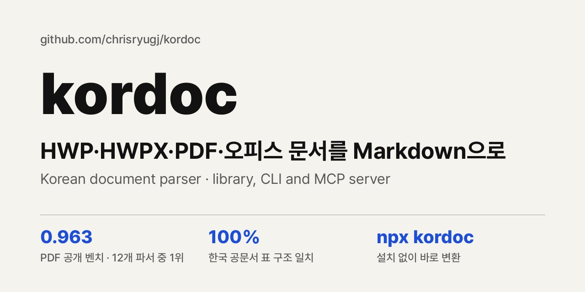

</details>

---

<!-- devtrack-draft-id: 54147ef8-a432-42be-8bd8-086807ac6c8f -->
<details>
<summary><strong> AI 시대 개발 감각 확인법: 시작부터 ‘이것’을 빠뜨리면 탈락</strong></summary>

AI에게 시키면 1분 만에 그럴듯한 화면이 나오는데, 막상 에러가 터지면 어디서부터 손대야 할지 막막해진 적 있으신가요?  
"과연 나한테 개발 감각이 있는 걸까?" 고민하는 분들을 위해, 실제 기업들이 AI 허용 시험장에서 지원자의 실력을 가려내는 3가지 평가 기준을 정리했습니다.

예전에는 백지에서 코드를 직접 타이핑하는 손기술이 중요했지만, 지금은 손은 빠르지만 우리 서비스 사정을 모르는 AI를 데리고 서비스를 끝까지 완성해 내는 감각이 핵심입니다.  
내가 프로젝트를 시작할 때, 만들 때, 끝낼 때 아래 세 가지를 직접 해보면 내 개발 감각을 바로 확인하고 키울 수 있습니다.

1. 시작할 때 — 빈칸을 스스로 찾아내는 '문제 정의 감각'  
• 바로 코드부터 짜달라고 시키지 말고 아래 두 줄을 먼저 입력해 보세요.  
"지금 이 기능을 만들 때 빠진 규칙이나 결정해야 할 빈칸이 뭔지 나한테 먼저 질문해 줘."  
"그리고 계획서를 써서 내가 승인하기 전까지는 아직 코드 짜지 마."

2. 만들 때 — 깨지는 조건을 찌르는 '예외 검증 감각'  
• 내 화면에서 한 번 잘 돌아간다고 넘어가지 말고 두 가지를 되물어보세요.  
"지금 만든 기능에서 두 명이 동시에 누르면 어디가 깨질 수 있어?"  
"그 문제를 막으려고 왜 이 방식을 썼는지 내가 이해할 수 있게 설명해 줘."

3. 끝낼 때 — 처음 온 사용자가 30초 안에 쓰게 만드는 '서비스 완결 감각'  
• 내 컴퓨터(localhost)에서만 돌리지 말고 무료 배포 도구로 링크를 만들어 친구 한 명에게 보내보세요.  
• 아무 설명 없이 처음 30초 동안 어디서 멈칫하는지 관찰하고 첫 화면을 고쳐보는 과정에서 진짜 실력이 남습니다.

https://youtu.be/O8g6rSiwLgE

</details>

---

<!-- devtrack-draft-id: 8d6845cd-d0e8-4952-a4ca-cb46cfb2dfdc -->
<details>
<summary><strong>대부분의 개발자들은 AI가 제공하는 첫 번째 코드 솔루션을 그대로 받아들입니다.</strong></summary>

Boris Cherny(Anthropic의 Claude Code 창시자)가 내부 엔지니어링 팀이 더 나은 출력을 강제하기 위해 사용하는 정확한 프롬프트를 공유했습니다:

1. "Elegant Rewrite" 프롬프트:  
AI가 기술적으로 작동하지만 지저분하고 임시방편 같은 수정안을 줄 때, 이렇게 답하세요:

"지금 알고 있는 모든 것을 바탕으로, 이걸 버리고 우아한 솔루션을 구현해."

2. "Reverse PR Review" 프롬프트:  
풀 리퀘스트를 열기 전에 역할을 뒤집어 AI가 당신을 테스트하게 하세요:

"이 변경 사항에 대해 나를 철저히 심문하고, 내가 네 테스트를 통과할 때까지 PR을 만들지 마."

3. "Behavioral Proof" 프롬프트:  
"이게 작동하나요?"라고 묻는 대신 말하세요:

"메인 브랜치와 이 기능 브랜치 간의 동작 차이점을 비교해서 이게 작동한다는 걸 증명해."

코딩 에이전트를 자동완성 도구처럼 대하지 마세요.   
시니어 엔지니어가 초안을 검토하듯 그들을 밀어붙이세요.

</details>

---

<!-- devtrack-draft-id: 87ef83c9-b8d9-4e38-9574-8840f6e47b56 -->
<details>
<summary><strong>이것이 미래의 1인 기업이 어떻게 생겼는지 보여줍니다.</strong></summary>

팀이 아닙니다.

전체 부서를 대체하는 AI 에이전트 시스템  
https://developersglobal.github.io/ai-agent-skills/

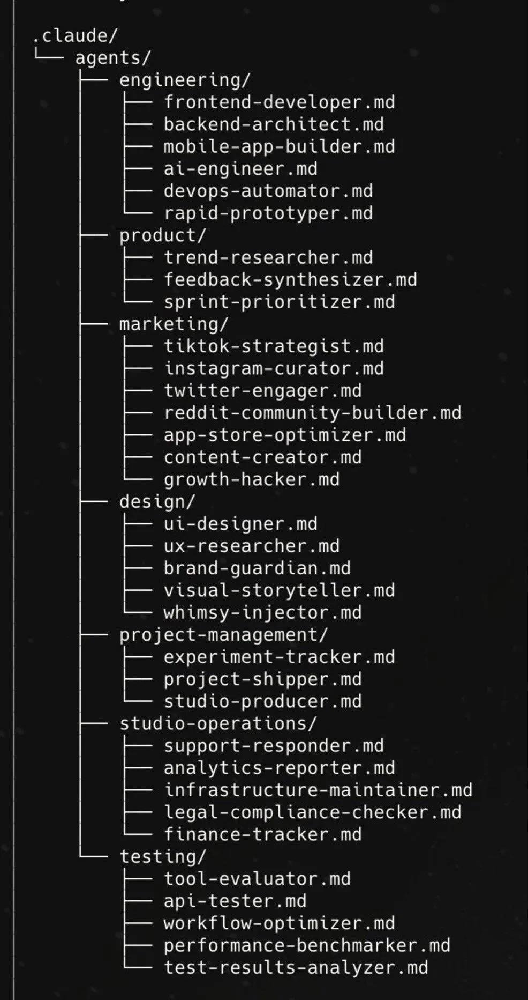

</details>

---

<!-- devtrack-draft-id: 5e82b31e-e7d6-4a8e-b218-f2be8b7d85f3 -->
<details>
<summary><strong>AI가 코드를 빨리 짜주기 시작하자 카카오페이손해보험 개발팀은 오히려 “이걸 왜 해야 하죠?”를 더 따지기 시작함.</strong></summary>

팀이 공개한 글을 보면 코드는 빠르게 올라오는데  
사람이 검토하는 속도는 따라가지 못했다고 함.

만드는 사람은 빨라졌는데  
읽고 이해할 사람은 그대로였던 거임.

그래서 작업을 작게 나누고,  
코드 변경 요청서에  
해결하려는 문제와 지금 해야 하는 이유,  
검토한 대안까지 쓰도록 바꿈.

여기서 흥미로운 건  
AI에게 일을 더 잘 시키는 방법보다  
아예 시키지 않아도 되는 일을 걸러내기 시작했다는 점임.

예전에는 하루 걸릴 일이면  
“이거 꼭 해야 하나?”부터 생각했을 텐데,  
AI가 금방 해주면 일단 만들고 싶어짐.

근데 만드는 비용이 줄었다고  
검토하고 유지하는 비용까지 사라지는 건 아님.

앱도, 보고서도, 콘텐츠도 비슷하다고 생각함.  
쉽게 만들 수 있다는 이유로 시작하면  
정작 중요한 일을 확인할 시간이 줄어들 수 있음.

AI 덕분에 뭐든 만들기 쉬워질수록  
“뭘 더 만들까”만큼  
“이걸 왜 만들어야 하지”가 중요해지는 듯.

</details>

---

<!-- devtrack-draft-id: 98f420e0-2d47-4ad2-9b02-e33d04f0bc4b -->
<details>
<summary><strong>AI를 좀 더 실수를 줄이면서 사용하는 방법. (현재 시점) </strong></summary>

AI를 사용하면서 일반 사용자로서 간단한 문서를 만드는 것이나 이미지 생성하는 일은 그렇게 어렵지 않아요. 

물론 이미지 생성을 상업용이나 더 디테일을 살리려면 간단한 프롬프트만으로는 어렵죠. 

하지만 대부분의 저와 같은 비개발자들이 흔히 하는 실수가 있습니다. 예를들면, 플랜 모드를 사용하지 않고 본인이 하고 싶은 문장을 적고 바로 모두 만들어 주길 바라죠. 

하지만 어떤 작업이든 모든 권한을 주었을때 마지막 단계에서 크레딧은 소모가 되었는데 내가 원하는 결과물이 아닌 경우라면 어떻게 될까요?

첨부한 이미지 파일의 텍스트를 읽어 보시고 본인에게 맞게 적용해보세요. 

실수가 줄어들고 병목 구간이 어딘지 알게 되면서 본인의 AI 사용 역량은 더 효율적으로 바뀝니다.

하나 더 쉬운 절차로 가는 꿀팁을 공유 합니다. 

위의 내용을 한발자국 더 나아가서 개인이 여러 주제로 작업을 하는 분이라면 일종의 업무 시작 가이드를 순서로 구성해서 프롬프트 요소를 검증하시고 '스킬'로 만들고 그 업물를 본인이 기억하기 쉬운 단어로 바꾸세요. 

저는 '업무 시작 가이드'로 네이밍을 하고 대화를 시작합니다. 플랜 모드와 동일하진 않지만 꽤 효율적이고 작업의 과대 해석을 미연에 방지할 수 있습니다.

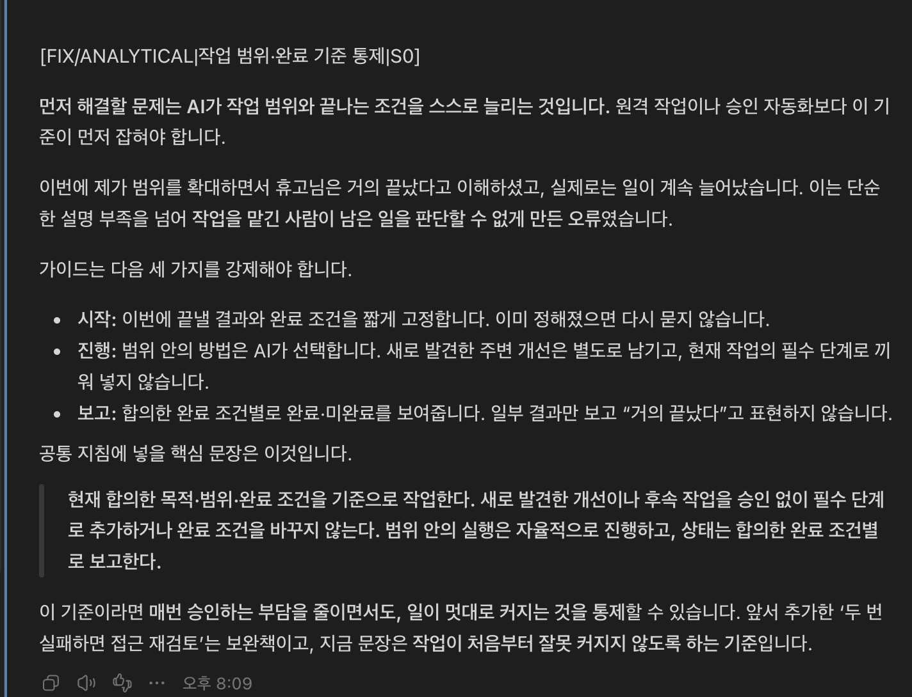

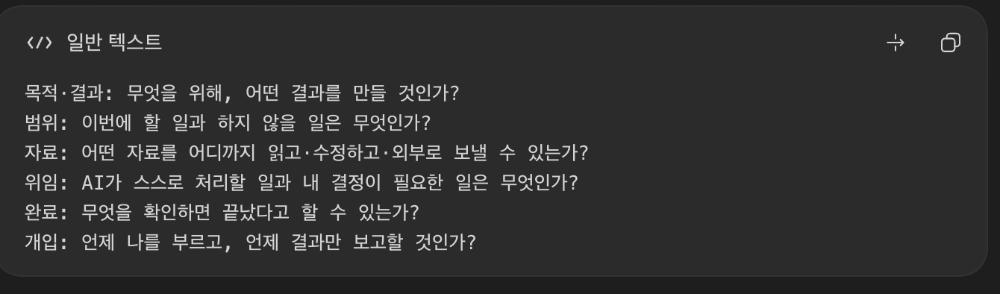

</details>

---

<!-- devtrack-draft-id: 31bc929e-b174-4c4e-b139-abbfd7d8c5d1 -->
<details>
<summary><strong>AI가 거의 모든 작업을 대체하는 시대에 오히려 몸값이 올라가는 사람들 특징.</strong></summary>

남들보다 고난도 코딩을 하거나 기술을 엄청 잘 다루는 사람이 아님.

진짜 차이는 무엇을 질문하고 검증할 줄 아느냐에서 갈림.

과거에는 정답을 만드는 생산 속도가 핵심 경쟁력이었음.

하지만 이제 생성 속도는 AI 때문에 사실상 평준화됐음.

문제는 AI가 1초 만에 쏟아내는 수많은 결과물 중에서 어느 게 진짜 정답이고 핵심인가를 알아채는 눈임.

결국 질문을 똑똑하게 던지는 능력, 그리고 AI가 내놓은 답의 오류를 집어내는 맥락 파악력이 몸값을 결정함.

기술을 다루는 테크닉보다, 분야의 본질을 깊게 이해하고 있는 사람이 AI를 만났을 때 미친 시너지가 남.

기술이 발전할수록 역설적으로 기본기와 본질에 대한 이해가 훨씬 더 중요해짐.

도구를 쓰는 법에 목매기보다, 내가 다루는 분야의 본질을 깊게 파는 사람이 결국 판을 먹음.

</details>

---

<!-- devtrack-draft-id: 763e6e46-0459-4628-8691-feb9f2d2efb6 -->
<details>
<summary><strong>요즘 느끼는 건 코딩보다 더 상위 수준의 설계를 배워야겠다는 거예요.</strong></summary>

인간을 만드는 프로젝트라고 생각해 보면, 우선 인간에게 머리 1개, 팔 2개, 다리 2개가 있다는 것을 알아야겠죠.

여기서 코딩은 팔에 어떤 뼈와 근육이 있고, 그 근육이 어디서 시작해 어디에 붙는지 구현하는 작업에 가깝고요.

이제 세부 구현은 AI가 알아서 해주니까 AI에게 전부 맡겨서 다리 3개짜리 인간을 만들수 있고 그게 잘 걸어 다닐 수도 있겠죠. 

하지만 그게 잘 설계된 인간인지는 다른 문제니까요.

단순히 뭐 만드는 게 아니라... 진짜 시스템을 만들어야 되지 싶다는 생각을 합니다.

지금은 그냥 딸깍 하면 만들어주긴 하는데 진짜 쓸모있는걸 만들어서 공개하려면 설계 능력도 필수인거 같아요.


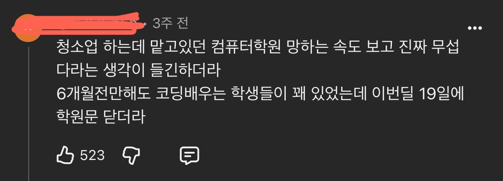

</details>

---

<!-- devtrack-draft-id: b3fb180a-683e-4f90-984d-5850e26ef928 -->
<details>
<summary><strong>AI로 코드 짜는 속도는 빨라졌지만, 실제 가능성을 확인하는 건 여전히 사람의 몫인데요.</strong></summary>

PM이 개발자 입장에서 기능을 만들기 전에 세 가지를 먼저 확인할 필요가 있는데요. 

1) 기능에 대한 충분한 설명

2) 결과 검증 능력

3) 영향 범위 파악이라고 생각합니다

https://maily.so/makersnote/posts/wjzdx0yvr3p

</details>

---

<!-- devtrack-draft-id: 70650b40-a5fb-4c52-94c0-7dc42210bf20 -->
<details>
<summary><strong>AI가 코드를 대신 짜주기 시작하니까 개발자들은 오히려 코딩 전에 더 많은 시간을 쓰기 시작했는데요</strong></summary>

요즘 주목받는 스펙 기반 개발(Spec-Driven Development, SDD)얘기임

AI에게 "이런 앱 만들어줘" 하면 코드는 금방 나오는데, 돌려보면 요구사항이 빠져 있거나 멀쩡하던 기능이 깨지는 경우가 있죠  
2025년 Stack Overflow 조사에서도 개발자의 66%가 '거의 맞지만 완전히 맞지는 않는 AI 결과'를 주요 불편사항으로 답했어요

그래서 나온 게 코드 짜기 전에 뭘 만들고 어떻게 작동해야 하는지부터 구체적으로 정리하자는 방식으로  
흐름은 대략 이럼  
스펙 작성 → 설계 → 작업 분리 → AI 코드 작성 → 테스트

결제 기능이면 단순히 "결제 기능 만들어줘"로 끝내는 대신 중복 결제 방지, 오류 처리, 사용자 권한, 성공 조건까지 먼저 정해두는 거죠

관련 툴도 빠르게 크는 중  
GitHub Spec Kit: 스펙 작성부터 작업 분리, 구현까지 지원하는 오픈소스고 스타 14만 개 돌파  
Amazon Kiro: 요구사항과 설계를 바탕으로 AI 에이전트가 코드를 작성하는 개발 환경

물론 반론도 있어요  
처음부터 완벽한 스펙을 작성하려는 접근 자체가 구현하면서 배우는 게 없을 것이라는 전제를 깔고 있는건데 실제로 개발하다 보면 생각이 바뀌고 새로운 문제가 발견되니까 스펙도 코드와 함께 계속 수정해야 한다는 얘기죠

간단한 프로토타입에 수십 페이지짜리 스펙까지는 과함  
반대로 결제나 지갑처럼 작은 오류가 자산 손실로 이어질 수 있는 기능이라면 얘기가 다르고요

개인적으로 전 AI 덕분에 코드를 직접 작성하는 부담은 줄어들고 있지만, 무엇을 만들어야 하고 어떤 조건을 충족해야 제대로 작동하는지 판단하는 일은 여전히 사람 몫이라고 생각함

AI 코딩을 하신다면 스펙 기반 개발도 한 번쯤 볼 만할 듯 

https://github.com/github/spec-kit

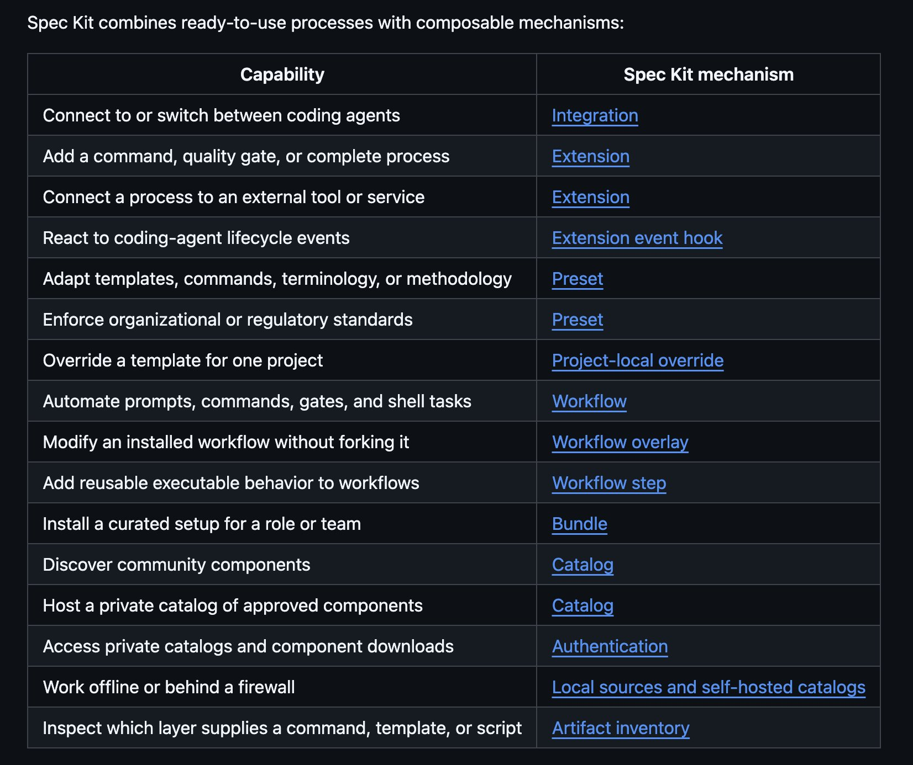

</details>

---

<!-- devtrack-draft-id: 7047e333-e979-49a1-9ad6-14c6080a70a0 -->
<details>
<summary><strong>AI 시대 앞으로도 개발자로 일하고 싶다면 폐쇄망 개발 습관 들여야 함.</strong></summary>

외부로 나가는 데이터 속도도 2Mbps 미만 으로 대역폭 제한해놓고 그마저도 연결되는 시간이 몇분 안되는 시간으로 정해져있는 환경에서 개발해야 됨.

(2Mbps은 잘 쳐준거고 400kbps 정도 생각하면 됨)

이런 조건이 최근 AI한테 대체안되는 개발자에게 요구하는 요건임.

</details>

---

<!-- devtrack-draft-id: 0364797c-dfd6-4f2a-b40f-345cd3e64e48 -->
<details>
<summary><strong>누구나 게임을 만들 수 있게 되면서 시장이 넘쳐날까 봐 모두가 걱정하고 있어요.</strong></summary>

대부분의 사람들은 본질적으로 소비자예요. 무언가를 완성하는 데는 여전히 수백, 수천 시간이 걸리고, 도구가 아무리 쉽게 만들어져도 대다수는 그 시간을 들이지 않을 거예요.

공감. “구현”은 어떻게 한다고 치더라도 “테스트”는 어떻게 할건데? 게임 만들때 가장 많이 해야하는 부분은 “코딩”이 아니라 “플레이 테스트”임. 30년전부터 게임 하나 출시할때마다 토나올 정도로 게임 플레이를 해야 했기 때문에, 해당 게임이 출시된 이후에는 지켜워서 한동안 쳐다도 안보게됨.

소규모로 게임 처음 만들 때는 제약 없이 내 기획대로 세상이 쭉쭉 만들어지니 즐거운데, 시간이 지나니까 게임의 모든 요소를 알고 있어서 플레이하는게 정말 너무나 힘듦. 꾸준히 테스트해주는 친구가 있는데 너무 고마워서 눈물을 흘릴 지경임.

</details>

---

<!-- devtrack-draft-id: f38f57a5-df3a-489e-abf4-1f3fee0da7b0 -->
<details>
<summary><strong>AI에 관해서는, 말하는 게 자주 바뀌는 엔지니어 쪽이 더 믿음직스럽네</strong></summary>

조금 전까지만 해도 "코드는 지금까지처럼 제대로 읽고 이해해야 한다"고 말하던 선배 엔지니어들이, 이제는 "나 자신은 전혀 안 읽는다"고 말하고 있으니까.

그 외에도 plan 모드를 주변에 엄청 추천하던 엔지니어가, 이제 그 본인이 전혀 안 쓰고 있거나.

그 사람이 당시에 쓴 Claude Code에 대한 사내 문서를 기반으로 질문을 했더니, "아, 그 글의 생각은 이제 오래됐으니, 본 적 없는 걸로 해 주세요"라고 답이 오거나.

보통이라면, 일관된 의견을 가진 사람 쪽이 압도적으로 믿음직스럽지.

하지만 이렇게 빠르게 진화하는 이상, 이전의 자신의 생각을 아무렇지 않게 버리는 엔지니어 쪽이 오히려 의견을 듣고 싶어지네.

</details>

---

<!-- devtrack-draft-id: d608003f-9e11-4903-95c9-4b91aec99280 -->
<details>
<summary><strong>&quot;AI 쓰는데 업무가 늘었다?&quot;, &quot;AI가 일 다 해준다더니 사람은 왜 더 바빠졌나&quot; 같은 기사들을 보다가 어제 X에 쓴 자소서 얘기가 떠올랐음.</strong></summary>

여러 편 읽어 보니 문장은 다들 매끈했는데, 본문 중간에 붙여 넣은 파일 이름이 그대로 남아 있거나, 첫 문장부터 다른 곳 이름으로 시작하는 글이 꽤 있었음. 쓴 사람이 내기 전에 한 번만 다시 읽었으면 없었을 실수였음.

AI를 썼는지는 알 수 없지만, 기사 속 숫자도 같은 얘기였음. 업무에 AI 쓰는 8,316명에게 물었더니,

‣ 34%는 AI가 쓰거나 거든 작업물을 끝까지 안 읽고 남한테 넘긴 적이 있음  
‣ 48%는 고쳐야 하는 AI 작업물을 남한테서 받아 봤음  
‣ 39%는 AI 결과물 검토가 직접 하는 것보다 오래 걸린 적이 있음  
‣ 58%는 회사에 공유 전 확인할 명확한 규칙이 없다고 함

AI를 만드는 회사도 비슷했음. 앤트로픽 내부 보고서로는 직원들이 쓰는 클로드 에이전트가 작업 세션 시간의 약 80%를 사람 지시나 답을 기다리는 데 쓰고, 에이전트 결과를 검토하는 일의 비중은 작년 가을 10%에서 올봄 22%로 늘었다고 함.

그래서 드는 생각. 작성자가 AI로 글을 빠르게, 많이, 그럴듯하게 써 올수록 검토자가 읽고 확인할 시간은 늘어남. 결국 작성자가 아낀 시간이 검토자의 시간으로 넘어가는 건 아닐까.

검토자는 보통 상급자임.

이게 한계에 오거나 상급자가 더는 안 되겠다고 판단하는 순간이 오면, 가져온 문서를 검토하는 데 시간이 덜 들수록 고과에 반영되는 날이 오지 않을까 하는 생각이 듦.

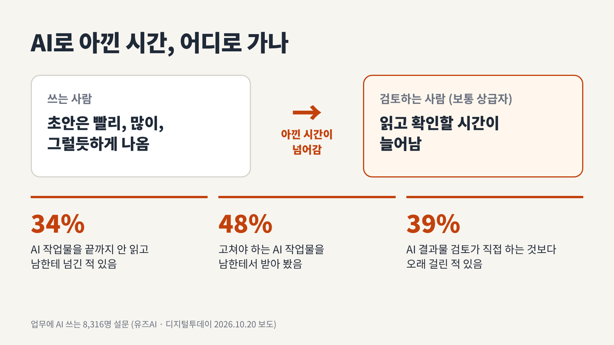

</details>

---

<!-- devtrack-draft-id: 6e3b22fd-2a9c-4bac-b5a4-a8d8c9a2f767 -->
<details>
<summary><strong>한 AI가 취약점을 찾으면, 다른 AI는 그 판단이 틀렸다는 증거부터 찾습니다.</strong></summary>

Cloudflare가 이 보안 감사 과정을 오픈소스 Skill로 공개했습니다.

먼저 프로젝트 구조와 외부 입력, 권한·신뢰 경계를 파악한 뒤 여러 에이전트에 점검을 나눠 맡깁니다.  
인증·접근 권한, 프롬프트 인젝션, 공급망, 클라우드 설정 등을 살펴볼 가이드도 들어 있습니다.

취약점 후보가 나오면, 발견한 에이전트와 별개의 새 에이전트가 검증합니다.  
결론을 뒷받침하는 근거뿐 아니라 반박할 수 있는 증거도 찾는 방식입니다.

결과는 ‘확인됨·추가 검증 필요·기각’으로 나눠 JSON과 Markdown 보고서로 남깁니다.  
소스 코드 근거, 영향, 수정 제안도 함께 정리하고요. 전체 흐름은 공식 문서에서 볼 수 있습니다.

🔗 https://github.com/cloudflare/security-audit-skill/blob/main/skills/security-audit/SKILL.md

어디까지 점검했는지도 기록합니다.  
다음 감사에서는 빠진 범위를 보완하고, 변경된 코드를 재검증하면서 이전 결과를 이어갈 수 있습니다. 

설치는 아래 명령어로.

```
npx skills add https://github.com/cloudflare/security-audit-skill --skill security-audit
```

설치 후 점검할 저장소에서 코딩 에이전트에 이렇게 요청하면 됩니다.

```
security audit this codebase
```

병렬 서브 에이전트를 지원하는 코딩 도구와 Node.js가 필요하고, 코드를 실행하는 동적 검증에는 격리된 샌드박스도 필요합니다.

MIT 라이선스로 공개됐지만 실행에는 모델 사용량이 들고, 한 번의 감사로 모든 취약점을 찾는다고 보장하진 않습니다.  
프로젝트와 설치 안내는 여기서 확인할 수 있습니다.

https://github.com/cloudflare/security-audit-skill

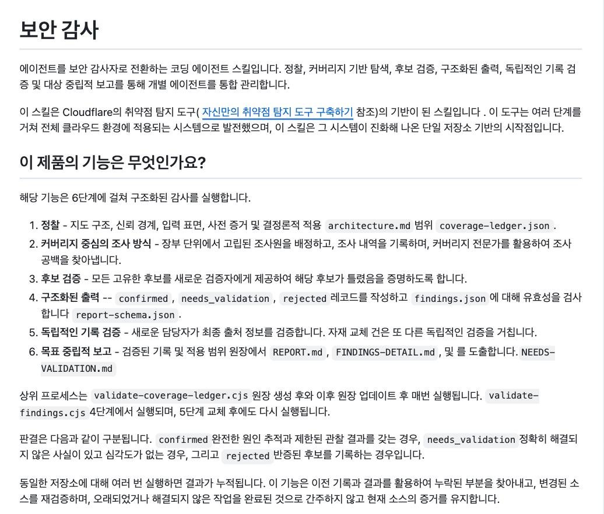

</details>

---

<!-- devtrack-draft-id: 487941c0-bc7e-4c25-9aa4-23c446b5ec04 -->
<details>
<summary><strong>개발자에게 이제 필요한 건 프롬프트 작성법만은 아닌 것 같습니다.</strong></summary>

Anthropic의 새 아카데미는 자사 엔지니어와 같은 수준의 역량을 목표로 기업 엔지니어들에게 Claude 활용법을 가르칩니다.

AI 에이전트를 실제 업무에 도입하려면 기술뿐 아니라 회사의 프로세스와 보안, 도입 후의 책임까지 알아야 하기 때문입니다.

그렇다면 한국 개발자는 AI와 경쟁해야 할까요, 아니면 AI를 현장에 정착시키는 역할을 맡아야 할까요?

AI 시대의 개발자는 코더일까요, 배치자일까요?

</details>

---

<!-- devtrack-draft-id: c6537e7e-2220-4b63-986f-b75d783f286b -->
<details>
<summary><strong>한번씩들 정리시키세요.</strong></summary>

프롬프트:

'이 컴퓨터에서 불필요하게 용량이나 메모리를 차지하고있는 것들을 찾아줘.'

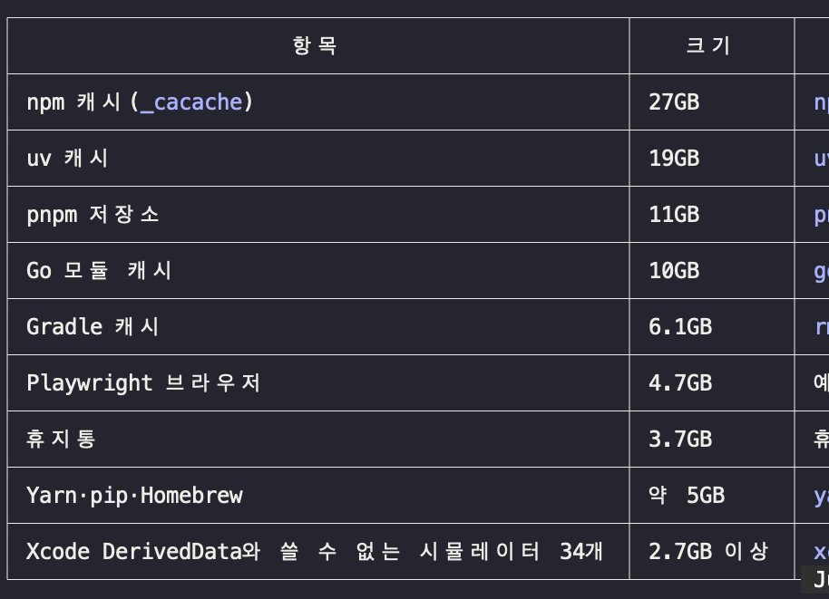

</details>

---

<!-- devtrack-draft-id: 18d0be64-1942-4ee3-8b94-1aab320f4734 -->
<details>
<summary><strong>AI와 제조 엔지니어링 붙여서 나온 결론. </strong></summary>

다쏘 시스템, 오토데스크

지금도 전통적인 제조 SaaS지만, AI가 점차 설계와 가공으로 들어오는데 그람에도 결국 막강한 해자는 레거시 시스템. 유지 보수. 보안. 데이터 연속성. 그리고 세계적 대기업이 운용해서 쓰는 시스템. 이건 아무리 프로그램을 카피해도 넘을 수 없음.

대안 캐드라고 리버스 엔지니어링 이전부터 프로그램이 많았지만 결국 업계를 주도하는건 이 기업들이었음.

대신 헥사곤, 샌드빅도 좋게 보여짐. 이 기업들은 특화된 cmm장비 및 소프트웨어나 cam 가공 소프트웨어, 광산, 캠용 툴 등 다양하게 가지고 있음. 그리고 이 기업들도 지금 AI를 도입하여 여러 서비스를 시작함 

내가 처음했던 판단은 모든것이 보안인데 온프레미스로 가야한다였으나, 프론티어 모델과 오픈웨이트의 격차가 큰 것을 확인했고 이들 SaaS 기업도 그에 대한 인식 및 클라우드 연동으로 가기 때문에 그 문제에서 벗어날 수 있다 생각됨. 물론 초 대기업은 백업으로 만들긴 할듯? 

여튼 이 분야의 끝은 다크팩토리가 될텐데 그 문제는 6G가 되어야지만 가능한 레벨로 생각됨. 그 이전까지 AI가 제조 효율성을 얼마만큼 증대시키느냐가 가장 중요해보임.

</details>

---

<!-- devtrack-draft-id: 4a0cf5bf-6d54-43de-a40b-1a5ee5b8ba15 -->
<details>
<summary><strong>AI 시대에 더 심각해진 가드레일 프로그래밍</strong></summary>

"리치 히키(Rich Hickey)와 같은 거장들은 테스트를 맹신하여 설계를 소홀히 하는 '가드레일 프로그래밍'을 경계해야 한다고 주장합니다. 테스트가 통과되었다는 사실에 안주하여 뇌를 빼고 코딩을 하는 태도는 오히려 시스템의 복잡성을 키우는 결과를 초래합니다. 타입 체크나 유닛 테스트가 100% 통과했음에도 실제 구동 시 수십 개의 버그가 발생하는 이유는, 개발자가 코드의 논리적 구조와 엣지 케이스를 깊이 있게 설계하지 않았기 때문입니다.

테스트는 설계를 도와주는 도구여야지, 부실한 설계를 덮어주는 면죄부가 되어서는 안 됩니다."

</details>

---

<!-- devtrack-draft-id: e7c384c1-1af0-47fc-9bb7-651e44d370fd -->
<details>
<summary><strong>AI 티 나는 한글 85가지 잡아주는 스킬이 별 6천 개</strong></summary>

숫자랑 주장은 안 건드리고 번역투, 첫째·둘째 나열, '시사하는 바가 크다' 같은 말투만 사람 글처럼 고쳐준다고 함. 클로드 코드에선 /humanize-korean 치면 끝 ㄷㄷ

보고서 AI로 뽑는 형들은 내기 전에 이거 한 번만 돌려보셈

https://github.com/epoko77-ai/im-not-ai

</details>

---

<!-- devtrack-draft-id: 95b59176-c6e0-4193-bb11-f9e35b767563 -->
<details>
<summary><strong>AI가 쓴 글은 왜 이해하기 어려울까?</strong></summary>

AI가 쓴 영어 대화, 코딩 설명, 에세이를 분석하니 주요 모델 9개 모두 사람의 글보다 낯선 단어 조합이나 사물이 사람처럼 행동하는 표현을 더 자주 사용함. 같은 문장을 일본어로 번역했다가 영어로 되돌리면 이런 특징이 줄어듦

연구진은 적은 토큰에 정보를 압축하려는 압력이 원인일 수 있다는 가설을 제시함. 작은 모델에 긴 답변을 벌점으로 주는 강화학습을 적용하자, 학습하지 않은 일부 문장 구조에서도 짧은 표현을 선호하는 변화가 나타남

AI가 쓴 글이 묘하게 안 읽히는 이유..  
원인은 '압축'일 수 있다고 함  
짧은 글자 수에 정보를 꽉 눌러 담으려다 보니  
그럴듯한데 한 번에 안 들어오는 문장이 나오는 것

AI로 글 쓸 때 마지막 한 번은  
이거 바보도 이해할 수 있냐?로 검증 해보자  
나 바보라서 많이 써먹음ㅋ

</details>

---

<!-- devtrack-draft-id: 7eb103aa-9925-4c69-891e-3268ac4561b0 -->
<details>
<summary><strong>특히 ai예찬론 펼치는 이미 한자리 꿰찬 아저씨들이 너무너무싫다</strong></summary>

요즘 느끼는 거지만  
AI 안 써보고 부하직원에게 딸각 시전하는 아저씨들:ai가 대체한다  
AI 써도 결국 내가 더블체킹하는 걸 아는 사초생: 결국 인력은 필요함 쪽이 되는 듯

</details>

---

<!-- devtrack-draft-id: 45446df9-e243-4eb6-8992-601a5d2d1fc2 -->
<details>
<summary><strong>요즘 개발하면서 느끼는 건</strong></summary>

AI가 코드를 대신 써주는 시대일수록 "무엇을 만들지" 정하는 능력이 더 중요해진다는 거예요 💡 코드는 점점 싸지고, 좋은 질문과 설계는 점점 귀해지네요.

</details>

---

<!-- devtrack-draft-id: 2409d262-30f2-4a5b-9912-edeec7a73fd6 -->
<details>
<summary><strong>개발자/엔지니어 출신이라고 하더라도 AI전략을 반드시 잘하는건 아니다.</strong></summary>

략은 큰 틀에서 보자면 어떤 문제를 풀 것인가, 그리고 어떤 도구를 이용해 그 문제를 다룰것인가를 정하는 일이다.

그러나 개발자/엔지니어 출신의 경우 본인이 잘 다루는 도구만 휘두르는 경우가 많다. 망치를 들고있으면 모든게 못으로 보인다.

그리고 전략 일을 해보면, 실제 업무의 90%는 커뮤니케이션이다. 다시말해, 사람의 마음을 움직이는 일이다. 이는 기술에 대한 이해만으로 할 수 있는 일이 아니다.

AI 전략 쪽으로 인력 구하기 매우 어렵다.

현업 입장에서 이야기 하자면, 99%가 기술에 대한 이해가 없다. AI의 동작 원리를 이해하지 못하면서 전략을 짠다. 당연하게도 컨설팅 레포트 등을 ‘자기 나름대로 이해’ 하고선 포멧만 바꿔서 전략을 만든다.

1% 정도 개발 경험이 있는 전략가도 있다. 문제는 정말 프론티어 문제를 다뤄본 사람은 거의 없다는 것이다. 최고 수준의 로봇, 자율주행, 에이전트 기술의 개발, 검증 과정을 경험해본 사람의 대부분은 여전히 프론티어에 있다.

최근 국내 대기업들이 AX를 시작하며 타이틀만 보고 경쟁사에서 임원급 인력을 뽑는 경우가 많은데, 반년이 안되서 사람 잘못뽑았다는 이야기가 나온다. 당연히 지금 임원으로 있는 사람들은 세부적인 사항들을 모른다. 솔직히 말해 거의 키워드 정도만 이해하는 수준이 대부분이다.

하나 조언을 하자면, 실적 있는 곳에서 직접 발로 뛴 사람들을 채용하고 그들에게 가능한 많은 권한을 주라는 것이다.

</details>

---

<!-- devtrack-draft-id: b277ec8d-66ce-4164-b7b1-3768611599b7 -->
<details>
<summary><strong>AI로 하루만에 다 되는 건 그걸 이미 누군가 시도했던 적이 있기 때문이다</strong></summary>

0. 일단 지가 AI로 순식간에 갖다 만들 수 있었던 건 밑바닥부터 만든 게 아니라 이미 다 공개된 것으로 만들었기 때문

1. 저작권 문제 : 코리요는 공공누리 제4유형으로 이미지 변경과 2차 저작물 작성 원칙 불허

코리요ZIP이라고 화성시 마스코트 캐릭터를 갖다 썼는데, 코리요 이용에 대해 허락을 받았는지, 원본 이미지 변경이나 AI 재생성이 있었는지, 캐릭터 이용이 허락 범위 안에 있는지 확인 필요.

이준석은 2025년 9월에도 코리요 캐릭터를 AI로 변형해 사용했다는 혐의로 고발돼 경찰이 수사에 착수했다는 보도가 있음.

2. 압축 소프트웨어는 유지보수할 것이 없다? BULLSHIT.

이준석이 자기가 AI로 만든 프로그램이 포괄적으로 구현했다는 7-ZIP만 해도 CVE, 심각한 취약점이 꾸준히 발견되고 있음. 압축 프로그램이라는 SW는 지속적 보안 유지보수가 필요함. 압축은 빈번한 정보처리행위이므로, 악용의 위험은 언제든 존재함. 악성 활용시 얻을 이득이 적지 않다는 소리

그런데 이걸 이준석이 일시적으로 만든 AI프로그램으로 공공기관에 보급해 대체한다? 이준석이 취약점 접수해서 수정하고 배포하고 업데이트하고 그런거 다 합니까? "하루만에 만들었다" 고 하는 사람에게 그런 태도를 기대한다? 웃기는 이야기입니다.

3. 무료 소프트웨어 배포는 기부 행위에 해당할 수 있음.  
공직선거법 112조 1항, 기부행위는 금전/물품/재산상 이익을 무상으로 제공하는 행위로 정의. 113조 1항에서는 국회의원과 정당 대표자 등이 선거구 관련 기부행위를 못 하도록 함.

중앙선관위의 기부행위 예방 안내문엔 이런 사례도 있음.

'재산적 가치가 있는 후보자 명의의 자필 폰트를 홈페이지나 SNS에서 무료 배포하는 행위'

무료 디지털 저작물도 기부행위의 대상이 된다는 소리. 이미 무료 압축 프로그램이나 라이브러리가 많다고 해도 그것을  AI로 묶어내서 프로그램화 하는 것은 거기에 소비된 토큰만큼의 재산적 가치를 유권자들에게 준다고 볼 수 있음. 기부행위라 보아야 할 것임.

4. 이준석의 행위는 국내에서 정당하게 사업을 영위하는 기업에 대한 부당한 권력 남용 공격에 해당할 수도 있음.

알집이 sw 관점에서 여러 비판을 받고 있을 수 있으나, 그렇게 수주한 공공 자금으로 회사를 운영하며 사회에 기여하고 있음. 또한 이준석이 언급한 다른 압축 프로그램인 '반디집' 역시 마찬가지로 정상적인 사업을 영위중임.

이스트소프트의 고무줄 영업 뭐 이런걸 비판할 수는 있겠지만, 빈카운터 짓 하다가 선을 좀 세게 넘는 것이 아닌지?

</details>

---

<!-- devtrack-draft-id: 62cbf9cc-7707-46a3-81ac-7f4232c7f541 -->
<details>
<summary><strong>요즘 AI 활용 평가를 넣는 회사가 많아졌다고 느껴서, PD수첩에 나온 모의고사 시연 화면을 보고 시험 잘 보는 방법을 풀어봄!</strong></summary>

기사로 확인된 곳은 HD현대, 기아, LG CNS, 포스코DX, SK하이닉스 5곳. 

시간·문항 수·채점표는 기사에 안 나오지만, 뉴스웨이 보도로는 업계가 공통으로 보는 게 3가지였음. 

문제를 정의하고 AI에 어떻게 지시하는지, AI 결과물의 오류·한계를 찾는지, 결과뿐 아니라 과정. 

회사별 방식이랑 이 3가지는 이미지에 정리해 둠. 

SK하이닉스 인사 담당자도 AI를 얼마나 잘 다루는지가 아니라 AI로 문제를 푸는 능력을 본다고 했음~

시연 화면 문제는 이런 식이었음. 실제 기업 문제도 아니고 실제 형식과 같은지도 알 수 없지만 참고는 될 듯함.

중견 제조사 경영지원팀 3년차가 주인공이었음. 해상운임이 올라 물류비가 전년 대비 34% 늘었고, 임원 회의용 1장 보고를 하루 안에 만들어야 하는 상황. 

주어진 자료는 물류비 42억→56억, 수출국 비중, 내년 2월에 갱신하는 단일 포워더 연단위 계약, 영업팀의 판가 인상 반대 정도였음.

써낼 건 현황 요약, 원인 분석, 대응안 3가지와 각각의 효과·리스크, 임원이 물을 만한 질문 2개와 답변. 3,000자 이내, 제한 시간 20분, AI 질문은 10번까지. 주어지지 않은 수치를 사실처럼 쓰지 말라는 주의도 붙어 있었음.

나라면 어떻게 했을까 하고 생각해봤음. 정답은 아니고 참고용.

1. 처음에는 AI 없이 써낼 것 4가지와 금지 조건부터 적기.  
2. 첫 질문에 자료 전부 + 역할 + 제약을 한 번에 넣기.  
3. 질문 중 몇 번은 검증에 쓰기. 42→56은 직접 계산하면 +33.3%인데 문제엔 34%로 적혀 있었음.  
4. 없는 수치는 추정이라고 밝히고 근거 붙이기. 대응안 효과 %를 지어내는 게 제일 위험할 듯함.  
5. 주어진 제약인 단일 포워더, 2월 갱신, 판가 인상 반대를 대응안에 반영하기.

이제 스펙만이 아니라 AI를 어떻게 쓰는지도 준비해야 할 듯함.

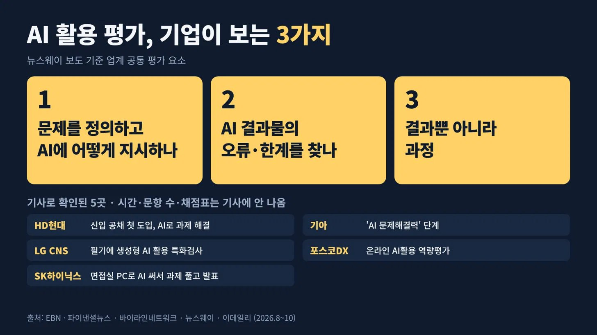

</details>

---

<!-- devtrack-draft-id: 0b60772d-126e-40a0-b4bb-aa6a1f633e09 -->
<details>
<summary><strong>바람직한 자동화란 뭘까에 대해서 잠깐 생각해봤습니다.</strong></summary>

자동화라는게, 결국은 복잡하거나, 오래 걸리는 일을 사람 손 거치지 않고 하는 작업이 될텐데요, 그 자체에는 아무도 뭐라 하는 사람이 없을 겁니다. 

IT 업계에서는 흔히 작업 파이프라인이라는 용어로 작업들의 과정을 정의하고, 이를 자동으로 돌리기 위한 과정을 거치는데요, 저도 회사 있을 때 젠킨스 등을 통해서 자동화 파이프라인을 만들고 편하게 빌드도 하고, 특정 처리를 아침마다 자동으로 돌리곤 했습니다.
 
근데 자동화도 결국은 하나의 작업이고, 작업에 대해서는 만들 때도 검증이 필요하고 결과물에 대해서도 충분히 괜찮은 퀄리티가 됐는지 확인 작업이 필요하죠.

뭘 자동화 하든 작업에 대해서 그래도 이 파이프라인이 안전한지, 이상한 결과를 내지는 않는지, 자신의 의도대로 동작하고 있는지 정도는 확인하는 절차가 필요하다고 봅니다. 

요즘 그록이니, dots니 알아서 해주는 에이전트가 나오면서 관련 작업을 그대로 던져놓고 알아서 되겠지 하시는 분들이 계실 수 있는데, LLM은 항상 확률적으로 동작하는 그 특성상 자동화 작업을 걸어놔도 위험할 수 있습니다.

물론 요즘은 성능이 그리 나쁘지 않기 때문에 큰 문제가 발생할 확률이 매우 높은 편은 아닙니다만, 그래도 본인이 만든 파이프라인이 어떻게 동작하고 있는지, 완전 자동화가 되었다고 해서 손놓고 있기 보다는, 한 번씩 결과물들을 보면서, 문제 없이 돌아가고 있는지, 잘못된 결과나 큰 문제로 이어질 수 있는 결과물로 가고 있지는 않은지 항상 경계해야 합니다.

실제로 파이프라인을 잘 만들어놔도 엣지케이스들은 항상 존재할 수 있습니다.  
언제는 3개월간 잘 돌아가던 자동화 시스템이 갑자기 라이브 도중에 문제 터져서 잘 돌아가던 게임이 화면 전체가 하얗게 나오던 문제가 있어서 사수님이랑 밤샘으로 오류 잡았던 기억이 있네요... 얼마나 죄송하던지;;

저도 문제 덩어리 작업물들 많이 만들곤 하지만, 그래도 마음 한 켠에는, 주의해야지라는 맘을 가지고 작업하고 있습니다.

다들 관련 작업하시는 분들은 조심해서 안전하게 작업하도록 합시다~!

</details>

---

<!-- devtrack-draft-id: 3d5f3024-65b2-46ab-8b64-f5041cf88113 -->
<details>
<summary><strong>IT 업계 종사자가 AI를 써보고 요즘 진짜 무섭다며 털어놓은 고민.</strong></summary>

1. 시니어는 경험과 직관으로 AI를 더 잘 부릴 거라는 전망  
2. 주니어는 전체를 보는 눈을 키워야 하는 시기  
3. 신입은 정말 막막할 것 같다는 걱정

AI가 일을 얼마나 바꿀지는 몰라도 신입 자리부터 좁아진다는 말은 계속 들림ㄷㄷ

일본에서도 일거리가 줄었다는 말까지 나와서 남 일 같지 않음....

</details>

---

<!-- devtrack-draft-id: 26661f9c-09a9-461e-969b-8c4e93ab37b3 -->
<details>
<summary><strong>"AI는 결국 지식베이스 싸움"이라는 얘기를 했는데그 지식베이스가 '낡았을 때'가 더 무서운 거였음. 레거시는 진짜.. 공포임</strong></summary>

연구에 따르면 CLAUDE.md, AGENTS.md가 지금 코드랑 다르면  
AI가 90% 정도는 옛날 문서를 따른다고 함

근데 생각해보면 당연함  
사람도 지시서에 그렇게 적혀 있고, 다른 코드도 다 그렇게 돼 있으면  
"그렇게 하라면서요?" 하잖음

AI가 이상하게 움직일 때 먼저 볼 것  
1. 가이드 문서가 낡았나  
2.내 요청이 "알아서 잘 해줘"였나

바로 써먹을 한 줄

```
"문서와 코드가 다르면 코드를 따르고, 다른 부분은 마지막에 전부 알려줘"
```

</details>

---

<!-- devtrack-draft-id: b8af00be-e06f-419a-9745-9416e88e9487 -->
<details>
<summary><strong>AI한테 묻지 말고, AI가 나를 인터뷰하게 하세요</strong></summary>

Claude 채팅에 이렇게 넣으면 됩니다.

```
"Interview me in depth using free text, or askuserquestion tool when multiple choice works, about relevant parts of my life you don't know about yet and save it all to memory."
```

풀어 보면 이래요. 아직 모르는 내 얘기를 깊게 물어보고, 객관식이 맞는 질문은 선택지로 묻고, 들은 건 전부 메모리에 저장하라는 거예요.

ChatGPT나 Claude가 자기를 20분만 인터뷰하면 10배는 더 쓸모 있을 거라고 오래 생각해 왔다고 했죠.

포인트는 한 번으로 끝내지 않는 거예요. 원글도 내가 어떻게 생각하고 뭘 중요하게 여기는지 파고들고, 같이 일하면서도 계속 물어보라고 합니다.

저는 오랫동안 ChatGPT, Claude 같은 것들이 단지 20분 동안 나를 인터뷰하는 데 시간을 보낸다면 10배는 더 유용할 거라고 생각해왔어.

내 삶을 깊이 파고들고, 내가 어떻게 생각하는지, 무엇을 중요하게 여기는지, 내가 하려고 하는 일이 뭔지. 그리고 우리가 함께 일하면서 계속 질문을 던지는 거지.

</details>

---

<!-- devtrack-draft-id: 1fc41111-bc8b-4143-be9e-e0d0c99022ad -->
<details>
<summary><strong>아 진짜 지피티, 클로드, 제미나이 쓰면서 개길게 보고하고 공유하는 사람들 생겼는데 너무 힘듦</strong></summary>

요점 정리 못해서 AI가 써주는대로 메신저에 내용 10줄씩 줄줄 써서 공유하는데 그게 보라고 올리는 건지 뭔지 가독성도 떨어지고 시간만 뺏는 느낌,, 3줄 요약으로 말 안하면 AI 압수하고 싶음

회사 다니면서 느낀 건데 일 잘하는 사람들 메일은 진짜 읽기가 편함

엄청 어려운 단어를 쓰는 것도 아니고 글을 잘 쓰는 것도 아닌데 딱 읽으면 내가 뭘 해야 하는지 알겠음

반대로 세 번 읽어도 뭘 요청하는 건지 모르겠는 메일도 있음...

차이가 뭔지 생각해보니까 세 가지였음. (타래로)

첫째, 제목에 용건이 있음.

'안녕하세요, 문의드립니다'보다  
'[확인 요청] 10월 비용 정산 내역'이 훨씬 좋음.

받는 사람 입장에서는 메일 열기 전부터 뭘 해야 하는지 알 수 있고, 나중에 다시 찾기도 쉬움.

메일 제목을 잘 쓰는 게 생각보다 엄청난 배려임.

둘째, 배경 설명보다 요청사항이 먼저 나옴.

'이러이러한 사정으로 검토를 진행하였으며...'가 다섯 줄 이어지면 읽다가 길을 잃음.

차라리 첫 부분에 '첨부 자료 검토 후 금요일까지 회신 부탁드립니다'라고 적고 아래에 배경을 설명하는 게 훨씬 편함.

셋째, 상대방이 다시 물어볼 일을 줄여줌.

언제까지 필요한지, 어떤 파일을 봐야 하는지, 어느 부분을 확인해야 하는지.

이 세 가지가 빠지면 메일 한 통으로 끝날 일이 다섯 통이 됨.

특히 '가능한 한 빨리'보다 날짜를 정확히 적어주는 게 좋음. 사람마다 빨리의 기준이 다르니까.

</details>

---

<!-- devtrack-draft-id: e1811b69-d1fd-478f-9d9e-e0d0fcfbbd0c -->
<details>
<summary><strong>카카오가 한국어 검색 AI를 공짜로 풀었습니다</strong></summary>

카카오가 한국어 검색용 임베딩 모델 'Kanana-2-embedding' 2종을 Hugging Face에 오픈소스로 공개했어요. 크기는 30억 개, 13억 개 매개변수 두 가지예요.

임베딩 모델은 문장의 뜻을 숫자 묶음으로 바꿔서 비슷한 문서를 찾게 해 주는 모델이에요. 챗봇이 회사 문서를 뒤져서 답할 때(RAG) 뒤에서 일하는 게 바로 이거예요.

카카오가 직접 평가한 결과로는 비슷한 크기의 Qwen3-Embedding-4B 등보다 한국어 성능이 좋았다고 해요. 필요하면 결과값 크기를 줄여서 가볍게 쓸 수도 있어요.

카나나 오픈 라이선스라 상업적으로도 쓸 수 있습니다. 한국어 RAG 만들면서 "왜 엉뚱한 문서를 가져오지" 하던 분들 이제 교체해 볼 기회가 생겼어요.

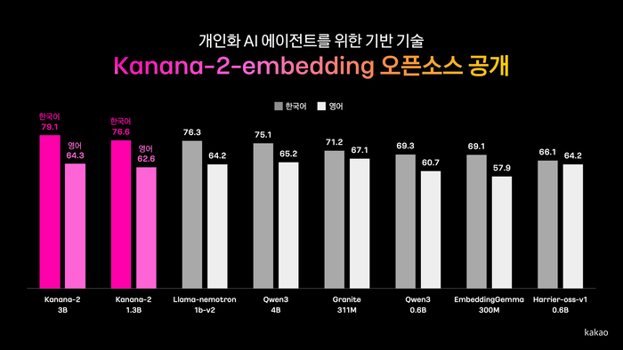

</details>

---

<!-- devtrack-draft-id: 3f58e5e4-74c8-43b3-953e-7fab1688a2e0 -->
<details>
<summary><strong>사내망 때문에 클로드와 회사 시스템 사이를 손으로 잇는 AX 담당자.</strong></summary>

1. AI가 만든 코드를 사람이 사내망에 옮기고 에러를 다시 가져가는 반복  
2. 매번 보안상 문제 될 내용이 없는지 걸러야 하는 일까지 붙음  
3. 그러다 스스로를 인간 API라고 부르게 됨

보안 검토까지 사람이 매번 해야 하니 자동화 프로젝트인데 손이 제일 바쁘다;;

답글에선 이걸 디지털 상하차라고 부름ㅋㅋ

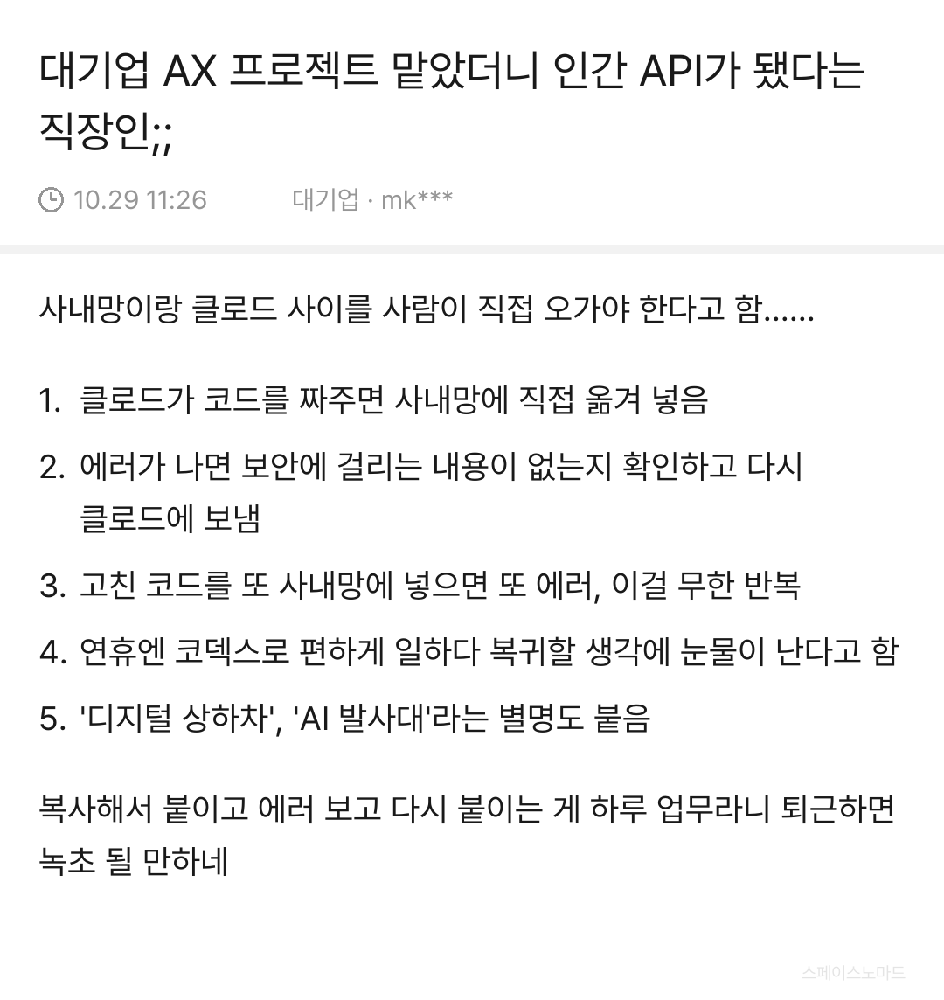

</details>

---

<!-- devtrack-draft-id: 52d88dae-bb02-4164-b124-7c92170142ed -->
<details>
<summary><strong>코드 품질 팁, 나처럼 여전히 코드에 신경 쓰는 사람들을 위해.</strong></summary>

삼항 연산자 중첩을 멈춰라. 그건 보기 흉하고 따라가기 매우 어렵다. run과 조기 반환을 대신 사용해라.

run()은 한 줄짜리 도우미로, 전달된 함수를 호출한다. 한 줄당 하나의 조건, 그리고 TypeScript가 각 분기를 좁혀준다.

여기 React 예제지만, 값을 할당하는 모든 곳에서 작동한다. 이걸 스킬로 저장하고 린터에서 강제 적용해라.

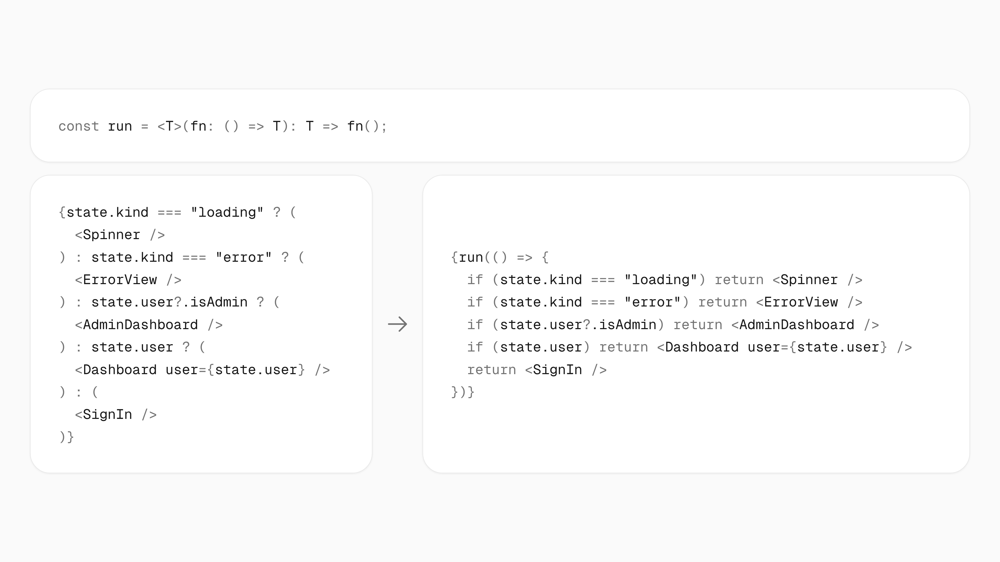

</details>

---

<!-- devtrack-draft-id: e8f3ebb1-82f9-4735-abd4-da2c3a2886c6 -->
<details>
<summary><strong>행정안전부가 보고서 쓰는 법을 바꿈. 사람이 보기 좋은 문서보다 AI가 읽기 좋은 문서가 먼저라는 이유로.</strong></summary>

행안부는 3월 말부터 내부에 'AI 시대 보고서 작성법'을 시행함.  
꾸밈은 줄이고 표는 단순하게. 마크다운 기반으로 쓰는 방식임.

배경은 한글 문서였음.  
복잡한 표와 도식이 많아서 AI가 내용을 제대로 못 읽었다고 함.

AI는 들여놨는데 정작 AI가 읽을 문서가 준비 안 돼 있던 거임.

당연히 반발도 나옴.  
"AI에 사람이 맞춰야 하느냐"는 말까지.  
담당 과장은 효율이 좋아진 사례가 쌓이면  
자연스럽게 받아들일 거라고 봄.

그렇다고 AI에 다 맡기겠다는 건 아님.  
앞으로 AI가 초안을 쓰고  
공무원은 검토하는 쪽으로 갈 거라면서도  
최종 검증과 책임은 사람 몫이라고 선을 그음.

5월에는 규정까지 고침.  
행정기관이 전자문서를 만들 때 AI가 읽을 수 있는 개방형 형식을 지키도록 의무화함.

여기서 흥미로운 건 더 똑똑한 AI를 찾기 전에  
AI가 읽을 재료부터 고쳤다는 점임.

회사에서도 비슷한 장면이 많을 듯. 셀 병합 가득한 엑셀, 표를 이미지로 붙인 PPT를 넣고 "정리해줘" 하면 결과가 엉뚱하게 나옴.  
그럼 보통 AI 탓부터 하게 됨.

근데 AI가 못 읽는 문서라면 사람이 검토할 때도 원문을 다시 뒤져야 하는 건 똑같음.

AI를 잘 쓰는 팀은 프롬프트보다 문서 양식부터  
바꾸는 팀일지도.

</details>

---

<!-- devtrack-draft-id: 49ce6912-6d1d-4343-8a4e-77fcef000ae5 -->
<details>
<summary><strong>우리 모두 관리자 마인드를 가져야 한다. 신입이든 경력이든 예외 없다.</strong></summary>

10년 전 신입 때 내 일은 시키는 걸 받아서 만드는 거였다. 무엇을 만들지, 왜 만드는지는 위에서 정했다.  
그걸 정하는 사람이 관리자였다.

지금은 다르다.  
AI한테 "이거 만들어"라고 하면 코드가 나온다.  
그 순간 나는 만드는 사람이 아니라 시키는 사람이 된다. 시키는 사람이 해야 할 일은 딱 관리자가 하던 일이다.

무엇을 만들지 정하기.  
왜 만드는지 설명하기.  
나온 결과물이 맞는지 검증하기.  
틀렸으면 어디가 왜 틀렸는지 짚어서 다시 시키기.

이걸 못 하면 AI는 그럴듯한 쓰레기를 빠르게 만들어준다.

DORA 2025 보고서 보면 개발자 90%가 AI를 쓰는데  
AI 결과물을 높게 신뢰한다는 응답은 3%다.  
97%는 검증이 필요하다는 걸 안다는 뜻이다.

회사 다니면서 일 잘 시키는 관리자를 봤다.  
목표를 한 줄로 말하고, 제약을 먼저 알려주고, 결과물을 보고 구체적으로 피드백했다.  
못 시키는 관리자는 "알아서 잘해봐"라고 했다.

AI한테도 똑같다.  
"알아서 잘해봐"라고 하면 알아서 이상한 걸 만든다.  
AI가 사람의 노동을 대체하기 시작한 이후로  
살아남는 기준은 코드를 잘 치느냐가 아니다.

AI를 사람처럼 다룰 줄 아느냐다.

</details>

---

<!-- devtrack-draft-id: ca4ab07a-6a64-4f44-9fed-795def6f47c8 -->
<details>
<summary><strong>개발자는 아니지만 "개발자처럼 일하기"는 모두에게 적용되어야 하는 이야기 같다. </strong></summary>

AI 이전에 파이썬 공부하면서 들었던 말 중 "Divide and Conquer"가 아직도 기억에 남는다. 문제를 작은 단위로 쪼개고, 논리를 빌드업하면서 어느 순간에 끝마쳐야 하는가. 데이터 분석을 위해 했던 공부였지만 사실 돌이켜보면 그건 "일하는 방식"에 대한 것이 아니었나 싶음.

</details>

---

<!-- devtrack-draft-id: 60af53c5-6aab-49d4-8ff3-b093853ccc89 -->
<details>
<summary><strong>요즘 개발자들 웃픈 장면 </strong></summary>

개발자: "내 기술 이제 쓸모없어"  
비개발자: "개발 알았으면 AI 더 잘 썼을 텐데"

근데 둘 다 반씩 맞음

개발자는 코드 치는 시간이 줄었을 뿐  
일을 쪼개고, 끝 기준 정하고, 확인 방법 만드는 습관은  
오히려 더 귀해짐

비개발자한테 필요한 것도 문법이 아님  
월말 정산 어디서 틀리는지,  
서류에서 뭐 빠지면 반려되는지 아는 사람은  
이미 그 습관을 갖고 있음

개발자는 기술을 잃은 게 아니라 쓰는 자리가 바뀐 것  
AI 시대 진짜 기술은 내 일을 순서대로 설명하는 능력

요즘 이상한 장면이 보입니다. 개발자들은 자기 기술이 쓸모없어졌다며 우울해하고, 개발을 모르는 사람들은 개발을 알았더라면 에이전트를 더 잘 썼을 거라며 아쉬워합니다.

Thariq가 이 얘기를 짧게 올렸는데 몇 시간 만에 47만 회 넘게 조회됐습니다. 양쪽 모두 찔리는 데가 있다는 뜻이겠죠.

저는 둘 다 반만 맞다고 봅니다. 에이전트 시대에 줄어드는 건 코드를 직접 치는 시간이고, 오히려 값이 오르는 건 개발자들이 몸에 익힌 습관입니다. 일을 작은 단계로 쪼개고, 무엇이 되면 끝인지 먼저 정하고, 결과가 맞는지 확인할 방법을 미리 만들어 두는 습관입니다.

이 습관은 코딩을 몰라도 가질 수 있습니다. 보험 청구 서류에서 무엇이 빠지면 반려되는지 아는 사람, 월말 정산이 어디서 자주 틀리는지 아는 사람은 이미 갖고 있습니다. 그 순서를 글로 적어 에이전트에게 넘길 수 있으면 됩니다.

개발자는 기술을 잃은 게 아니라 쓰는 자리가 바뀐 것이고, 비개발자에게 필요한 건 문법이 아니라 자기 일을 단계로 설명해 보는 연습입니다.

지금 아주 이상한 일이 일어나고 있어

기술적인 사람들은 슬퍼하고, 그들의 기술이 이제 쓸모없어졌다고 생각해

비기술적인 사람들은 더 기술적으로 되고 싶어 절박하게 바라며, 에이전트를 더 잘 사용할 수 있기를

</details>

---

<!-- devtrack-draft-id: 05eff3af-10eb-46d2-bd90-cad988f20155 -->
<details>
<summary><strong>AI가 쓴 글이 티 나는 건 몇몇 단어보다, 모든 문장이 같은 힘으로 쓰여 있기 때문입니다.</strong></summary>

미국에서 "AI 글은 왜 이렇게 티가 나냐"는 글이 하루도 안 돼 69만 회 넘게 조회됐습니다. 'quietly' 같은 단어 말고도 리듬이 어딘가 이상하다는 얘기가 많았습니다.

한국어도 비슷합니다. "단순히 A가 아니라 B입니다" 같은 뒤집기, 문단마다 비슷한 길이, 끝에 붙는 "결국 핵심은", 사람이라면 대충 넘어갈 부분까지 빠짐없이 챙기는 말투가 그렇습니다.

더 흔한 경우는 내가 쓴 글을 AI에게 "자연스럽게 다듬어 줘"라고 맡길 때입니다. 생각은 내 것인데 문장이 AI 리듬으로 바뀌어서, 읽는 사람은 AI 글로 봅니다. 그 원글에도 "이 글도 AI로 다듬은 것 같다"는 답글이 달렸습니다.

다듬을 때는 이렇게 맡기는 편이 낫습니다.

"내 문장은 고치지 말고, 틀린 사실, 맞춤법, 두 가지 뜻으로 읽히는 문장만 표시해 줘. 고쳐야 하는 이유를 한 줄씩 적어 줘."

고치는 건 직접 해야 글에 내 리듬이 남습니다.

</details>

---

<!-- devtrack-draft-id: 138468c5-1e1f-47dc-ac19-ea7da20c314f -->
<details>
<summary><strong>카카오가 ‘Kanana-2-vision-encoder’ 2종을 허깅페이스에 풀었습니다.</strong></summary>

각 2B, 98M짜리 모델인데.. 4B급 모델의 비전 인코더(모델 내 이미지 인식 파라미터)와 비슷하다고 하네요. 특히 한국어를 잘 다룬다고.

개발기를 블로그에 매우 상세히 작성했는데, 설명도 잘 되어 있고 내용 퀄리티가 상당합니다.

개발기는 여기  
https://tech.kakao.com/posts/840

가중치는 여기 (사업화 불가 라이선스)  
https://huggingface.co/collections/kakaocorp/kanana-2-vision-encoder


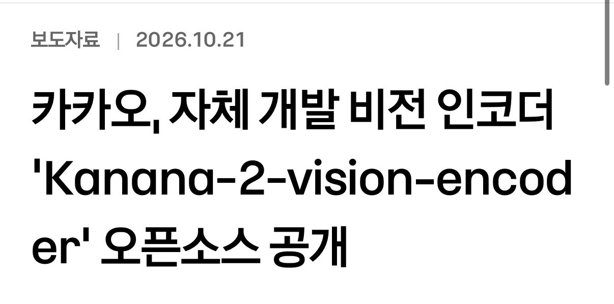

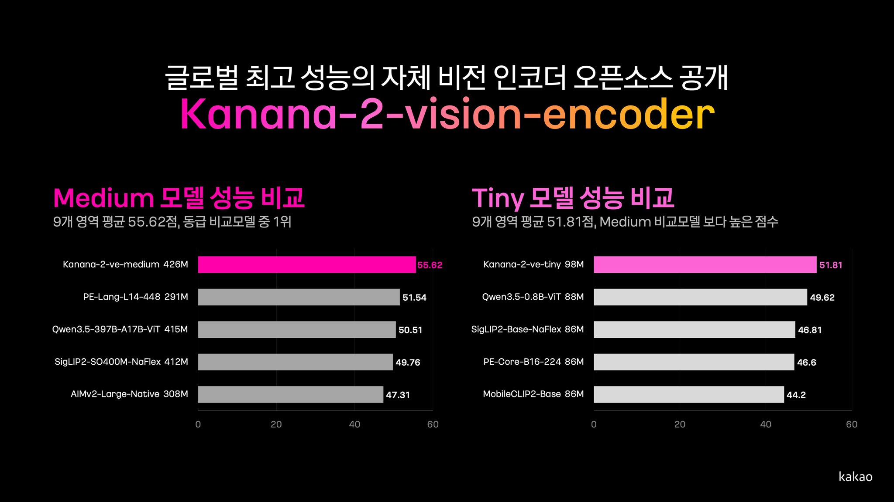

</details>

---

<!-- devtrack-draft-id: 0a95dcae-6217-4287-ac31-ee28ed9c1763 -->
<details>
<summary><strong>기본기는 변하지 않는다</strong></summary>

기본기가 있는 사람과 없는 사람은 차이가 날 수 밖에 없다  
그 작은 한 끝을 "귀찮아"라며 안하는 사람과  
AI와 함께 탐구라고 해 본 사람은  
긴 시계열로 훨씬 우위에 설 수 밖에 없다

</details>

---

<!-- devtrack-draft-id: 3a624421-a62e-45df-af0f-5154f17c9207 -->
<details>
<summary><strong>AI를 잘 쓰는 법, 1년 새 이름이 다섯 번 바뀌었습니다</strong></summary>

프롬프트 → 컨텍스트 → 하네스 → 루프 → 그래프

공식적인 발전 순서는 아니에요. 해외 개발자들 사이에서 주목받는 개념이 넓어지는 흐름이에요. 단계별로 풀어 볼게요.

1. 프롬프트 엔지니어링: AI한테 명령하기  
질문을 어떻게 쓰느냐의 기술이에요. 역할을 주고, 예시를 보여 주고, 출력 형식을 정해 주는 거예요.  
예: "너는 10년 차 마케터야. 아래 제품 소개를 3줄로 요약해 줘."  
한계는 분명해요. 문장을 아무리 다듬어도, AI가 모르는 정보는 답에 안 나와요.

2. 컨텍스트 엔지니어링: AI한테 정보 주기  
무엇을 묻느냐보다 무엇을 보여 주느냐가 중요해진 단계예요. 회사 문서, 이전 대화, 검색 결과, 사용자 정보를 골라서 AI가 보는 창에 넣어 줘요.  
핵심은 많이 넣는 게 아니라 필요한 것만 넣는 거예요. 쓸데없는 정보가 많으면 오히려 답이 흐려져요.

3. 하네스 엔지니어링: AI가 일할 환경 만들기  
하네스는 말에 채우는 마구라는 뜻이에요. AI가 쓸 수 있는 도구(검색, 파일, 코드 실행), 지켜야 할 규칙, 권한 범위를 정해 주는 작업이에요.  
같은 모델이라도 어떤 작업 환경에 넣느냐에 따라 결과가 크게 달라져요. Claude Code나 Codex 같은 코딩 에이전트가 이 단계의 대표 사례예요.

4. 루프 엔지니어링: AI가 스스로 실행·검증·수정하기  
한 번 답하고 끝나는 게 아니라, 실행하고 결과를 확인하고 틀리면 고치는 과정을 반복하게 만드는 거예요.  
예: 코드를 짜고, 테스트를 돌리고, 실패하면 에러를 읽고 다시 고쳐요.  
핵심은 "언제 멈출지"예요. 통과 기준이 없으면 AI는 끝없이 돌거나, 틀린 채로 "완료"라고 말해요.

5. 그래프 엔지니어링: 여러 AI가 역할 나눠 협업하기  
AI 하나가 다 하지 않고, 조사하는 AI, 쓰는 AI, 검수하는 AI처럼 역할을 나눠요. 누가 누구에게 일을 넘기는지 연결 구조(그래프)를 설계하는 거예요.  
저도 이렇게 쓰고 있어요. 리서치봇이 자료를 모으면 X봇이 초안을 쓰고, 블로그 글은 블로그봇이 쓰면 검수봇이 따로 검사해요.  
대신 넘기는 과정에서 정보가 빠지거나 틀어질 수 있어서, 마지막 확인은 사람이 해야 해요.

정리하면, 질문을 잘 쓰는 사람에서 AI가 일하는 구조를 설계하는 사람으로 역할이 옮겨 가고 있어요.

그렇다고 프롬프트가 쓸모없어진 건 아니에요. 다섯 단계 모두 결국 "AI에게 뭘 원하는지 정확히 말하는 능력" 위에 쌓여 있어요.

</details>

---
