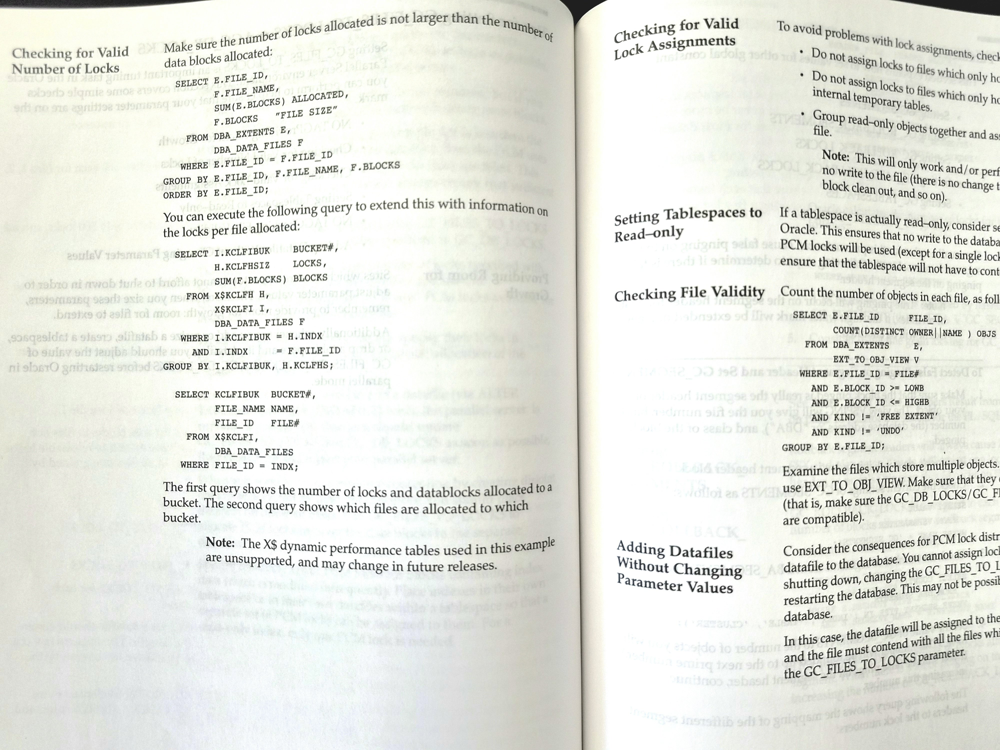

# 데이터베이스

속성: Backend

<strong>🗄️ SQL 기술 난이도 순위 🔥</strong>

🟢 쉬움 (모두 여기서 시작)

- SELECT → 데이터 가져오기 📊
- WHERE → 결과 필터링 🔍
- ORDER BY → 출력 정렬 ↕️
- COUNT / SUM / AVG → 기본 인사이트 ⚡

🟡 쉬움 → 중간 (핵심 SQL 사고)

- GROUP BY → 데이터 집계 🧩
- HAVING → 그룹화된 결과 필터링 🎯
- JOINS → 테이블 결합 (INNER / LEFT / RIGHT) 🔗

🟠 중간 (대부분이 여기서 막힘)

- Subqueries → 중첩 로직 🌀
- Window Functions → 고급 분석 📈
- CTEs → 더 깔끔하고 읽기 쉬운 쿼리 🧱

🔴 어려움 (성능 중심 사고)

- Query Optimization → 더 빠른 쿼리 ⚙️
- Indexing → 트레이드오프 (속도 vs 저장 공간) 🧠

🟣 매우 어려움 (전문가 영역)

- Database Performance Tuning → 깊이 있는 시스템 지식

⚠️ 대부분의 개발자는 JOINS에서 멈춤.  
그래서 그들의 쿼리는 작동하지만... 확장되지 않음.

진짜 SQL 기술 = 정확 + 빠름 + 확장 가능 ⚡

---

<strong>최고의 데이터베이스와 실제 프로젝트에서 흔히 사용되는 곳</strong>

1. PostgreSQL → 구조화된 관계형 데이터 🧱
2. MySQL → 웹 애플리케이션 백엔드 🌐
3. MongoDB → 스키마 유연한 문서 데이터 📦
4. Redis → 고속 캐싱 ⚡
5. DynamoDB → 서버리스 데이터베이스 워크로드 ☁️
6. Elasticsearch → 검색 기능 🔍
7. Cassandra → 분산형 대규모 시스템 🌍
8. Neo4j → 그래프 관계 데이터 🔗

---

<strong>PostgreSQL 데이터베이스 인터뷰의 90%는 이 7가지 주제</strong>

1. 인덱스  
B-트리, GIN, GiST, 부분 인덱스, 복합 인덱스, 그리고 인덱스가 실제로 쓰기 작업을 느리게 할 수 있는 경우.
2. 쿼리 계획  
EXPLAIN, EXPLAIN ANALYZE, 순차 스캔 대 인덱스 스캔, 비용 추정, 그리고 플래너가 때때로 당신의 인덱스를 무시하는 이유.
3. 트랜잭션  
ACID, 격리 수준, MVCC, 잠금, 교착 상태, 그리고 Postgres가 일반 쓰기 작업 중에 읽기를 차단하지 않는 이유.
4. 스키마 설계  
정규화, 비정규화, 외래 키, 제약 조건, 데이터 유형, 파티셔닝, 그리고 실제 접근 패턴에 맞춘 테이블 설계.
5. 성능 튜닝  
느린 쿼리, 연결 풀링, vacuum, autovacuum, 팽창, 캐싱, 그리고 불필요한 왕복을 줄이는 방법.
6. 복제와 백업  
WAL, 스트리밍 복제, 읽기 복제본, 시점 복원, 장애 조치, 그리고 백업 복원 테스트가 단순히 백업을 수행하는 것보다 더 중요한 이유.
7. 동시성  
행 수준 잠금, 낙관적 잠금, 비관적 잠금, SELECT FOR UPDATE, 경쟁 상태, 그리고 높은 트래픽 하에서의 안전한 업데이트.

---

<strong>데이터베이스는 갑자기 실패하지 않습니다</strong>

- 대학에서 데이터베이스에 대해 가르쳐주는 것:
    
    → 테이블에는 행과 열이 있다
    → 기본 키를 사용하라
    → 스키마를 정규화하라
    → SQL에는 SELECT, INSERT, UPDATE, DELETE가 있다
    
- 프로덕션에서 실제로 중요한 것:
    
    → 잘못된 컬럼에 인덱스를 두는 것은 인덱스를 아예 두지 않는 것보다 나쁘다
    → N+1 쿼리는 트래픽이 앱을 망치기 전에 먼저 앱을 파괴한다
    → 라이브 데이터베이스에서의 마이그레이션은 완전히 다른 스포츠다
    → "그냥 JOIN을 쓰면 돼"라는 말은 새벽 2시에 커리어를 끝장낸다
    → 연결 풀 고갈은 서버 크래시와 똑같이 느껴진다
    → 소프트 삭제는 쿼리가 기어가는 속도가 될 때까지 영리해 보인다
    → 백업은 복원을 한 번도 테스트하지 않았다면 아무 의미가 없다
    → 1,000행에서는 잘 작동하는 쿼리가 1,000,000행에서 깨진다
    

---

<strong>효율적이고 빠른 SQL 쿼리를 작성하기 위한 10가지 팁</strong>

1. SELECT 문에서 * 대신 컬럼 이름을 사용하세요
2. SELECT 문에 HAVING 절을 포함시키지 마세요
3. 불필요한 DISTINCT 조건을 제거하세요
4. 서브쿼리를 중첩 해제하세요
5. 인덱싱된 컬럼을 쿼리할 때 IN 술어를 사용하는 것을 고려하세요
6. 일대다 관계를 가진 테이블이 포함된 테이블 조인을 사용할 때 DISTINCT 대신 EXISTS를 사용하세요
7. UNION 대신 UNION ALL을 사용하는 것을 시도하세요
8. 조인 조건에서 OR을 사용하지 마세요
9. 연산자의 오른쪽에 함수를 사용하지 마세요
10. 중복된 수학 연산을 제거하세요

---

<strong>개발자들이 알아야 할 9가지 데이터베이스 유형</strong>

1. 𝗥𝗲𝗹𝗮𝘁𝗶𝗼𝗻𝗮𝗹  
↳ 미리 정의된 스키마와 SQL 쿼리를 사용해 테이블에 구조화된 데이터를 저장합니다.
2. 𝗞𝗲𝘆-𝗩𝗮𝗹𝘂𝗲  
↳ 초고속 조회와 캐싱을 위해 간단한 키-값 쌍을 저장합니다.
3. 𝗗𝗼𝗰𝘂𝗺𝗲𝗻𝘁  
↳ 유연하고 중첩된 구조를 가진 JSON-like 문서로 데이터를 저장합니다.
4. 𝗪𝗶𝗱𝗲-𝗖𝗼𝗹𝘂𝗺𝗻  
↳ 대규모 분산 워크로드를 위해 유연한 컬럼 패밀리에 데이터를 저장합니다.
5. 𝗧𝗶𝗺𝗲-𝗦𝗲𝗿𝗶𝗲𝘀  
↳ 메트릭, 로그, 이벤트 추적을 위한 시간 스탬프가 붙은 데이터를 저장합니다.
6. 𝗚𝗿𝗮𝗽𝗵  
↳ 연결된 데이터를 효율적으로 쿼리하기 위해 엔티티 간 관계를 저장합니다.
7. 𝗩𝗲𝗰𝘁𝗼𝗿  
↳ 유사성 검색과 AI 기반 검색을 가능하게 하는 임베딩을 저장합니다.
8. 𝗖𝗼𝗹𝘂𝗺𝗻𝗮𝗿  
↳ 분석 쿼리를 최적화하기 위해 행 대신 컬럼별로 데이터를 저장합니다.
9. 𝗜𝗺𝗺𝘂𝘁𝗮𝗯𝗹𝗲 𝗟𝗲𝗱𝗴𝗲𝗿  
↳ 데이터가 수정되거나 삭제될 수 없는 변조 방지 기록을 저장합니다.

기억하세요, 더 이상 모든 상황에 맞는 만능 데이터베이스는 없습니다. 대부분의 시스템은 단일 데이터베이스를 사용하지 않고, 다양한 워크로드를 위해 여러 유형을 조합합니다.

---

<strong>Shopify, 재고 예약 시스템을 Redis에서 MySQL로 교체</strong>

[https://news.hada.io/topic?id=30006](https://news.hada.io/topic?id=30006)

왜 postgre가 아니라 mysql을 쓰냐는 말이 나왔는데  
Redis의 대체라면 mysql을 쓰는게 좋을것같긴하다 저 사례처럼 잦은 빈도로 행을 생성하고 지우는 시스템에서는 postgres보다 더 유리하니깐?

---

<strong>PostgreSQL 19가 그래프 쿼리를 지원하게 됩니다.</strong>

SQL/PGQ를 사용하면 SQL에서 관계를 직접 쿼리할 수 있습니다:

→ 소셜 네트워크  
→ 추천 시스템  
→ 사기 탐지  
→ 종속성 그래프

Postgres는 더 이상 단순한 관계형 데이터베이스가 아닙니다.  
이제 모든 것을 위한 데이터베이스로 거듭나고 있습니다.

---

<strong>모든 엔지니어는 지금 자신의 전문 분야와 관계없이 데이터베이스에 대해 잘 알게 되는 게 좋다.</strong>

DB에는 최소한 SQL/테이블 설계/데이터 마이그레이션/튜닝의 4개 분야가 있다.

1. SQL 기본적인 쿼리를 쓸 수 있는가?
2. 테이블 설계 테이블 간의 관계를 포함해서 테이블 설계를 정규화 포함해서 할 수 있는가? 인덱스를 올바르게 붙일 수 있는가?
3. 데이터 마이그레이션 기존의 데이터를 잃지 않고 새로운 시스템으로 데이터를 옮길 수 있는가?
4. 튜닝 슬로우 쿼리 분석, 개선, 모니터링을 포함해서 튜닝을 할 수 있는가?

---

<strong>현대 소프트웨어가 데이터를 처리하는 5가지 방법:</strong>

1. 데이터베이스  
데이터를 저장하여 애플리케이션이 나중에 검색하고 업데이트할 수 있게 합니다.
2. 캐시  
자주 사용되거나 계산 비용이 많이 드는 데이터를 가까이 두어 읽기 속도를 빠르게 합니다.
3. 검색 인덱스  
키워드, 필터, 랭킹, 자동 완성 기능을 통해 데이터를 쉽게 찾을 수 있게 합니다.
4. 배치 처리  
누적된 대량의 데이터를 일정에 따라 처리합니다. 보고서, 청구, 분석, 백필 등을 생각해보세요.
5. 스트림 처리  
데이터가 도착하는 대로 반응합니다. 주문 이벤트, 사기 검사, 알림, 실시간 대시보드를 생각해보세요.

이러한 도구들은 서로 다른 문제를 해결합니다.

좋은 시스템 설계는 데이터 문제를 적합한 도구에 맞추는 것으로 시작합니다.

---

<strong>2026년 PostgreSQL 인터뷰의 90%는 이 7가지 포인트로 귀결됩니다:</strong>

1. 인덱스: btree vs GIN/GiST, 복합 순서, 그리고 왜 쿼리가 여전히 순차 스캔을 하는지.
2. EXPLAIN (ANALYZE, BUFFERS): 계획 읽기, 나쁜 노드 찾기, 추측 대신 그걸 고치기.
3. MVCC + vacuum: 죽은 튜플, autovacuum 조절, 그리고 팽창이 어떻게 랜덤 지연으로 나타나는지.
4. 락: 행 vs 테이블 락, 락 대기열, 그리고 pg_locks/pg_stat_activity로 블로킹 디버깅.
5. 격리 수준: READ COMMITTED vs REPEATABLE READ, 어떤 이상을 수용할지, SERIALIZABLE이 언제 해로운지.
6. WAL + 복제: 체크포인트, 스트리밍 복제본, 지연, 그리고 무엇이 페일오버를 망치는지 (동기 vs 비동기).
7. 스키마 설계: 제약 조건, FK 트레이드오프, 파티셔닝, 그리고 언제 비정규화가 영리한 쿼리를 이기는지.

---

<strong>SQL 학습을 지나치게 복잡하게 만들지 마세요.</strong>

대신 이 로드맵을 따르세요.

1. SELECT, FROM, WHERE 배우기
2. 필터링 마스터하기 (AND, OR, IN, BETWEEN, LIKE)
3. ORDER BY로 정렬하기
4. COUNT, SUM, AVG, MIN, MAX로 집계하기
5. GROUP BY로 데이터 그룹화하기
6. HAVING으로 그룹 필터링하기
7. 모든 일반적인 조인 배우기 (INNER, LEFT, RIGHT, FULL
8. 서브쿼리 작성하기
9. 공통 테이블 표현식 (CTE) 사용하기
10. 윈도우 함수 마스터하기 (ROW_NUMBER, RANK, LAG, LEAD)
11. 날짜와 시간 함수 배우기
12. COALESCE, CASE, 조건부 로직으로 NULL 처리하기
13. 쿼리 실행 계획 읽고 성능 최적화하기
14. 50개 이상의 실제 비즈니스 SQL 인터뷰 문제 풀기 ([http://DataExpert.io/questions](https://t.co/zjMRQzPtoM)에서)
15. 실제 데이터셋을 사용한 프로젝트 구축하기

---

<strong>쿼리 느리면 이제 클로드한테 물어본다</strong>

주말에 사이드 프로젝트 DB 좀 만지다가 쿼리 하나가 계속 느려서 짜증났다. postgres 써본 사람은 알 텐데, 뭐가 문제인지 알아보려면 EXPLAIN ANALYZE라는 명령어로 실행계획(쿼리가 DB 안에서 어떤 순서로 데이터를 찾아가는지 보여주는 진단서 같은 것)을 뽑아보고, 그 결과를 눈으로 해석해야 한다. 근데 이게 초보한테는 그냥 암호문이거든. 몇 줄 보다가 그냥 덮어버린 적도 있다.

그러다 GitHub에서 postgres-mcp라는 걸 발견했다. MCP 서버라는 게 클로드에 꽂는 확장 커넥터 같은 건데(콘센트에 멀티탭 꽂듯이 기능 하나를 통째로 추가하는 거라고 보면 된다) 이번 건 그 상대가 Postgres DB다. 이걸 붙여두면 클로드가 DB 연결 자체를 손에 쥐고 직접 안을 들여다볼 수 있게 된다는 거다.

예전엔 쿼리 느리면 pgAdmin 켜서 실행계획 캡처하고, 그걸 클로드 채팅창에 복붙해서 '이거 왜 느려?' 물어봤다. 캡처 잘라내고 붙여넣는 것부터 이미 귀찮았다. 근데 이제는 그냥 클로드한테 '이 쿼리 왜 느리지'라고 말만 하면, 클로드가 알아서 DB에 붙어서 실행계획을 직접 조회하고 읽는다. 심지어 인덱스(자주 찾는 컬럼을 미리 정리해둬서 검색을 빠르게 해주는 색인 같은 것) 후보를 몇 개 뽑아서, 이 인덱스를 걸면 실제로 얼마나 빨라지는지 가상으로 시뮬레이션까지 해보고 제안해준다는 거다. 실제로 걸어보기 전에 먼저 계산해준다는 소리다.

건강검진 기능도 있다는데, 인덱스 상태·커넥션(DB에 지금 몇 개나 연결돼 있는지) 사용량·vacuum(죽은 데이터 청소 작업) 진행 상태·시퀀스 한계 같은 걸 한 번에 훑어준다고 한다. 사이드 프로젝트라 DB를 매일 들여다보는 것도 아니고, 어느 날 갑자기 느려지거나 뭔가 이상해지면 그제서야 알아채는 편인데, 이런 걸 클로드한테 그냥 물어볼 수 있다는 게 크다.

근데 솔직히 DB에 뭔가를 직접 물려두는 건 좀 무섭긴 하더라. AI가 실수로 운영 데이터 지우면 어떡하나 싶은 생각, 이런 도구 볼 때마다 한 번쯤 드는 것 같다. 이 도구는 읽기 전용 모드를 지원해서 조회만 하게 걸어둘 수 있고, SQL을 안전하게 걸러서 실행하는 기능도 따로 있다고 한다. 그래도 나는 일단 사이드용 DB에서만 먼저 만져보려고 한다. 겁이 많은 건지 신중한 건지.

혼자 이것저것 돌리는 사람 입장에서는 DB 성능 튜닝이 제일 뒤로 밀리는 작업이었는데, 이런 게 있으면 그냥 클로드한테 던져놓고 잊고 지내도 될 것 같다.

출처: GitHub — crystaldba/postgres-mcp

---

<strong>바이브코딩으로 DB 만들 때 AI에게 이것만은 꼭 시키세요.</strong>

`created_at`

`created_by`

`updated_at`

`updated_by`

이 4개는 거의 기본입니다.

나중에 데이터를 보다 보면 꼭 이런 질문이 나옵니다.

- 이거 언제 만들어졌지?
- 누가 수정했지?
- 최근 일주일 데이터만 볼 수 있나?

이때 이 컬럼들이 없으면 정말 고생합니다.

그리고 하나 더.

시간은 KST(Asia/Seoul) 타임존으로 저장하거나, 최소한 타임존을 명확히 지정하세요.

시간 정보가 제각각이면 로그, DB, 서버 시간을 맞춰보는 것만으로도 시간을 다 씁니다.

저는 AI에게 보통 이렇게 시킵니다.

"모든 테이블에 created_at, created_by, updated_at, updated_by를 추가하고, 시간은 KST(Asia/Seoul) 기준으로 일관되게 저장해줘"

처음 10초 아끼려다가 나중에 몇 시간을 날리는 경우가 정말 많습니다.

---

<strong>Postgres 19는 인프라가 처리해야 할 트래픽 급증을 제대로 다룹니다.</strong>

상상 속 평균적인 하루에 맞춰 고정된 하나의 I/O 풀을 사용하는 방식이 아닙니다.

동적으로 처리합니다.

→ 트래픽 급증  
→ I/O 큐가 증가  
→ PostgreSQL이 감지  
→ 더 많은 워커가 시작  
→ 큐가 해소  
→ 수요가 줄면 추가 워커가 사라짐

수동 개입 없음.  
영구적인 과잉 프로비저닝 없음.

프로덕션 트래픽 아래에서 숨이 막히는 작은 워커 풀 없음.

PostgreSQL은 당신이 돌봐야 하는 인프라가 아니라 적응하는 인프라가 되고 있습니다.

---

<strong>DB 데이터 스키마 다이어그램 생성 오픈소스</strong>

StackRender

ERD 만들 때 좀 더 예쁜 UI 로 설계하고  
배포할 수 있겠네요.

[https://github.com/stackrender/stackrender](https://github.com/stackrender/stackrender)

---

<strong>엑셀처럼 짜니까 리얼 DB였다</strong>

사이드로 뭐 만들 때마다 제일 귀찮은 게 뭔지 아나. 코드는 어떻게든 짜지는데 데이터 저장할 데가 없어서 매번 새로 세팅하는 거. DB(데이터베이스, 그러니까 정보 쌓아두는 창고) 하나 만들려면 설치하고 스키마(표 구조) 짜고... 퇴근하고 30분 남았는데 그 세팅만 하다 하루 날린 적도 있다.

teable이라는 거 봤는데 이거 좀 웃긴 물건이더라. 겉보기엔 그냥 엑셀 표다. 칸 만들고 행 채우고 하는 게 딱 스프레드시트인데, 그 뒤에서 실제로 돌아가는 건 포스트그레스(회사들이 진짜 서비스에 쓰는 정식 데이터베이스 프로그램)라는 거. 그러니까 표 만드는 손맛으로 진짜 DB를 만드는 셈이다.

이게 왜 나한테 반가웠냐면, 나는 SQL(DB한테 「이 데이터 줘」라고 명령 내리는 언어) 제대로 못 짠다. 근데 teable에 표 하나 만들어놓고 클로드 코드한테 「이 표 API(프로그램끼리 대화하는 창구)로 연결해서 데이터 읽고 쓰게 해줘」 시키면, 클로드 코드가 알아서 그 표를 진짜 DB처럼 다룬다. 예전엔 사이드 프로젝트 하나 만들 때마다 DB부터 깔고 스키마 손으로 짜고 그 다음에야 코드 붙였는데, 이제는 그냥 표 만들어놓고 클로드 코드한테 여기 붙어서 일하라고 던져주면 끝이다. 표 이름이랑 칸 이름만 알아듣기 쉽게 지어놓으면 클로드 코드가 알아서 어디에 뭘 넣을지도 잘 찾아낸다.

더 재밌는 건 이게 「에이전트가 살아있는 데이터 안에서 일한다」는 컨셉을 대놓고 밀고 있다는 거. 클로드 코드 같은 애가 뭘 만들면 그게 내 실제 표, 실제 흐름 안에 자연스럽게 바로 들어와서 앉는다는 얘기다. 보통 AI 도구는 「일단 만들어봤어요, 니 시스템 연결은 니가」 이런 식이었는데, 여긴 애초에 데이터가 있는 자리에서 바로 작업하게 짜놨다는 거지. 만들고 나서 연결하는 게 아니라 연결된 채로 만든다는 순서 차이가 생각보다 크다.

클라우드로 그냥 써도 되고 내 컴퓨터에 직접 깔아서 써도 된다는데(셀프호스팅, 남의 서버 안 빌리고 내 장비에 통째로 올려서 돌리는 거), 나는 원래 남 서버에 내 데이터 올리는 거 좀 꺼림칙해하는 편이라 이 옵션 있는 게 크더라.

근데 이거 결국 에어테이블이랑 뭐가 다르냐고 물으면, 껍데기만 보면 비슷해 보이는 거 인정한다. 다만 밑바닥이 흉내낸 DB가 아니라 진짜 포스트그레스라는 게 다르다고 본다. 스프레드시트처럼 쉬워 보이는데 나중에 일 커져도 다시 갈아엎을 필요가 없다는 거니까. 쉬워 보이는 게 사실 제일 제대로 만들어진 물건인 경우, 난 그런 거에 자꾸 손이 간다.

출처: GitHub — teableio/teable

---

<strong>저장 프로시저를 모르는 젊은 개발자가 늘어나는 이유</strong>

이 영상에 달린 댓글을 정리해 보았습니다.

가장 큰 반향을 일으킨 것은,

「Java로 짜놓은 배치 작업을 SQL과 PL/SQL만으로 다시 짜보니, 2일이나 걸리던 처리가 1시간 만에 끝났다」

라는 경험담이었습니다.

게다가,

「커서 처리가 너무 느려서 일괄 처리로 바꿨더니, 수십 배 빨라졌다」

라는 의견도 있었습니다.

저장 프로시저의 강점은 역시 DB 가까이에서 대량 데이터를 한 번에 처리할 수 있다는 점이죠.

반면에, 댓글란에는 신중한 의견도 많았습니다.

「DB에 비즈니스 로직을 넣으면 유지보수성이 떨어진다」

「로직과 데이터는 노후화 속도가 다르기 때문에 분리하는 게 낫다」

라는 지적입니다.

빠르다고 해서 모든 걸 저장 프로시저에 몰아넣는 게 좋은 건 아닙니다.

디버깅하기 어렵습니다.  
설계서와 구현이 어긋나기 쉽습니다.  
트리거와 섞이면 처리 위치가 파악되지 않습니다.

「전문 검색해도 처리 내용이 어디에도 없다」

며 상사에게 물어보러 갔다는 추억담도 있었습니다.

여기서 의견이 갈린 점은, 어디까지 DB 쪽에 처리를 맡겨야 하느냐 하는 부분입니다.

금융권에서는 지금도 저장 프로시저가 대량으로 돌아가고 있지만, 웹이나 마이크로서비스에서는 앱 쪽에 로직을 몰아넣는 설계가 주류가 되었습니다.

저장 프로시저를 모르는 젊은 개발자가 늘어난 건, 기술이 사라진 게 아니라 시스템 전체의 분배 방식이 바뀐 탓일지도 모릅니다.

---

<strong>DBeaver가 MCP 지원하면서 AI랑 DB가 직통으로 연결됨.</strong>

이제 자연어로 DB한테 말 걸면 알아서 스키마 파악하고 쿼리까지 뱉어줌. 사실상 AI가 내 전담 DBA가 되는 셈인데, 스키마 노출 범위 정할 수 있는 게 신의 한 수인 듯.

MCP 지원을 설정하여 IDE의 AI 어시스턴트가 데이터베이스와 직접 연동되도록 할 수 있습니다. 스키마에 대해 물어보고 자연어로 쿼리를 생성하며, AI가 데이터베이스의 어떤 부분을 사용할지 선택할 수 있습니다.

DBeaver Team Edition Web 26.0에서 설정 방법을 확인하세요 (CloudBeaver Enterprise에서도 사용할 수 있습니다) ↓

https://x.com/dbeaver_news/status/2046579527166447732

---

<strong>데이터베이스 설계를 하고 계신다면, 이 도구는 저장할 가치가 있습니다.</strong>

DrawDB는 브라우저에서 작동하는 무료 오픈소스 도구로, 데이터베이스를 쉽게 그린 후 버튼 하나로 SQL로 변환할 수 있습니다.

시작하려면 계정 생성도 필요 없습니다.

[https://github.com/drawdb-io/drawdb](https://github.com/drawdb-io/drawdb)

---

<strong>DB 설계에서 &quot;삭제해버리는 건 무섭기 때문에, 일단 논리 삭제로 해두자&quot;라고 되어,</strong>

깨닫기도 전에 여러 테이블에 is_deleted가 늘어나 있는 경우가 있습니다. 처음에는 편리하지만, JOIN이 늘어나면 is_deleted = false도 함께 늘어납니다. 게다가 작성 누락해도 SQL 에러가 나지 않기 때문에, 삭제된 데이터가 화면이나 집계에 섞여서야 알아채게 되는 게 골치 아픕니다.

최근 ORM이라면 자동으로 제외해주지만, 집계나 배치에서 직접 SQL을 작성하는 경우에는 결국 그 부분을 의식해야 합니다.

또 하나 주의해야 할 게, "탈퇴" "휴면"까지 삭제 플래그로 다루는 경우입니다. 이는 삭제가 아니라, 보통 상태(status)로 가지고 있는 게 더 명확한 경우가 많습니다.

감사(audit)라면 이력으로, 쓰레기통에서 되돌리고 싶다면 논리 삭제로, 이런 식으로 구분하는 거죠.

논리 삭제가 나쁜 건 아니지만, "혹시 모르니"라고 해서 모든 테이블에 넣어두면 나중에 꽤 힘들어집니다.

무엇을 위해 남기는지. 이 부분은 처음에 정해두면 편합니다

---

<strong>생산 환경에서 실제로 작동하는 데이터베이스 인덱싱 전략</strong>

인덱스를 추가하는 것은 쉽다.

올바른 인덱스를 추가하는 것이 진짜 기술이다.

이것을 어떻게 생각할지 살펴보자:

1. 필터링, 조인, 정렬에 사용되는 열에 인덱스 추가
- 큰 테이블에서 WHERE, JOIN 또는 ORDER BY에 열이 나타나면 후보가 된다.
- 쿼리에서 거의 사용되지 않는 열에는 인덱스를 추가하지 마라.
1. 간단한 조회를 위해 단일 열 인덱스 사용  
적합한 경우:
- 기본 키
- 외래 키
- 이메일, 사용자 이름, 주문 ID

이것이 첫 번째이자 가장 일반적인 전략이다.

1. 쿼리가 여러 열에 필터링될 때 복합 인덱스 사용  
예시: WHERE user_id = 12 AND status = 'paid'
- (user_id, status)에 대한 인덱스가 별도의 두 개 인덱스보다 낫다.
- 열 순서가 중요하다. 가장 선택적이고 자주 필터링되는 열을 먼저 배치하라.
1. 커버링 인덱스는 추가 테이블 조회를 피한다
- 인덱스가 쿼리에 필요한 모든 열을 이미 포함하고 있다면, 데이터베이스는 메인 테이블을 건드리지 않는다.
- 이는 읽기 속도를 훨씬 빠르게 만들 수 있다.
1. 낮은 카디널리티 열에는 단독으로 인덱스 추가하지 마라
- 성별, is_active 또는 값이 몇 개밖에 없는 status 같은 열은 단독으로는 큰 도움이 되지 않는다.
- 복합 인덱스의 일부로 사용될 때 더 잘 작동한다.
1. 쓰기 비용을 기억하라
- 모든 인덱스는 읽기를 가속화하지만 삽입, 업데이트, 삭제를 늦춘다.
- 인덱스가 많을수록 모든 쓰기 작업에 더 많은 노력이 든다.
1. 항상 EXPLAIN으로 검증하라
- 절대 맹목적으로 인덱스를 추가하지 마라.
- 쿼리 계획을 확인하라.
- 데이터베이스가 여전히 순차 스캔을 하고 있다면, 인덱스가 도움이 되지 않는다.

모든 것에 인덱스를 추가하는 것이 목표가 아니다.

시스템이 실제로 사용하는 정확한 접근 패턴에 인덱스를 추가하는 것이 목표다.

가장 흔한 인덱싱 실수는 너무 적은 인덱스인가, 너무 많은 인덱스인가?

---

<strong>2026년 PostgreSQL 인터뷰의 90%는 이 7가지 포인트로 귀결됩니다:</strong>

1. 인덱싱 기본(과 실수)  
B-tree vs GIN/BRIN, 복합 인덱스 순서, 그리고 (a,b)에 대한 인덱스가 왜 WHERE b = ?에서 거의 도움이 되지 않는지.
2. 쿼리 플랜 읽기  
EXPLAIN (ANALYZE, BUFFERS): seq scan vs index scan, nested loop vs hash join을 파악하고, CPU 바운드인지 IO 바운드인지 확인.
3. 트랜잭션 + 격리 수준  
READ COMMITTED vs REPEATABLE READ vs SERIALIZABLE을 알고, 실제 실패 모드: lost updates, write skew, deadlocks.
4. 락킹과 동시성  
Row locks, advisory locks, NOWAIT/SKIP LOCKED를 작업 큐에 사용하고, 핫 로우가 왜 처리량을 녹이는지.
5. MVCC와 vacuum  
블로트가 어떻게 발생하는지, autovacuum 튜닝 신호, 그리고 장기 실행 트랜잭션이 클린업과 디스크에 미치는 영향.
6. 복제와 신뢰성  
Streaming replication 기본, 지연, failover 트레이드오프, RPO/RTO 용어, 그리고 프로모션 중 읽기 작업에 무슨 일이 일어나는지.
7. 스키마와 마이그레이션  
제약 조건 우선(PK/FK/UNIQUE/CHECK), 안전한 온라인 변경(컬럼 추가, 백필, 검증), 그리고 default + rewrite가 프로덕션에 왜 해로운지.

---

<strong>내부 조인에서는 동일한 조건이라면 ON 절에 작성하든 WHERE 절에 작성하든 조회 결과는 동일해집니다.</strong>

반면 외부 조인에서는 조건을 ON 절에 작성하느냐 WHERE 절에 작성하느냐에 따라 의미가 달라지고 조회 결과도 달라질 수 있습니다.

그럭저럭 경험이 있는 사람이 이 기본적인 내용을 파악하지 못해서 조금 놀랐습니다.

LEFT JOIN의 왼쪽 테이블에 대해 ON 절에서 조건을 쓸 수 있는 건 함정이죠.

실무에서는 보통 그런 짓 안 하니까, 꽤 맹점이네요.

---

<strong>Shopify가 재고 예약을 위해 Redis를 MySQL로 교체했습니다</strong>

이전에 고병렬 처리는 MQ + Redis + MySQL이라고 했고, 최종 일관성을 유지하기 위해 다양한 보완 작업을 했죠.

이제 Shopify는 Redis를 제거하고, 블랙프라이데이를 버텨냈으며, 피크 타임에 데이터베이스 인스턴스 CPU가 평균 50% 미만으로 유지됐어요.

앞으로 관련 소매 시스템을 구축할 때, Shopify만큼 높은 병렬이 필요하지 않다면 이 스키마를 고려해볼 만해요. 물론, 비즈니스 레이어의 데이터베이스 분할 로직도 매우 중요하죠.

대가는 훨씬 더 많은 MySQL 인스턴스가 필요하다는 점이며, 재고 테이블의 행 수가 1000배로 증가했기 때문입니다. 네, 엔지니어링 측면에서 더 최적화할 수 있습니다. 핫스팟 상점의 경우, 별도의 MySQL 인스턴스로 분리하여 충분한 리소스를 할당합니다. 소규모 상점의 경우, 하나의 MySQL 인스턴스에 병합합니다.

---

<strong>DB에서 수수하지만 초중요한 것들</strong>

- 인덱스  
→ 검색을 고속화
- 트랜잭션  
→ 일련의 처리를 모아서 관리
- 락  
→ 동시 업데이트로 인한 불일치를 방지
- 백업  
→ 마지막 보루
- 실행 계획  
→ SQL이 느린 원인을 찾기

SQL을 작성할 수 있게 된 "다음"에 익히고 싶은 부분들.

---

<strong>SQL은 바로 이것입니다:</strong>

- 데이터 저장 (테이블, 스키마, 데이터베이스)
- 데이터 정리 (TRIM, REPLACE, CAST, COALESCE)
- 데이터 검색 (SELECT, WHERE, ORDER BY, LIMIT)
- 데이터 분석 (GROUP BY, HAVING, JOINS, SUBQUERIES)
- 데이터 자동화 (뷰, 저장 프로시저, 트리거)

그게 다예요

---

<strong>2026년 PostgreSQL의 90%는 이 10가지 개념(그리고 그들이 숨기는 프로덕션 트레이드오프)을 마스터하는 것입니다:</strong>

1. MVCC + 격리 수준 읽기는 쓰기를 차단하지 않지만, 여전히 이상 현상이 발생합니다; READ COMMITTED와 REPEATABLE READ의 차이와 앱이 가정하는 것을 알아야 합니다.
2. Vacuum, bloat, 그리고 autovacuum 죽은 튜플은 정상입니다; 실수는 테이블/인덱스 bloat를 무시하다가 지연이 급증하고 디스크가 가득 찰 때까지 기다리는 것입니다.
3. 인덱스 설계 + EXPLAIN (ANALYZE, BUFFERS) 복합 인덱스, 부분 인덱스, 그리고 왼쪽부터 규칙은 무작위 단일 열 인덱스를 항상 이깁니다.
4. WAL, 체크포인트, 그리고 복제 지연 대부분의 “미스터리” 복제본 문제는 체크포인트/I/O 압력 때문입니다; 지연을 주시하고 비동기화할 수 없는 것을 이해하세요.
5. 연결 관리 하나의 앱 서버가 Postgres를 DDoS할 수 있습니다; pgbouncer를 사용하고, 풀을 제한하며, 요청당 1 연결을 하지 마세요.
6. 락킹과 핫 콘텐션 어떤 DDL이 차단되는지, 행 락이 어떻게 보이는지, 그리고 하나의 긴 트랜잭션이 클린업을 어떻게 동결시키는지 알아야 합니다.
7. 해로운 쿼리 패턴 LIMIT/OFFSET 페이징, N+1 쿼리, 그리고 경계 없는 IN 리스트는 CPU 스파이크와 캐시 미스로 나타납니다.
8. 중요한 관측성 p95 쿼리 시간, 대기, 임시 파일, autovacuum 통계, 그리고 총 시간 기준 상위 쿼리를 추적하세요, 단지 가장 느린 단일 호출만이 아닙니다.
9. 실제로 테스트하는 백업 + 복원 베이스 백업 + WAL 배송을 통한 PITR이 진짜 기준입니다; 복원하지 않은 백업은 로그 파일일 뿐입니다.
10. 보안 기본값 역할, 최소 권한, RLS, 그리고 감사 추적; 흔한 실패는 앱 역할에 스키마 소유자를 부여하고 이를 “간단하다”고 부르는 것입니다.

---

<!-- devtrack-draft-id: a8611cd2-a712-4b0f-9041-28b95578ebf1 -->

<strong>데이터베이스는 거의 변하지 않는 내용에 응답해서는 안 된다.</strong>

애플리케이션이 수천 또는 수백만 명의 사용자를 보유할 때, 한 장의 카드, 한 세션 또는 안정적인 설정은 매 요청마다 읽을 필요가 없다. 바로 그 때문에 캐시가 존재한다. 그리고 잘못 사용되면, 캐시는 거짓말을 한다.

명확히 알아두면 유용한 몇 가지 개념:

1) 히트와 미스: 데이터가 캐시에 있거나, 없어서 소스에 가야 하는 경우.  
2) TTL: 값이 오래된 것으로 간주되기 전에 얼마나 오래 살 수 있는지.  
3) 무효화: 실제 데이터가 변경될 때 캐시를 삭제하거나 업데이트하는 것. TTL만으로는 부족하다.  
4) 캐시 스탬피드: 많은 요청이 동시에 미스에 도달해 데이터베이스를 한꺼번에 때리는 현상.  
5) 일관성: 얼마나 지연이 허용되는지. 목록 가격은 마지막 단위 재고와 다르다.  
6) 키: 값을 식별하는 것. 키가 잘못 구성되면 한 사용자의 데이터가 다른 사용자에게 캐시된다.

게다가 설계를 바꾸는 세 가지 결정이 있다:

- 어디에 사는지: 프로세스 메모리, Redis 또는 CDN에.  
- 누가 쓰는지: 애플리케이션이 읽을 때, 또는 데이터를 수정하는 동일한 흐름이.  
- 캐시하지 않는 것: 세밀한 권한, 잔고, 그리고 1초도 거짓말할 수 없는 모든 것.

예를 들어, 재고가 10분 동안 캐시되면 두 사용자가 마지막 단위를 구매할 수 있다. 카드는 빠르게 로드된다. 구매는 잘못된다. 여기서 캐시는 최적화하지 않았다: 오류를 결제 순간으로 옮겼을 뿐이다.

탐색할 몇 가지 도구: Redis, Memcached, CDN 캐시 및 HTTP 캐시.

그리고 응답이 빠르다고 해서 충분한 게 아니다. 히트율, 무효화 시점, 대규모 미스에서 무슨 일이 일어나는지 아는 것도 중요하다.

빠른 API가 만료된 데이터를 제공한다면 건강하지 않다: 문제만 예쁜 숫자 뒤에 숨긴 것일 뿐이다.

---

<!-- devtrack-draft-id: 47b0beb9-3f5c-4361-8f17-f7cdf669689c -->

<strong>AI로 개발하면서 좀 걱정스러운게 코드 부채 쌓이는 것과 마찬가지로 DB 부채도 쌓이는 느낌</strong>

내가 모르는 테이블과 스키마들이 생기는게 너무 무섭  
뭔가 잘 돌아가기는 하는데 괜찮은걸까?

AI 신버전 나올때마다 최신 버전으로 내 테이블 칼럼들이랑 구조 연결관계 분석해서 보고해달라고 하면 ㅋㅋ 엉터리로 만든거 많이 잡아내더라구요. 근데 잘 돌아가고 있으니 굳이 또 테이블 수정할 필요는 없고 걍 쓰고 있읍니다

---

<!-- devtrack-draft-id: e787fb32-dc00-436d-9c47-91fe147a0afc -->

<strong>어떻게 100줄짜리 SQL 쿼리는 유지보수가 안 된다고 여겨지는데, </strong>

같은 로직을 다섯 개 서비스와 메시지 큐에 분산시키는 건 건축이라고 여겨지는지 모르겠네요

보통 그렇거든요. 쉽게 따라갈 수 있는 대규모 복잡한 쿼리를 몇 번이나 봤나요? 그리고 제가 말하는 건 처음 80줄이 그냥 매개변수일 뿐이라는 뜻이 아니에요.

저는 정말 쓰레기 같은 SQL 코드도 엄청 많이 봤어요. 그건 다루기 아주 힘들고, 저장 프로시저의 재귀 루프를 포함해서요. 트리거가 사방에 있죠. 트리거가 SP를 호출해서 트리거가 다시 발동하는 거요.

그리고 일단 그게 들어가고 앱이 대부분의 시간에 대충 작동하면, 변경하는 게 무서워져요.

물론 마이크로서비스로 멍청한 짓을 하거나 과도하게 설계할 수도 있죠, 뭐든 간에. 하지만 로깅은 보통 훨씬 낫고 코드도 보통 읽기 쉬워요.

저는 1년 동안 거의 SQL을 작성하지 않았어요. 그리고 누군가의 끔찍한 레거시 코드를 읽어야 할 때, 제 뇌를 아프게 하고 시간을 낭비하는 대신 그냥 Claude에 붙여넣어서 읽을 수 있는 무언가로 변환해 달라고 하죠.

---

<!-- devtrack-draft-id: 6a391c68-317e-4f48-b679-6b4e73cdf426 -->

<strong>SQL 문을 포맷하는 좋은 방법은 키워드를 왼쪽에, 표현식/식별자를 오른쪽에 두고 중앙 정렬하는 것입니다. 그런 기능을 제공하는 IDE가 있나요?</strong>

이것을 "리버 포맷팅"이라고 합니다. 이를 위한 플러그인이 있습니다.

---

<!-- devtrack-draft-id: 66a3d2aa-5127-4174-abb0-2041e580c0a3 -->

<strong>PostgreSQL 무중단 스키마 변경을 위한 실무 가이드</strong>

DB가 켜져 있는 것보다 구버전과 신버전 앱이 함께 정상 동작하도록 배포 순서를 나누는 것이 중요함. 새 구조 추가, 데이터 이전, 읽기와 쓰기 전환, 검증, 기존 구조 제거를 분리하는 ‘확장-축소’ 방식

컬럼 이름 변경도 새 컬럼을 추가하고 양쪽에 쓰면서 기존 데이터를 옮긴 뒤, 여러 릴리스에 걸쳐 전환함. 기존 데이터를 채우는 백필은 작은 배치로 커밋하고 중단과 재개가 가능하도록 구성

완료 기준은 SQL 종료나 잔여 행 0개가 아니라 신구 데이터의 일치와 실제 서비스 동작 검증. 기존 컬럼 삭제는 관찰 기간 뒤 별도로 진행

## 무중단의 기준은 서비스 동작과 데이터 정확성

- 개발 환경에서 즉시 끝나는 SQL도 프로덕션에서는 대형 테이블, 장기 트랜잭션, 잠금 대기열, 복제본, 연결 풀, 백그라운드 작업, 동시 쓰기 때문에 장애를 일으킬 수 있음
- **무중단 마이그레이션**의 성공 조건은 데이터베이스의 온라인 상태보다 넓음
    - 요청 오류율이 유의미하게 증가하지 않고, p95/p99 지연 시간이 합의한 범위에 있어야 함
    - 핵심 업무의 쓰기가 계속되고 복제 지연이 제한되어야 함
    - 데이터 손실, 중복, 잘못된 변환이 없어야 함
    - 배포 중 구버전과 신버전이 모두 유효하게 동작하며, 즉흥적인 대응 없이 중단하거나 되돌릴 수 있어야 함
- 목표는 잠금을 완전히 없애는 것이 아니라 **빠른 잠금 획득과 영향 제한**임
    - 제한적인 잠금을 보유한 채 오래 걸리는 작업을 수행하지 않아야 함
    - 각 마이그레이션에 예상 잠금, 실행 시간, I/O 특성, 호환성 유지 기간, 관측 계획, 중단 조건, 정리 단계를 지정해야 함

## SQL이 실행되기 전에도 잠금 대기열이 장애를 만들 수 있음

- 여러 `ALTER TABLE` 형식은 일반적인 읽기와 쓰기 모두와 충돌하는 **`ACCESS EXCLUSIVE`** 잠금을 획득함
- 마이그레이션이 장기 트랜잭션의 잠금 해제를 기다리면, 이후 애플리케이션 쿼리도 그 뒤에 줄을 설 수 있음
    - 스키마 변경이 실제로 시작되지 않았어도 장애 범위가 커질 수 있음
- 위험은 **실제 실행 및 잠금 동작**을 기준으로 판단해야 하며, DDL과 데이터 마이그레이션이라는 분류만으로는 부족함
    - PostgreSQL 버전, 연산과 데이터 타입, 테이블/인덱스 크기, 기존 트랜잭션 길이가 영향을 줌
    - 쿼리 트래픽, 연결 제한, 외래 키와 종속 객체, 복제본과 논리 디코딩 슬롯도 확인해야 함
    - 테이블 스캔/재작성 여부와 디스크, WAL, I/O, CPU 여유를 함께 평가해야 함

## 확장-축소로 변경을 독립적인 배포 단계로 나눔

- **확장-축소**, 또는 병렬 변경(parallel change)은 기존 계약을 한 번에 교체하지 않고 호환 가능한 새 구조를 도입한 뒤 점진적으로 이전하는 방식임
    1. **확장**: 기존 코드를 깨뜨리지 않는 새 스키마를 추가함
    2. **이전**: 기존 데이터를 백필하고 두 표현을 함께 지원함
    3. **전환**: 읽기와 쓰기를 새 표현으로 이동함
    4. **검증**: 정확성을 확인하고 충분한 프로덕션 운영 기간을 관찰함
    5. **축소**: 기존 코드, 컬럼, 인덱스, 호환성 경로를 제거함
- 각 단계는 **별도 배포와 관측**이 가능해야 하며, 롤링 배포 중 신구 애플리케이션 인스턴스가 함께 동작해야 함
- 축소 단계의 담당자와 일정을 미리 정하지 않으면 임시 컬럼, 이중 쓰기, 사용하지 않는 인덱스가 영구적인 복잡성으로 남음

## 실행 전 점검과 타임아웃 설정

- **잠금과 작업량**을 실제 배포 버전의 문서와 테스트로 확인해야 함
    - 짧은 메타데이터 변경도 충돌하는 트랜잭션 때문에 무기한 대기할 수 있음
    - 테이블 스캔은 대량 I/O와 긴 실행 시간을, 재작성은 임시 디스크와 WAL, 복제 트래픽, 백업 부하를 요구할 수 있음
- **프로덕션 규모와 의존성**을 기준으로 리허설해야 함
    - 스테이징은 행 수, 인덱스 크기, 쓰기 동시성, 데이터 편향, 장기 트랜잭션을 충분히 재현하지 못하는 경우가 많음
    - 프로덕션 메타데이터와 대표성 있는 복원본을 사용하고, N과 N+1 버전이 함께 동작하는지 확인해야 함
    - 뷰, 함수, 트리거, 외래 키, 분석, ETL, CDC 커넥터, 내보내기, BI 도구, 수동 관리 연동을 점검해야 함
- **중단 조건과 권한**을 실행 전에 정해야 함
    - 잠금 대기, 지연 시간, 오류, 복제 지연, CPU, 디스크, WAL, 대기열 깊이에 임계값을 지정함
    - DDL을 되돌려도 변환된 데이터나 외부 부작용은 복원되지 않으므로, 무조건적인 역방향 마이그레이션보다 전진 복구가 안전할 수 있음
- 곧바로 잠금을 획득해야 하는 작업에는 짧은 **`lock_timeout`** 을 적용함
    - 예시는 `lock_timeout = '2s'`, `statement_timeout = '15s'`로 설정한 뒤 `accounts`에 `risk_tier text`를 추가함
    - 값은 워크로드별로 정하되, 안전하게 잠금을 얻지 못한 경우와 정상적으로 시작한 작업에 시간이 더 필요한 경우를 구분해야 함
- 재시도는 통제된 시간대에 제한된 대기 간격으로 수행하며, 성공할 때까지 타임아웃을 늘려서는 안 됨
    - 별도 세션과 명시적인 트랜잭션 범위로 설정 누출을 방지함
    - 시도, 데이터베이스, 마이그레이션 버전, 애플리케이션 릴리스, 실패 원인을 기록함
    - 재시도 전에 차단 세션과 장기 트랜잭션을 확인하며, 오래된 `idle in transaction` 세션이 실제 결함일 수 있음

## 컬럼 추가와 제약 조건 검증을 분리함

- 최신 PostgreSQL에서 변동성 기본값이 없는 **NULL 허용 컬럼 추가**는 대체로 빠른 메타데이터 작업이지만, 여전히 잠금이 필요함
- 최종적으로 필수 값이 될 컬럼은 단계적으로 도입함
    - NULL 허용 컬럼 추가 → 기존 행을 읽고 새 필드를 쓰는 코드 배포 → 작은 배치로 백필 → NULL이 없음을 확인함
    - 동등한 검사 제약 조건을 추가하고 검증한 뒤, 해당 버전에서 가장 안전한 방식으로 **`NOT NULL`** 을 적용함
    - 임시 호환성 코드는 나중에 제거하며, 스키마 확장과 전체 백필, 제약 조건 강제를 한 트랜잭션에 묶지 않음
- **기본값의 의미**도 모든 쓰기 경로에서 확인해야 함
    - 데이터베이스 기본값은 컬럼을 생략할 때 적용되며, 애플리케이션이 명시적으로 `NULL`을 쓰는 경우까지 반드시 적용되는 것은 아님
- 일부 외래 키와 검사 제약 조건은 **`NOT VALID`** 로 추가해 기존 전체 데이터를 즉시 스캔하지 않고 신규 또는 변경 행부터 검사할 수 있음
    - 예시는 `payments`에 `CHECK (amount_minor >= 0) NOT VALID`를 추가함
    - 기존 위반 데이터를 수정한 뒤 별도 시점에 `VALIDATE CONSTRAINT`를 실행함
- PostgreSQL ALTER TABLE 문서에 따르면, 신규 쓰기를 이미 검사하므로 별도 검증에는 추가와 검증을 한 번에 수행할 때보다 덜 제한적인 잠금을 사용할 수 있음
    - 두 명령을 같은 트랜잭션에 넣으면 최초 잠금이 커밋까지 유지되어 운영상 이점이 크게 줄어듦
    - `CHECK (column IS NOT NULL) NOT VALID`를 추가하고 검증하는 방식은 최종 `NOT NULL` 변경에 앞서 기존 행의 유효성을 확보할 수 있으나, 최적화 동작은 PostgreSQL 버전별로 확인해야 함

## 동시 인덱스 생성의 이점과 비용

- 일반 **`CREATE INDEX`** 는 생성 중 테이블 쓰기를 차단하므로, 큰 고부하 테이블에서는 `CREATE INDEX CONCURRENTLY`의 적합성을 검토해야 함
    - 예시는 `orders (customer_id, created_at DESC)`에 인덱스를 생성함
    - 동시 생성은 정상 쓰기를 허용하지만 더 오래 걸리고 추가 작업을 수행하며, 일반 트랜잭션 블록 안에서 실행할 수 없음
    - I/O, CPU, WAL, 복제 지연이 증가할 수 있음
- 실패하면 **유효하지 않은 인덱스**가 남을 수 있으므로, 원인을 확인하고 의도적으로 제거하거나 재구축한 뒤 재시도해야 함
- 생성 후에는 유효/준비 상태, 의도한 정의, 프로덕션과 유사한 매개변수에서의 실행 계획 사용 여부를 확인함
    - 쓰기 지연과 저장 공간이 허용 범위인지, 나중에 제거할 중복 또는 불필요한 인덱스가 있는지도 점검함
- 적합한 고유 인덱스를 동시 생성한 뒤 **`ADD CONSTRAINT ... USING INDEX`** 로 고유 제약 조건이나 기본 키에 연결할 수 있음
    - 인덱스 구축 중 테이블 업데이트 차단을 피하는 방법이지만, 인덱스는 이후 모든 쓰기에서 유지 비용을 발생시킴

## 컬럼 이름 변경은 여러 릴리스에 걸쳐 수행함

- 직접 이름을 바꾸면 기존 이름을 사용하는 코드, 작업, 연동이 깨지므로 **보조 컬럼을 통한 이전**을 사용함
- `users.name`을 `display_name`으로 바꾸는 예시는 다섯 릴리스로 진행함
    - **릴리스 1**: NULL을 허용하는 `display_name`을 추가하고 `name`은 유지함
    - **릴리스 2**: 모든 변경에서 두 컬럼에 쓰고, 읽기는 `name`을 유지하거나 `row.display_name ?? row.name`으로 대체 경로를 둠
    - 백그라운드에서 기존 값을 제한된 배치로 복사하고 진행 상황을 기록함
    - **릴리스 3**: `display_name` 읽기로 전환하되 대체 경로와 모니터링을 일시적으로 유지하며 두 표현을 비교함
    - **릴리스 4**: 새 컬럼을 기준으로 삼고 기존 컬럼 쓰기를 중단한 뒤 합의된 기간 동안 관찰함
    - **릴리스 5**: 기존 컬럼 의존성을 제거한 뒤 별도 마이그레이션에서 `name`을 삭제함
- **이중 쓰기의 책임 위치**를 명확히 정해야 함
    - 애플리케이션 구현은 이해하기 쉽지만 모든 쓰기 주체를 수정해야 함
    - 임시 데이터베이스 트리거는 알지 못하는 쓰기 주체도 포괄하지만 숨은 동작을 추가하므로 신중한 테스트가 필요함
- 단일 이름 변경 명령보다 오래 걸리지만 **롤링 배포, 롤백, 검증**을 지원함

## 타입 변경은 변환의 의미까지 검증함

- 일부 타입 변경은 메타데이터만 바꾸지만, 다른 변경은 테이블을 재작성하거나 애플리케이션의 전제를 깨뜨림
- 위험도가 높으면 목표 타입의 **새 컬럼**을 만들고 확장-축소로 이전함
    - 예시는 `events`에 `occurred_at_v2 timestamptz`를 추가함
    - 이중 쓰기를 배포하고, 명시적으로 테스트한 변환을 배치로 실행하며 안전하게 변환할 수 없는 값은 격리함
    - 신구 표현을 비교한 뒤 기능 플래그로 읽기를 전환하고, 기존 필드 쓰기 중단과 삭제는 후속 릴리스로 분리함
- 문법적으로 성공한 형변환도 의미상 잘못될 수 있음
    - 통화, 식별자, 시간대, JSON 구조, 열거형, 정밀도 변경에서 특히 중요함
    - 금융 데이터는 반올림, 통화 단위, 과거 데이터 해석, 대사 방식을 먼저 정의해야 함
    - 핀테크 MVP 구축 가이드에서도 다루듯, 원장과 금액의 의미는 초기부터 명확히 해야 함

## 백필을 제한 가능한 프로덕션 워크로드로 운영함

- **백필**은 고객 트래픽과 CPU, 버퍼, I/O, WAL, 잠금, vacuum 처리 여력, 복제 대역폭을 두고 경쟁하므로 대형 테이블 전체에 무제한 업데이트를 실행하지 않음
- 안정적인 키로 작은 배치를 선택하고 **배치마다 커밋**함
    - 예시는 `risk_tier IS NULL`인 행을 `id`순으로 최대 1,000개 선택하고 `FOR UPDATE SKIP LOCKED`를 사용해 갱신함
    - 실제 쿼리는 동시성과 값 도출 로직에 맞춰야 함
- 백필 작업은 **멱등성과 재개 가능성**을 갖춰야 함
    - 체크포인트를 저장하거나 남은 작업을 안전하게 계산하고, 배치 사이에 처리 속도를 제한함
    - 서비스 지표 악화 시 자동으로 일시 중지하며, 완료/남음/실패/재시도 행 수를 노출함
    - WAL, 복제 지연, 죽은 튜플, vacuum을 감시하고, 여러 작업자는 검증된 분할 방식이 있을 때만 허용함
- 오프셋 페이지네이션은 동시 변경과 큰 오프셋 때문에 진행 추적이 불안정하므로 **키 범위, 커서, 작업 선점 방식**을 사용함
- 값 도출에 쓰는 원본 필드가 바뀔 수 있다면 애플리케이션 쓰기와 백필의 경합 규칙이 필요함
    - 이중 쓰기 코드, 행 버전, 조건부 업데이트가 필요할 수 있음

## 이중 쓰기의 불일치를 측정함

- 이중 쓰기 자체는 일관성을 보장하지 않음
    - 한 데이터베이스 트랜잭션에서 두 컬럼에 쓰는 경우와 PostgreSQL 및 별도 서비스/브로커/데이터베이스에 쓰는 경우는 다름
    - 외부 전파에는 트랜잭셔널 아웃박스나 로그 기반 CDC를 검토해 업무 상태와 이벤트 발행이 독립적인 두 커밋에 의존하지 않도록 함
    - CDC 가이드는 아웃박스, 멱등성, 순서, 재생, 대사를 다룸
- 마이그레이션 중 데이터 불일치를 계측함
    - 기존 값과 변환된 새 값이 다르거나 한쪽만 채워진 경우를 추적함
    - 구버전의 쓰기, 백필의 최신 값 덮어쓰기, 하위 소비자의 기존 스키마 조회를 확인함
    - 불일치가 0이 되거나 모든 예외를 이해하기 전에는 **축소 단계로 넘어가지 않음**

## 컬럼과 테이블 삭제는 마지막에 수행함

- **파괴적 변경**은 해당 객체 사용을 중단하는 릴리스와 분리해야 함
    - 읽기, 모든 쓰기, 백그라운드 작업을 중단하고 ORM 매핑과 `SELECT *` 가정을 제거함
    - 뷰, 함수, 트리거, 보고서, 내보내기, 연동을 점검하고 일정 기간 데이터베이스 접근을 관찰함
    - 백업/보존 정책에 따라 데이터를 보관하며 종속 제약 조건과 인덱스를 의도적으로 제거함
    - 실제 삭제에는 짧은 잠금 타임아웃을 사용함
- 컬럼 삭제는 즉시 모든 행을 재작성하지 않아 논리적으로 빠를 수 있지만, **잠금과 종속 객체**는 여전히 중요함
    - 디스크 공간은 후속 행 재작성이나 유지보수 전까지 회수되지 않을 수 있음
- 위험도가 낮은 환경에서 먼저 폐기 예정 이름으로 바꾸면 숨은 의존성을 찾을 수 있음
    - 프로덕션에서는 그 이름 변경 자체가 호환성을 깨뜨리는 DDL이므로 별도로 계획해야 함

## 관측은 데이터베이스, 애플리케이션, 데이터를 함께 봄

- 주요 마이그레이션에는 **전용 대시보드 또는 실행 현황 화면**이 필요함
- **데이터베이스 지표**는 잠금 대기와 차단 세션, 활성/장기 트랜잭션과 경과 시간, CPU, I/O 지연, 버퍼 활동, 디스크 여유를 포함함
    - WAL 생성/아카이브 처리량, 복제 지연과 복제 슬롯 보존량, 죽은 튜플과 vacuum 진행률도 확인함
    - 연결 풀 포화와 노출 가능한 인덱스/테이블 작업 진행 상황을 추적함
- **애플리케이션 지표**는 요청량, 오류율, 지연 백분위수, 데이터베이스 타임아웃과 직렬화 오류를 포함함
    - 대기열/작업 지연, 쓰기 실패와 재시도, 신구 코드 인스턴스 수, 기능 플래그 상태를 확인함
- **데이터 지표**는 백필 잔여 행, 신구 표현 불일치, NULL/유효하지 않은 값, 업무 수준의 대사 합계, 소비자 진행 상황과 오래된 데이터 읽기를 포함함
- 모든 지표를 **마이그레이션 단계와 릴리스 버전**에 연결해야 하며, SQL 종료가 아니라 애플리케이션 동작과 데이터 정확성 검증을 완료 기준으로 삼음

## 프로덕션과 유사한 조건에서 호환성을 시험함

- 정책이 허용하면 보호되고 적절히 익명화된 최근 프로덕션 스냅샷을 사용함
    - 테이블/인덱스 크기, 현실적인 데이터 분포, 동시 읽기/쓰기, 장기 트랜잭션을 재현함
    - 복제본 또는 대표성 있는 WAL 소비, 제한된 디스크/I/O 여유, N과 N+1의 동시 실행을 포함함
    - 재시도, 취소, 부분 완료도 테스트함
- **잠금 획득 시간과 작업 실행 시간**을 별도로 측정함
    - 유휴 스테이징에서 빠르게 끝났다는 사실만으로 바쁜 프로덕션 테이블의 안전성을 판단하기 어려움
- CI의 **호환성 테스트 순서**는 다음 조합을 포함해야 함
    1. 기존 애플리케이션과 기존 스키마를 테스트함
    2. 기존 애플리케이션과 확장된 스키마를 테스트함
    3. 새 애플리케이션과 확장된 스키마를 테스트함
    4. 이중 쓰기 중 신구 애플리케이션의 혼합 실행을 테스트함
    5. 백필 후 새 애플리케이션을 테스트함
    6. 축소 후 새 애플리케이션을 테스트함
- 이 순서는 마이그레이션과 애플리케이션을 **동시에 배포해야만 동작하는 오류**를 찾아냄

## 롤백과 전진 복구의 경계를 미리 정함

- **확장 단계**에서는 기존 스키마가 남아 있어 애플리케이션 롤백이 대체로 쉬움
    - 이중 쓰기 중에도 롤백이 필요하다면 기존 표현에 계속 유효한 값을 기록해야 함
- **파괴적 축소 이후**에는 복구가 훨씬 어려워짐
    - 컬럼을 다시 만들어도 데이터는 돌아오지 않으며, 전체 백업 복원은 이후 발생한 프로덕션 쓰기를 버릴 수 있음
- 복구 수단으로 새 읽기 경로의 기능 플래그 비활성화, 백필 중단/감속, 호환성 수정의 전진 배포를 준비함
    - 멱등 변환 재실행, 보존 원본이나 아카이브에서 선택적 데이터 복원도 고려함
    - 운영상 롤백이 더는 필요하지 않을 때까지 파괴적 정리를 미룸
- **쉽게 되돌릴 수 없는 시점**을 문서화하고, 그 경계를 넘기 전에 명시적인 승인을 받아야 함

## 지속적 배포에서 담당자와 실행 도구를 명확히 함

- 위험한 변경은 SQL 지식 부족뿐 아니라 **책임과 절차의 모호함**에서도 발생함
    - 기술 동작 책임자, 애플리케이션 호환성 책임자, 고위험 작업을 검토할 데이터베이스/플랫폼 담당자를 지정함
    - 중단 권한이 있는 운영자, 정리 담당자와 기한, 다음 단계 진입에 필요한 증거를 정함
- **마이그레이션 도구**는 변경 불가능한 버전 이력, 단일 실행 주체 또는 자문 잠금, 모의 실행/SQL 검토를 지원해야 함
    - 금지 연산 검사, 마이그레이션별 트랜잭션 제어, 잠금/실행 타임아웃, 구조화 로그와 지표가 필요함
    - 스키마 변경과 장시간 데이터 작업을 분리해야 함
- 모든 애플리케이션 복제본이 시작할 때 마이그레이션을 경쟁적으로 실행하게 하지 않음
    - 동시성을 통제하고 상태를 확인할 수 있는 **별도 릴리스 작업**으로 수행해야 함

## 반복되는 실패 패턴

- **애플리케이션 시작 시 자동 DDL**은 복제본 간 경쟁을 만들고 위험한 변경을 서비스 복구와 결합하므로 별도 릴리스 작업으로 분리함
- **모든 단계를 하나의 트랜잭션**으로 묶으면 장기 백필과 제약 조건 검증이 잠금과 행 버전을 유지하고 진행을 전부 성공 또는 전부 실패로 만듦
- 잠금 타임아웃이 없으면 대기열이 생기며, 고부하 테이블의 일반 인덱스 생성은 구축 시간 동안 쓰기를 멈춤
- 같은 배포에서 파괴적으로 이름을 바꾸면 롤링 배포 중 구버전과 백그라운드 작업이 실패함
- 속도 제한 없는 백필은 고객 트래픽, 복제본, vacuum이 사용할 자원을 빼앗음
- **잔여 행 0개**만으로 성공을 선언하면 잘못 변환된 값을 놓칠 수 있으므로 업무 불변 조건과 신구 표현을 대조해야 함
- 축소를 끝내지 않으면 임시 호환성 코드가 영구 구조가 되므로 확장 전에 정리 책임을 지정함

## 실무 실행 순서와 완료 조건

- **변경 분류 → 리허설 → 확장 → 호환성 코드 배포** 순으로 준비함
    - 잠금, 스캔/재작성, 크기, 의존성, 호환성, 업무 중요도를 분류함
    - 실제 규모와 동시 트래픽에서 실행 시간, 자원, WAL, 잠금, 실패 동작을 기록함
    - 제한된 타임아웃으로 최소한의 하위 호환 스키마를 추가하고, 양쪽 스키마 지원과 기능 플래그, 계측, 혼합 버전 검증을 준비함
- **백필 → 전환 → 관찰 → 축소** 순으로 마무리함
    - 멱등적이고 재개 가능하며 속도를 제한할 수 있는 작업으로 데이터를 이전함
    - 읽기나 쓰기를 점진적으로 옮기고 결과를 비교하면서 빠른 애플리케이션 수준 롤백을 유지함
    - 대표성 있는 트래픽과 운영 기간을 관찰해 알지 못했던 소비자가 기존 구조를 사용하지 않는지 확인함
    - 백업과 보존 상태를 검증한 뒤 호환성 코드와 기존 스키마를 별개의 통제된 변경으로 제거함
- 이 방식은 서비스 분리, 데이터 소유권 변경, 레거시 코드의 점진적 교체와 함께 진행하는 소프트웨어 현대화 및 마이그레이션에도 적용할 수 있음
- 안전한 PostgreSQL 마이그레이션의 기반은 **호환성과 검증 증거**이며, 개별 SQL 명령보다 릴리스 순서가 더 중요함
    - 체계적인 확장-축소 절차는 데이터베이스 변경을 정기 점검 시간에만 수행하는 작업에서 일상적인 지속적 배포로 바꿀 수 있음

---

