# 디자인

속성: Design


<details>
<summary><strong>전세계 브랜드들의 브랜드가이드를 모아둔 사이트 발견</strong></summary>


대기업의 브랜드가이드 PDF로 다운받아서 참고하는거  
너무 고능하자나 팀디자이너 당장 북마크하라

[https://brandingstyleguides.com/](https://brandingstyleguides.com/)

---


</details>

---


<details>
<summary><strong>비디자이너를 위한 정말 좋은 디자인 자료입니다.</strong></summary>


[https://namethatui.com/](https://namethatui.com/)

---


</details>

---


<details>
<summary><strong>5년차 프로덕트 디자이너가 회사 다니면서 꼭 쌓아두는 것</strong></summary>


1. 프로젝트 전후 화면
2. 왜 이렇게 결정했는지
3. 버린 시안과 실패한 시도
4. 사용자 피드백
5. 전환율·이탈률·리텐션 같은 지표
6. 내가 실제로 맡은 역할

포트폴리오 만들 때 제일 힘든 건  
디자인보다 그때 왜 그렇게 했는지 기억 안 나는 것!!!

퇴사하고 찾으려면 진짜 늦음.

---


</details>

---


<details>
<summary><strong>기업 브랜드 로고 사이트</strong></summary>


https://www.logochakchak.site/

---


</details>

---


<details>
<summary><strong>2026년에도 여전히 Pinterest를 디자인 영감으로 사용하고 있나요? 이게 그걸 대체할 거예요.</strong></summary>


1. [http://getlayers.ai](http://getlayers.ai/) — 50+ 웹사이트 프롬프트. 300+ 3D 장면, 1000+ 인터랙티브 그라데이션, 100+ 배경, 모션 섹션. 모든 게 프롬프트예요.
2. [http://supahero.io](http://supahero.io/) — 스와이프해서 가져올 수 있는 완전한 웹사이트 히어로 섹션 라이브러리.
3. [http://cta.gallery](http://cta.gallery/) — 실제로 클릭되는 콜-투-액션들.
4. [http://loadmo.re](http://loadmo.re/) — 대담하고 시끄러운 모바일 웹사이트 갤러리.
5. [http://60fps.design](http://60fps.design/) — 비싸 보이는 작은 모션 & 인터랙션 디테일들.
6. [http://recent.design](http://recent.design/) — 오늘 출시된 최고의 것들, 매일 새로고침.
7. [http://posts.design](http://posts.design/) — 한 곳에 모인 가장 날카로운 소셜 포스트 디자인.
8. [http://navbar.gallery](http://navbar.gallery/) — 복사할 가치 있는 모든 네브바 패턴.

---


</details>

---


<details>
<summary><strong>UI/UX 디자이너 여러분, AI 코딩을 위한 최고의 DESIGN.md 리소스 중 일부를 북마크해두셔야 할 것들입니다:</strong></summary>


스타일 → [http://styles.refero.design](http://styles.refero.design/)  
디자인 시스템 → [http://neuform.ai](http://neuform.ai/)  
UI 컴포넌트 → [http://typeui.sh](http://typeui.sh/)  
웹 디자인 → [http://aura.build](http://aura.build/)[디자인.md](http://xn--2z1bu26abc.md/) → [http://design-md.hyperbrowser.ai](http://design-md.hyperbrowser.ai/)  
디자인 리소스 → [http://designmd.supply](http://designmd.supply/)  
오픈 디자인 → [http://open-design.ai](http://open-design.ai/)[디자인.md](http://xn--2z1bu26abc.md/) → [http://designmd.me](http://designmd.me/)

---


</details>

---


<details>
<summary><strong>문서의 구획을 《황금비》나 《백은비》를 사용해 나누고 싶을 때 이 사이트 한 번 방문해 보세요</strong></summary>


길이를 입력만 해주면 알아서 계산 끝!!  
[https://voidism.net/metallicratio/](https://voidism.net/metallicratio/)

---


</details>

---


<details>
<summary><strong>여기저기 ai thread 에 올라오는 웹디자인 레퍼런스들을 봤는데</strong></summary>


첫페이지에 동영상 히어로 백그라운드에  
과도한 모션 떡칠남발,  
너무 화려하고 일관되지 않은 UI  
홈페이지 빼고는 구성력이 떨어지는 레이아웃  
클로드나 코덱스가 만든 그대로 해서  
CSS 튜닝을 해도 티가나는 디자인들  
클라이언트가 원하는 컨텐츠가  
반영되어야하는 요소가  
구현이 안되잇거나  
응용하기에는 코드수정없이  
불가한 페이지들이 숱하게 보인다.  
가장중요한 정적요소와 동적요소의 분배는  
페이지를 추가해갈수록 꼬이겟지.  
파워포인트나 슬라이드쇼 같은  
단편적 영상 클립생성과  
견실한 웹페이지 제작은 다른데  
기본개념도 없는 슬롭 디자인이 많다.  
제일중요한 속도문제보다  
멋드러진 모션에 토큰을 태우는  
바보들이 많아보인다.

---


</details>

---


<details>
<summary><strong>요즘 많이 보이는 모바일 UI 스타일 10가지</strong></summary>


앱 만들 때마다 지피티로 디자인 고민하다가 힘들어서, 요즘 자주 보이는 모바일 UI 스타일을 10개로 정리해봤음.

같은 기능의 앱이어도 색, 카드 모양, 타이포, 레이아웃만 바뀌면 인상이 완전히 달라짐.

📌 비교한 UI 스타일

01 Playful UI — 둥근 요소 + 밝은 컬러 + 캐릭터로 귀엽고 친근하게

02 Glassmorphism — 반투명 카드 + 블러 + 레이어로 유리 같은 느낌

03 Dark UI — 어두운 배경 + 높은 대비 + 포인트 컬러로 몰입감 있게

04 Soft UI — 저채도 컬러 + 둥근 카드 + 부드러운 그림자로 편안하게

05 Liquid Glass — 투명 소재 + 굴절 + 반사로 더 입체적이고 유동적인 느낌

06 Material 3 Expressive — 큰 버튼 + 다양한 도형 + 강한 색으로 기능을 확실하게 강조

07 Bento / Modular UI — 정보를 여러 개의 카드와 모듈로 나눠 한눈에 정리

08 Neo-Brutalism — 굵은 선 + 원색 + 강한 대비로 일부러 투박하고 강렬하게

09 3D / Immersive UI — 3D 오브젝트 + 깊이감 + 움직임으로 화면 안에 공간감 만들기

10 Bold Typography — 초대형 글자 + 강한 폰트 대비로 텍스트 자체를 디자인의 중심으로

같은 앱이어도 어떤 UI 스타일을 쓰느냐에 따라  
완전히 다른 서비스처럼 보임.


---


</details>

---


<details>
<summary><strong>프로그래머들이 가장 쉽게 막히는 건, 때로는 코드가 아니라 UI 감각이야.</strong></summary>


내 게으른 플레이 방법: 예쁜 기존 컴포넌트를 찾아서, AI 에이전트한테 바로 던져주고, 그게 알아서 고르고, 수정하고, 프로젝트에 끼워넣게 하는 거.

이 5개 사이트 먼저 북마크해둬:

1️⃣ Beautiful UI — [https://beautifului.dev](https://beautifului.dev/)  
2️⃣ BeUI — [https://beui.dev](https://beui.dev/)  
3️⃣ Rare UI — [https://rareui.com](https://rareui.com/)  
4️⃣ Transitions — [https://transitions.dev](https://transitions.dev/)  
5️⃣ shadcn/ui — [https://ui.shadcn.com](https://ui.shadcn.com/)  
Claude Code, Codex 같은 에이전트들도 참고로 쓸 수 있어.  
디자인 못해도 괜찮아, 좋은 거 어디서 찾는지 먼저 알면 돼.
</details>

---


<!-- devtrack-draft-id: 4fa46c5a-f8f1-4a09-addb-9b8c8fa51b5c -->
<details>
<summary><strong>님들아 제품 아이디어가 비슷해도 디자인·체감(UI/UX)이 제-일 중요하다</strong></summary>

제작중인 앱이나 웹사이트가 있다면  
여러 번 직접 눌러 테스트하고 써보면서 평가해서 개선하길.  

첫 화면 인상에서부터  버튼까지  
또 눌렀을 때 반응이 늦거나 애매한 지점,  

손이 가는 흐름, 시선이 끊기는 구간 등  

조금이라도 ‘뭔가 이상한데’ 싶으면 그때 바로 고쳐야함.  

본인 테스트에 조금이라도 어색하고 불편하면  
= (사용자 이탈 신호)라 생각함  

저도 디자이너가 아니고 디자인을 할 줄도 모릅니다만  
다만 대부분 사용자들이 맛있는 건 안다.  

정적인 페이지와 버튼이 그냥 놓여 있으면  
기능이 대겹급 혁신적 좋아도 눌러볼 생각이 안 듦.  

그래서 저는 버튼·카드·전환에  
작은 세밀한 반응과 생동감을 넣는 쪽으로 계속 손댔고,  

그 차이로 체감이 많이 개선되었음ㅇㅇ  

무료 인터랙티브 UI 컴포넌트 여기 하나 추천드림  
https://bencho.dev  

한 번 보고 끝나는 복붙용 레퍼런스가 아니라,  
비슷한 패턴을 여러 사이트에서 반복해서 보시는거 추천드립니다~  

디자인 용어들을 눈에 익혀야놔야  
클로드나 GPT같은 AI에이전트들에게 지시할 수 있음.  

</details>

---

<!-- devtrack-draft-id: 56994a3c-a143-46c3-b1c2-b0c2f8bf6325 -->
<details>
<summary><strong>모션그래픽 프롬프트 모음 사이트</strong></summary>

https://prompt-motion.com/

</details>

---

<!-- devtrack-draft-id: 09134261-3372-47a4-a25d-783712eb3f32 -->
<details>
<summary><strong>디자인 레퍼런스부터 AI 제작 도구까지 모아둔 웹사이트</strong></summary>

디자인 영감을 얻을 수 있는 갤러리와  
UI 컴포넌트, 개발 도구, 비주얼 소스, 유틸리티가  
카테고리별로 정리돼 있음

흩어진 링크들을 한곳에 모아둬서  
여기저기 북마크하고 뒤질 일이 줄어듦

https://www.designeer.xyz/

</details>

---


<!-- devtrack-draft-id: 5029e841-f5cd-4581-873e-4fa3abcf0f5b -->
<details>
<summary><strong>바이브코딩 하시는 분들!! 움직이는 UI 200개, 전부 100% 무료로 풀었습니다.</strong></summary>

**Lucian UX/UI Prompt입니다. (제가 만든 오픈소스입니다!)**

누르면 종이비행기가 날아가는 버튼, 낮과 밤이 바뀌는 스위치, 움직이는 카드와 차트 등등..

웹사이트에서 직접 눌러보고 마음에 드는 걸 고르시면 됩니다.

사용법도 간단합니다!

**원하는 UI 고르기 --> "프롬프트 복사" → 클로드코드나 코덱스에 붙여넣기**

**(그냥 마음에 드시는 UI 결정 후 프롬프트 복붙하면 끝!)**

**라이트와 다크 모드도 둘 다 지원합니다.**

그리고 클로드코드, 코덱스에서 알아서 쓰라고 맡길 수도 있는 스킬도 준비했습니다.

설치해두고 이렇게 시키시면 됩니다.

--> "lucian-uxui 스킬로 내 홈페이지에 요금제 토글이랑 FAQ 넣어줘."

**그러면 AI가 내 프로젝트 구조와 테마를 먼저 확인하고, 갤러리에서 필요한 UI를 찾아 실제 코드를 가져와 적용합니다.**

스킬 설치는 터미널에서 아래 명령으로 할 수 있습니다.

```
**npx skills add Seokwoooo/lucian-uxui**
```

개인 프로젝트든 상업용 서비스든 무료로 쓰실 수 있습니다.  
필요하신 분들 자유롭게 가져다 쓰세요 :)

http://lucianlabs.dev/uxui-prompt

</details>

---

<!-- devtrack-draft-id: 18a7929b-a3ec-4e4a-9ec8-69444ad0f058 -->
<details>
<summary><strong>Anthropic이 (드디어) Claude Motion을 출시했습니다.</strong></summary>

저는 16개의 Apple 스타일 애니메이션을 만들었습니다. 이렇게 했어요:

단계 1: 단계별 가이드를 읽으세요:

https://charliehills.substack.com/p/claude-motion-graphics

단계 2: 프롬프트를 받으세요:

https://charliehills.substack.com/p/16-claude-motion-prompts-and-my-brief

먼저 제 브랜드 키트를 주고 비슷한 결과만 나와서, 하나의 기준으로 브리프를 다시 썼어요: Apple 품질.

브리프는 절대 변하지 않아요. 같은 프롬프트(위)를 사용하고 한 줄(장면)만 다시 써요.

현재 팀 및 엔터프라이즈 전용입니다 (지금은요).

</details>

---

<!-- devtrack-draft-id: bfd6ab84-53b7-4e43-9082-bb9cf98443f3 -->
<details>
<summary><strong>타 부서에서 바이브 코딩한 물건들이 </strong></summary>

디버그를 위해서, 보안 리뷰를 위해서, 배포를 위해서, ... 여러 이유로 개발 부서에 인계되고 있다. 기획 과정에 참여도 안 해서 존재 이유도 모르겠는 물건들이 끊임 없이...

</details>

---

<!-- devtrack-draft-id: 9beab87e-15a7-45ec-aecb-2fb2ac632700 -->
<details>
<summary><strong>바이브코딩 많이 하는데 바이브 코딩 하면 진짜 오픈소스에 감사한 줄 알아야 함</strong></summary>

오픈소스로 쌓인 거대한 지적 유산으로 비로소 가능해진게 바이브코딩인데 딸깍 하면 다 만들어주니까 자기가 전능하기라도 한듯 오만해진 바이브코더들 참 많음. 휴브리스는 재앙을 부릅니다.

거대한 오픈소스 프로그램 그대로 가져온 프로젝트를 바이브코딩으로 몇 시간이면 만들 수 있다고 주장하는 분 보고 어이없었음. 겸손해야 오래 가지

</details>

---

<!-- devtrack-draft-id: be88a410-db7f-4c8a-ac01-92e2330dab95 -->
<details>
<summary><strong>게임처럼 탭으로 즐기는 CSS 애니메이션</strong></summary>

https://x.com/yui540/status/2110899224015687996

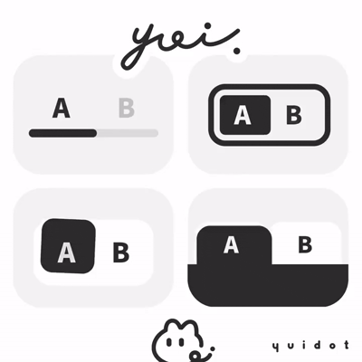

</details>

---

<!-- devtrack-draft-id: 730321df-ebb2-4094-862a-41cf18dce3f2 -->
<details>
<summary><strong>제품 사진에 내부 아웃라인을 추가하세요.</strong></summary>

흰색 카드 위의 흰색 사진은 테두리를 잃어버립니다. 이것이 그것을 되찾아줍니다:

```
.𝚙𝚛𝚘𝚍𝚞𝚌𝚝-𝚒𝚖𝚊𝚐𝚎 {
  𝚘𝚞𝚝𝚕𝚒𝚗𝚎: 𝟷𝚙𝚡 𝚜𝚘𝚕𝚒𝚍 𝚛𝚐𝚋(𝟶 𝟶 𝟶 / 𝟶.𝟷);
  𝚘𝚞𝚝𝚕𝚒𝚗𝚎-𝚘𝚏𝚏𝚜𝚎𝚝: -𝟷𝚙𝚡;
}
```

-1px는 선을 이미지 내부로 당겨서 크기를 추가하지 않고 border-radius를 따릅니다.

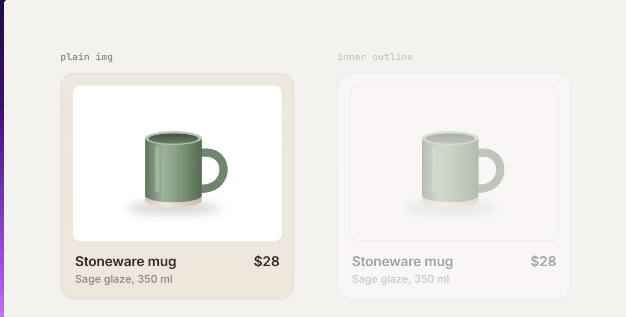

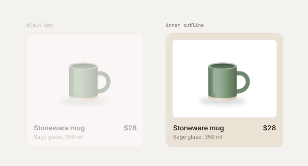

</details>

---

<!-- devtrack-draft-id: 80f1985c-5ea9-4333-816f-2f3d2dd2b71c -->
<details>
<summary><strong>AI에게 로딩 상태를 요청할 때, 보통 스피너를 받게 됩니다. </strong></summary>

이러한 일반적으로 사용되는 로딩 패턴들은 Claude나 Codex에서 원하는 것을 정확히 설명하는 데 도움이 됩니다. 나중에 참고하세요.

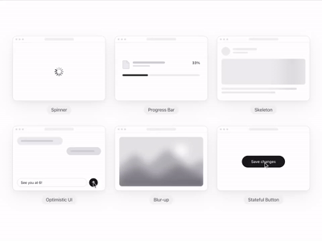

</details>

---

<!-- devtrack-draft-id: 7b2ed4bd-bd6f-43f2-b6c7-98685519184d -->
<details>
<summary><strong>지금까지 나온 거의 모든 오픈 소스 아이콘 세트</strong></summary>

https://icones.js.org/

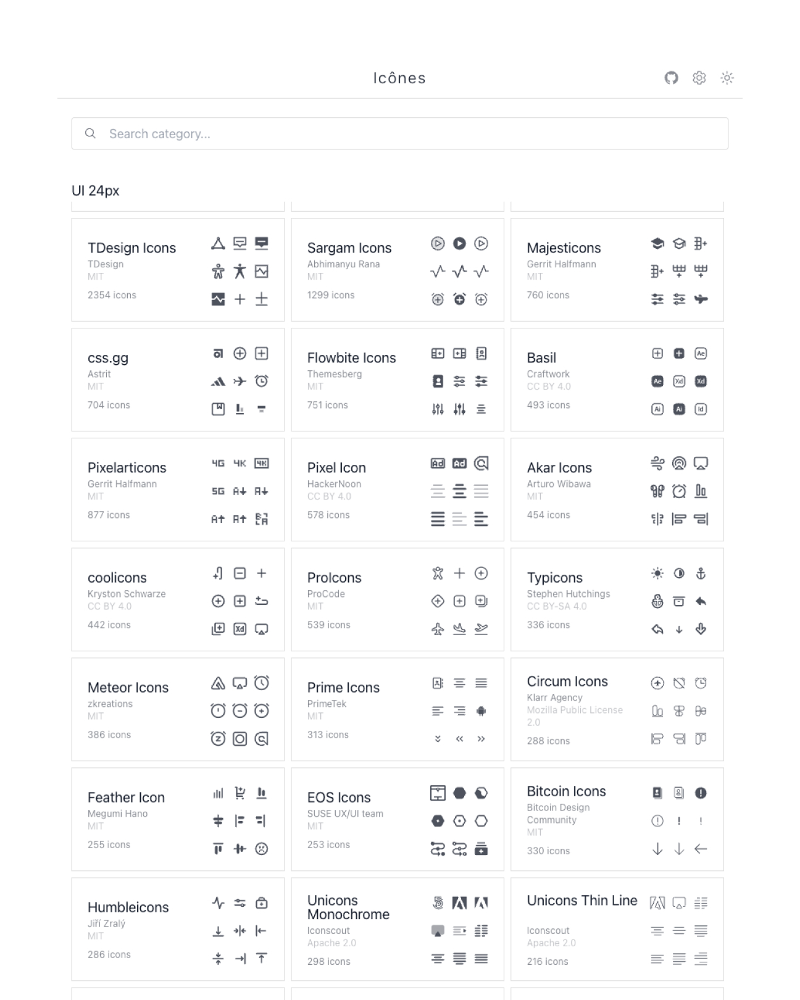

</details>

---

<!-- devtrack-draft-id: 9346b3d2-09f3-40cf-a6e2-7248df380104 -->
<details>
<summary><strong>오버플로우가 발생할 수 있는 행에 `𝚜𝚊𝚏𝚎 𝚌𝚎𝚗𝚝𝚎𝚛`를 사용하세요.</strong></summary>

일반 `center`를 사용하면, 상자보다 넓은 행이 양쪽으로 넘칩니다.

`𝚜𝚊𝚏𝚎 𝚌𝚎𝚗𝚝𝚎𝚛`는 맞을 때는 중앙 정렬하고, 맞지 않을 때는 왼쪽 가장자리부터 시작합니다:

```css
.𝚝𝚊𝚋𝚜 {
  𝚍𝚒𝚜𝚙𝚕𝚊𝚢: 𝚏𝚕𝚎𝚡;
  𝚓𝚞𝚜𝚝𝚒𝚏𝚢-𝚌𝚘𝚗𝚝𝚎𝚗𝚝: 𝚜𝚊𝚏𝚎 𝚌𝚎𝚗𝚝𝚎𝚛;
  𝚘𝚟𝚎𝚛𝚏𝚕𝚘𝚠-𝚡: 𝚊𝚞𝚝𝚘;
}
```

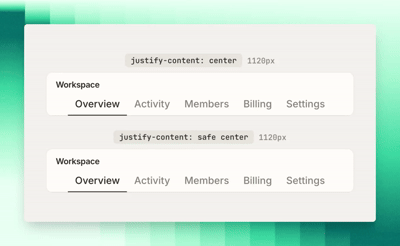

</details>

---

<!-- devtrack-draft-id: 431ecc13-b60b-45e2-a0eb-76499772701b -->
<details>
<summary><strong>&lt;/details&gt; 태그의 스택은 독립적으로 열립니다. </strong></summary>

세 개를 클릭하면 세 개의 개방된 답변을 얻습니다.

그들에게 동일한 name을 부여하면 하나를 열 때 다른 것들이 닫힙니다:

```json
<details name="faq">
  <summary>나중에 플랜을 변경할 수 있나요?</summary>
  <p>네. 업그레이드는 즉시 적용됩니다.</p>
</details>
```

```json
<details name="faq">
  <summary>환불을 제공하나요?</summary>
  <p>모든 요금 청구 후 30일 이내에 가능합니다.</p>
</details>
```

높이도 `interpolate-size`로 애니메이션할 수 있어요:

```css
:root { interpolate-size: allow-keywords; }
```

```css
details::details-content {
  height: 0;
  overflow: clip;
  transition: height 0.3s, content-visibility 0.3s allow-discrete;
}
```

```css
details[open]::details-content { height: auto; }
```

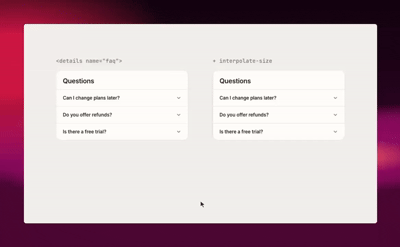

</details>

---

<!-- devtrack-draft-id: 597d9c90-ad8a-4f4d-9a61-0ce8729437dd -->
<details>
<summary><strong>앱이 어딘가 이상하게 느껴지지만 왜 그런지 모르겠다면, 아마도 간격 문제일 가능성이 큽니다.</strong></summary>

적절한 간격 배치는 단순한 디자인조차 세련되고 전문적인 느낌으로 만들어주죠. 때로는 아주 작은 디테일이 가장 큰 차이를 만들어냅니다.

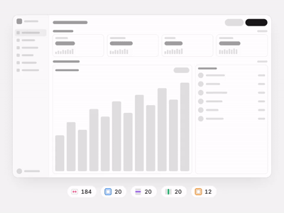

</details>

---

<!-- devtrack-draft-id: 6ced49e1-2312-4489-9f78-46715ad67a16 -->
<details>
<summary><strong>내가 쓰려고 남겨놓는 저작권 없는 무료 사이트들 모음</strong></summary>

1. 무료 트랜지션  
https://www.eisaidoo.com/

2. 상업적 무료 폰트 모음  
https://noonnu.cc/

3. 애니메이션 효과 무료 배포  
https://nopia31.booth.pm/items/7347590

4. Freeticon  
https://www.youtube.com/@freeticon/featured

5. 저작권 없는 목업, 이미지 사이트 1 - Magnific(구 Freepic)  
https://www.magnific.com/kr

6. 저작권 없는 스톡 사진 1  
https://unsplash.com/ko

7. 스톡 사진, 일러스트, 이미지, 브금 등  있는 사이트  
https://pixabay.com/ko/

(브금은 일로)  
https://pixabay.com/ko/music/

8. 최근 뜨고 있는 무료 브금(Dova-Syndrom)  
https://www.youtube.com/channel/UCq15_9MvmxT1r2-LLjtkokg

9. 귀여운 BGM 모음  
https://bgm-farm.pages.dev/#music

10. 거진 모든 이모지가 다 있는 이모티콘, 아이콘 사이트  
https://www.flaticon.com/

11. 연필 손그림 - Hand-drawing  
https://enpitsu-sozai.com/

12. 손그림 벡터 이미지 Hand-drawing Vector Image  
https://vectorshelf.com/

13. 사이트에서 색상 변경이 가능한 일러스트 사이트  
https://loosedrawing.com/


</details>

---

<!-- devtrack-draft-id: 3e25e04f-e475-4dd9-8ff8-74d0e4c81213 -->
<details>
<summary><strong>Compose용 Sea Glass를 소개합니다.</strong></summary>

서리 낀 색상, 부드럽게 깎인 가장자리, 그리고 각 조각 아래로 살짝 비치는 빛.

구글은 Material Design 4에서 시글라스를 다음 UI 소재로 삼아 성공을 거둘 수 있을 거라고 생각해요.

https://github.com/mttmcknn/sea-glass

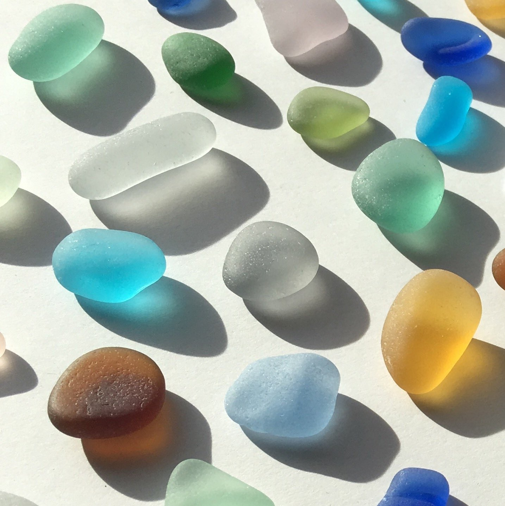

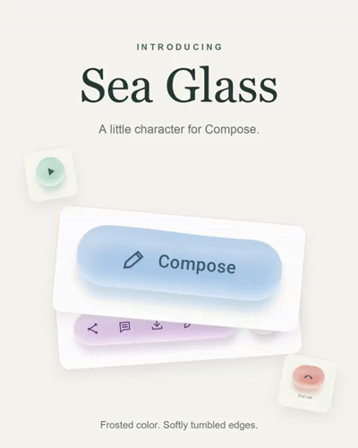

</details>

---

<!-- devtrack-draft-id: a7a162df-94db-4fba-b221-7da6d4f45e33 -->
<details>
<summary><strong>Figma에서 이 유행하는 프로그레시브 블러 효과를 배워보세요</strong></summary>

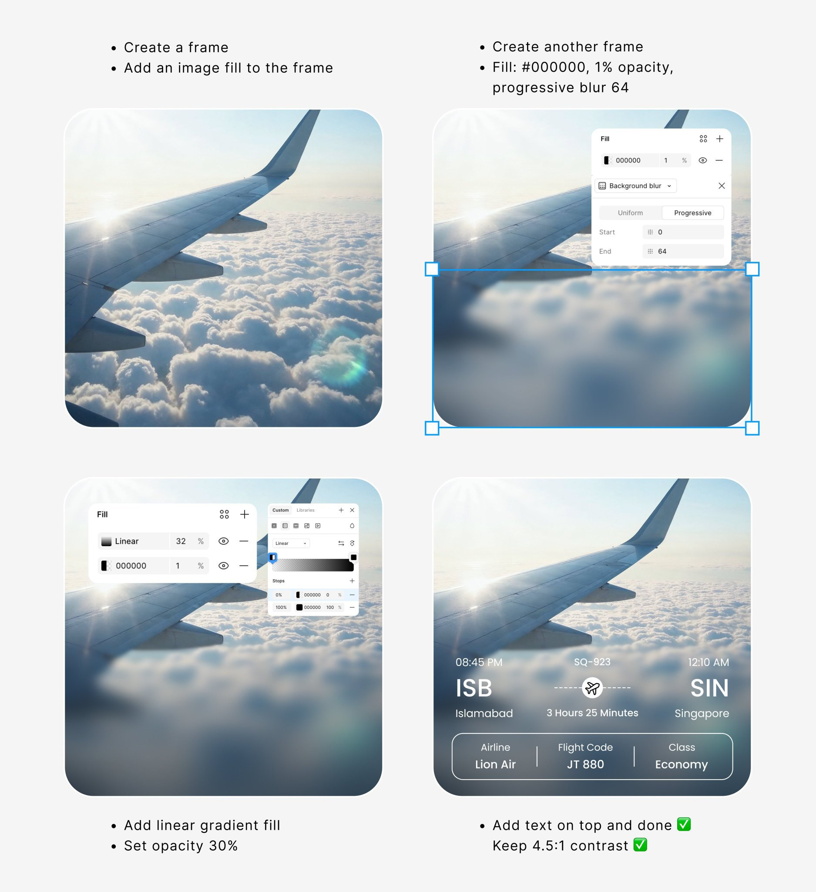

</details>

---

<!-- devtrack-draft-id: f06fbd80-e3ad-4699-a1e0-be4be2739787 -->
<details>
<summary><strong>디자인 팁 🌲 - 아이콘 크기를 𝘱𝘹가 아닌 𝟷𝗰𝗮𝗽으로 설정하세요.</strong></summary>

𝟷𝗰𝗮𝗽은 현재 폰트의 대문자 높이를 의미하므로, 아이콘이 모든 크기에서 텍스트를 따라갑니다:
```
.𝗹𝗮𝗯𝗲𝗹 {
  𝗱𝗶𝘀𝗽𝗹𝗮𝘆: 𝗳𝗹𝗲𝘅;
  𝗮𝗹𝗶𝗴𝗻-𝗶𝘁𝗲𝗺𝘀: 𝗯𝗮𝘀𝗲𝗹𝗶𝗻𝗲;
}

.𝗹𝗮𝗯𝗲𝗹 𝘀𝘃𝗴 {
  𝗯𝗹𝗼𝗰𝗸-𝘀𝗶𝘇𝗲: 𝟷𝗰𝗮𝗽;
}
```
𝗯𝗮𝘀𝗲𝗹𝗶𝗻𝗲은 아이콘을 텍스트의 베이스라인에 맞추므로, 모든 폰트에서 대문자를 가로지릅니다. 너비는 𝘃𝗶𝗲𝘄𝗕𝗼𝘹를 따릅니다.

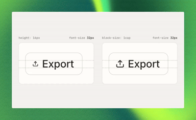

</details>

---

